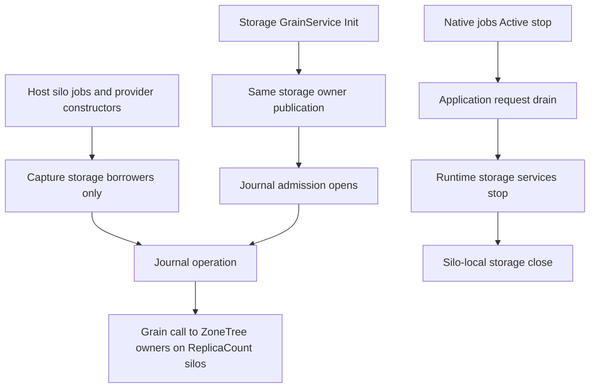

# Native runtime-journal construction and shutdown

Decision: [ADR-136](../../ADR/ADR-136-native-orleans-partition-ownership.md). Related: [RuntimeJournal](RuntimeJournal.md), [NativeRequestDrainLifecycle](NativeRequestDrainLifecycle.md), [NativeRuntimeConstructorCycle](NativeRuntimeConstructorCycle.md). This contract changes only internal construction and lifetime; persisted identities, provider name, format and packages are unchanged.

## Requirements and automated operation map

- REQ/AC-NATIVE-JOURNAL-LIFETIME-001: Generic Host and silo construction resolves the native job manager and journal provider/client before any storage publication. Construction opens no files and never invokes storage borrowers. A real journal catalog call waits behind closed admission; its cancellation settles that same Task before disposal and has no storage effect. `NativeRuntimeConstructorCycleTests` owns this production flow; descriptor inspection or a substitute service provider is insufficient.
- REQ/AC-NATIVE-JOURNAL-LIFETIME-002: admitted operations resolve the SAME registered `DatabaseEngine`, `ICommitCoordinator` and `GrainRequestCodec` only after `RuntimeJournalAdmission.WaitAsync`. The owner is published by the per-silo storage Grain Service, never by a delegate constructing a second store. Keep batch-size validation, the coordinator barrier, the current persisted principal, the signed native CQRS stream, the original command identity and uncertain-outcome replay. `RuntimeJournalNativeStorageTests` and the native job scheduled-effect operations cover this boundary.
- REQ/AC-NATIVE-JOURNAL-LIFETIME-003: native `LocalDurableJobManager` keeps its Active-stage scheduling admission and worker settlement, with no decorator or forwarding observer. A separate native lifecycle participant returns the SAME memoized `NativeRequestWorkOwner.DrainAsync` task at ApplicationServices stop, before runtime storage services stop and the lower storage close. `NativeRequestDrainLifecycleTests` exercises the real `SiloLifecycleSubject`, admitted producers and real ZoneTree effects. A failed or cancelled stop never licenses storage close while `IsJoined` is false.
- REQ/AC-NATIVE-JOURNAL-LIFETIME-004: native journal and real SDK/official MCP scheduled-job flows through the Aspire replicated cluster preserve outbox commit-before-schedule, at-least-once idempotent effects, stored receipts/replay, current persisted authority and recovery. Keep producer/iterator/task ownership, initiating plus cleanup failures and retained evidence when close is unknown.

## Ownership

ClusterRouting owns RuntimeJournalClient/StorageProvider, the server native runtime registration and the dedicated request-drain participant. Grain-call default-deny transitions are unchanged. There is no second journal, clock, dispatcher, scheduler, retry loop or storage.

Constructors validate pure immutable options without requiring open files. The database batch bound is validated at admitted use before the native command. Native jobs startup is the native provider behaviour; bootstrap that needs grain RPC runs only after Active. Shutdown stage values are the pinned Orleans constants, not a parallel lifecycle. Same-stage callbacks may run concurrently and failures may let later stages run; the storage close still checks the borrower-join state.

The internal registration entry is `NativeRuntimeJournalRegistration.Register(ISiloBuilder)`. It resolves no service or options during `UseOrleans` registration. Registered factories later request existing DI `IOptions`; native DurableJobs configuration uses those validated settings and the injected `TimeProvider`. Deferred journal codec/database/coordinator closures point only to the registered storage borrow delegates and return the SAME owner-held objects without registering borrowed disposables in DI. `NativeRequestDrainRegistration.Register` is independent of the native jobs participant.

Frontend, public API and schema are N/A. Process-kill evidence is not power-loss durability.
