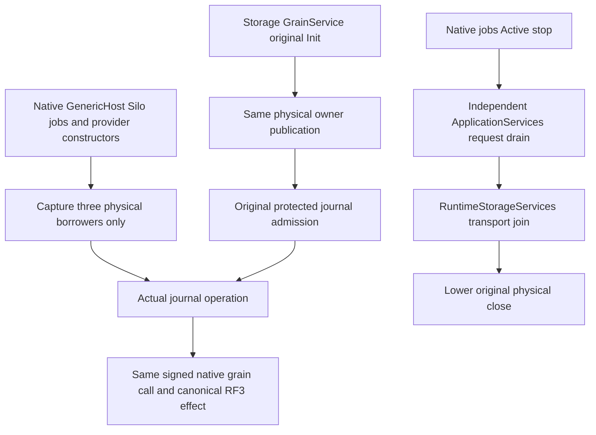

# Native runtime-journal construction and shutdown

ADR: [ADR-136](../../ADR/ADR-136-native-orleans-partition-ownership.md).
Related FoundationDelivery REQ/AC-FOUNDATION-003/005/006 and existing
ClusterRouting runtime journal / native DurableJobs contracts remain mandatory.
This complete KL018/092/093 batch changes only internal construction and lifetime.
Public/native persisted identities, provider name, format and packages are unchanged.

## Requirements and automated operation map

- REQ/AC-NATIVE-JOURNAL-LIFETIME-001: actual GenericHost/Silo construction resolves
  the native job manager and journal provider/client before any physical storage
  publication. Construction opens no files and never invokes physical borrowers.
  A real journal catalog call waits behind original closed admission; its original
  cancellation settles that same Task before disposal and has no physical effect.
  NativeRuntimeConstructorCycle operation tests own this real production flow;
  descriptor inspection or a substitute service provider is insufficient.
- REQ/AC-NATIVE-JOURNAL-LIFETIME-002: admitted operations resolve the SAME registered
  physical DatabaseEngine, ICommitCoordinator and GrainRequestCodec only after
  RuntimeJournalAdmission.WaitAsync. The owner is published by the actual per-silo
  storage GrainService, never by a delegate constructing a second store. Keep
  actual batch-size validation, coordinator barrier, current protected principal,
  signed native CQRS stream, original command identity and uncertain-outcome replay.
  Existing RuntimeJournal native storage/CAS/catalog/fence/replay/reopen operations
  plus actual nativeJobs scheduled canonical effects qualify this boundary.
- REQ/AC-NATIVE-JOURNAL-LIFETIME-003: remove the nativeJobs participant decorator
  and forwarding observer. Native LocalDurableJobManager retains its actual
  Active-stage scheduling admission/worker settlement. A separate normal native
  lifecycle participant returns the SAME memoized NativeRequestWorkOwner.DrainAsync
  task at ApplicationServices stop, before RuntimeStorageServices transport drain
  and lower physical close. NativeRequestDrainLifecycle operations exercise the
  real SiloLifecycleSubject, actual admitted producers and real ZoneTree effects.
  Failure/canceled stop never licenses storage close while IsJoined is false.
- REQ/AC-NATIVE-JOURNAL-LIFETIME-004: complete native journal and real SDK/official
  MCP Aspire RF3 scheduled-job flows preserve canonical outbox commit-before-
  schedule, at-least-once idempotent effect, stored receipts/replay, protected
  current authority and recovery. Keep original producer/iterator/task ownership,
  initiating plus cleanup failures and retained evidence when close is unknown.

## Exact ownership and integration

ClusterRouting owns RuntimeJournalClient/StorageProvider, Server native runtime
registration, and the dedicated request-drain participant. Root integrates the
three deferred factories and removes the now-unused job-manager descriptor type
probe; graph default-deny transitions remain byte-for-byte unchanged. The native
journal provider is reused with its existing gates and bounded handle lifecycle.
There is no second journal, clock, dispatcher, scheduler, retry loop or storage.
The application/storage owners and single-host composition are separate ADR136
batches; their same-owner DI publication is a required integration dependency.
Frontend/public API/schema are N/A for this internal refactor.

Constructors validate pure immutable options without requiring open files. The
physical database batch bound is validated at actual admitted use before the
native command. Native jobs startup remains the native provider behavior; bootstrap
which needs grain RPC runs only after Active. Shutdown stage values are the pinned
Orleans constants, not an invented parallel lifecycle. Same-stage callbacks may
run concurrently and failures may allow later stages to run; physical close still
checks the original borrower-join state.

Source drafts and native source parsing prove no compilation or runtime result.
Main integrates the full one-host/storage/runtime batches once, then performs
required real build, native operation, process-recovery and Docker RF3 SDK/MCP
checks with original artifacts. Exact-source Linux, fault/endurance and coverage
qualification remain OPEN; no task status changes from this source-only stage.

The internal registration entry is NativeRuntimeJournalRegistration.Register(ISiloBuilder).
It resolves no service or options during UseOrleans registration. Registered
factories later request existing DI IOptions; native DurableJobs configuration uses
those same validated settings and ordinary injected TimeProvider. Deferred journal
codec/database/coordinator closures point only to the existing registered physical
borrow delegates. The coordinator and request-work Func<T> return the SAME owner-held
objects without registering borrowed IDisposable/IAsyncDisposable aliases in DI.
NativeRequestDrainRegistration.Register is independent of the native jobs
participant, whose descriptor and instance remain unchanged.
