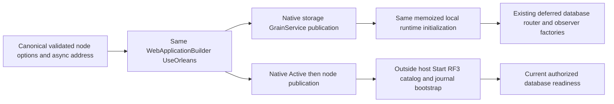

# Native single-host registration and deferred partition borrowers

REQ-FOUNDATION-003/004/005/006/009 under ADR-136 owns this internal registration
refactor. Existing REQ/AC-SCAT-001/002/003/004 and complete native request,
current-format/recovery/RF3/authorization/telemetry acceptance remain mandatory.
No package, public ABI, format, provider, clock policy or database authority changes.

REQ-ONEHOST-REGISTRATION-001: one WebApplicationBuilder registers native Orleans
in its existing service collection without a nested host/container or physical
acquisition during composition. AC-ONEHOST-REGISTRATION-001: canonical validated
NodeOptions and original asynchronously resolved address feed
OrleansSiloConfiguration.Register(builder,node,address,localhost); the same options
manager serves native DI. Existing native Azure/local fixture clustering,
serializer converters, native distributed directory/repartitioner, activity
propagation and every existing Grain Service remain registered. Native options
callbacks consume current typed IOptions policies; no competing configuration
binding/provider is introduced. PartitionStorageRegistration registers the one
storage owner before other native service declarations; same-stage ordering is
not assumed. The existing never-started-silo hosted-service guard remains.

REQ-ONEHOST-REGISTRATION-002: existing database and router services resolve only
after the actual storage publication and shared local-runtime initialization.
AC-ONEHOST-REGISTRATION-002: physical factories invoke the existing storage
owner.Borrow() after publication; no raw PartitionHost is a DI factory result.
Database/search factories borrow the same host, while optional movement/model/graph/tenant routers select
the same OrleansNode's prepared fields. RequireLocalRuntimePublished rejects early
optional resolution instead of caching a premature missing runtime. A disabled
feature preserves its native optional-null GetService result after successful
preparation; no alternative implementation or provider is selected. No constructor
may resolve these factories before its publication wait; all changed native
GrainService/lifecycle/job constructors belong to the accompanying source packets.

REQ-ONEHOST-REGISTRATION-003: preserve private observer identity and current
telemetry ownership. AC-ONEHOST-REGISTRATION-003: the same sealed observer interface
instance is registered by ServerConfiguration; canonical registration retains
existing explicit purpose/phase precedence. The one codec uses the original
native omission purpose when present, then the existing explicit/borrowed purpose
observer. A legitimately missing omission purpose cannot suppress that fallback.
Borrowed disposable components are registered as native Func<T> delegates.
The DI descriptor factory captures the original published component once at its
first resolution. Invoking the returned delegate only returns that reference: it
does not query the provider, call owner.Borrow or repeat the publication guard.
The container owns the delegate and does not capture the disposable component.
The existing ANN/Text/Online child operation objects retain their native delegate
at construction, before executing the admitted parent flow, so finally/Abort does
not look it up through a subsequently disposed provider.
Originally admitted finally/Abort work can retain that same reference through
provider disposal or owner stopping, while the actual operation still enforces
its original fresh authorization, resource bounds and closed-admission rules.
Grain activation, actual Init and operation callers
invoke these delegates; typed manual helper APIs keep the actual object. The
unused cache-budget, movement-dispatcher and producer-disposed aliases are removed.
Probe phase selection invokes the borrowed observer delegate before the existing
explicit instance; purpose selection and the three original identity cases remain.
Request probe observation still attaches to the same physical ApplyProbe only
after publication. One host uses its original ILoggerFactory/ServiceDefaults and
native Orleans activity propagation; there is no parallel telemetry host.

Source packet integration dependencies: PartitionStorageRegistration.Register
and IPartitionStoragePublication; inert native service constructors with original
Init waits; OrleansNode.RequestWork/ConnectionOwner/TenantPlacementRuntime,
InitializeLocalRuntimeAsync and RequireLocalRuntimePublished; the node's native
OrleansNodeLifecycle participant; NativeRuntimeJournalRegistration.Register with
DI-deferred policy access. Native jobs keep their own actual producer lifetime.
No legacy overload/nested-host fallback accompanies the replacement. Existing
SiloOwnerPurposeRegistrationTests retains its three original identity cases, through the same actual
RegisterObservers helper called by native registration. The fixture registers its
original real observer/connection instances in a genuine local service collection,
then resolves the complete identity and purpose selection assertions; it owns no
database topology and is not evidence for the unified host lifecycle.

A focused actual-container regression resolves the same borrowed native request
owner, disposes the container, invokes the original delegate again to verify the
same reference, then admits/releases a real capability before the
external node owner joins it. It uses actual production registration and original
native work ownership without mocks or another runtime implementation.

Verification: prepared-source syntax/numeric results, if executed, bind the exact
r4 postimages separately. They are not semantic binding or runtime proof.
Compiler/analyzers, exact native UID discovery, complete original operation
execution, owned partial-start/cancellation/cleanup, full unit/process recovery,
real Aspire Docker RF3 SDK/official MCP, Linux/fault/endurance/coverage and full
KL-018 qualification remain OPEN. Source registration order alone proves neither
publication ordering nor physical-close settlement.
