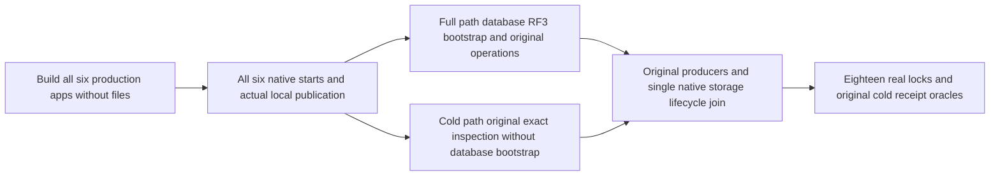

# Native six-owner production application fixtures

ADR-136 and REQ-FOUNDATION-003..006/009/010 own this internal integration stage.
REQ-NATIVE-APPLICATION-001 / AC-NATIVE-APPLICATION-001 requires the existing
ControlledPartitionMovementNativeHost and PartitionMovementLateNativeNode to use
the same production ServerConfiguration.BuildAsync and WebApplication.StartAsync.
Registration/build acquires no files and cannot borrow an unpublished PartitionHost.
The physical PartitionHost is never registered as a DI-owned disposable service.
After the same application startup succeeds, both fixtures borrow through their
already captured original PartitionHostApplicationOwner; they never reopen storage.
Each fixture captures the SAME inert options/service-provider-only OrleansNode before
app.Start, so a failure after local preparation but before Active publication still
drains its original routers/producers. This constructor performs no storage borrow;
operation-facing node/partition properties remain unavailable until publication. The original startup token flows through async DNS/build and native
application startup; all six applications are built before their native starts are
launched together. Full operation then invokes the same borrowed Node.StartAsync
for post-Active database journal/catalog/RF3 bootstrap and existing registration
wait. This is not a second host start. Existing logical partition identities,
physical owner routing, signed operation bytes, quorum receipts, native journals,
authorization and declared failure/cold oracles remain unchanged.

AC-NATIVE-APPLICATION-001 independently checks the actual same application provider:
ISiloStatusOracle reports Active, ILocalSiloDetails matches current native discovery,
IGrainFactory equals the node's published native factory, and the registered canonical
DatabaseEngine is the original PartitionHost.Database and the registered
Func<IReplicaEndpoint>, when invoked, returns that same PartitionHost.Consensus.
The endpoint factory keeps the disposable consensus outside DI ownership. These are
real lifecycle/ownership assertions inside existing whole operations, not a mocked
provider or success inferred from a configuration flag.

REQ-NATIVE-APPLICATION-COLD-002 / AC-NATIVE-APPLICATION-COLD-002 preserves the existing
cold inspection operations through production startup. Because non-primary native
localhost membership needs its real primary, each selected cold inspection now
owns a genuine six-application native-Active cohort. Cold startup never invokes
Node.StartAsync or waits for database quorum/catalog bootstrap. The selected return
is the actual PartitionMovementLateNativeNode. Its explicit Stop/Dispose joins all
five siblings and itself through the same cohort; sibling local closes avoid
recursive lease disposal, dependents finish before the original primary, and all
eighteen real physical locks must reopen after joined closure. Overlapping cold
leases are refused. The existing oracle token is forwarded through all four exact
OpenStoppedAsync call sites, with no new deadline. Complete before/after native rows,
replication entries, applied cuts, authority/receipts and retained blob bytes remain
literal/exact. Native lifecycle/provider callbacks do not receive an exemption for
new persisted writes. Any actual cold drift fails the original oracle.

REQ-NATIVE-APPLICATION-CLOSE-003 / AC-NATIVE-APPLICATION-CLOSE-003 requires original
startup and native request producers to settle before physical close. Fixtures
capture the same concrete ServerConnectionRegistry, PartitionStorageLifecycle and ownership record at build;
cleanup never resolves another borrower or directly disposes PartitionHost.
The original connection registry shutdown is observed and joined with CancellationToken.None
before the first node stop, keeping native routing live while accepted connections close.
A registry failure is retained alongside node and later cleanup failures; it does not
permit physical close or weaken the original unknown-ownership retention gates.
After original application Stop settles, the same memoized storage lifecycle stop
is joined explicitly for failed-start fallback. Application disposal is permitted
only after the original owner Closing task completes and CanReleaseRoot proves
physical release. Unknown ownership retains the application and evidence root.
Caller cancellation is an observation, while the same underlying original close
still joins. Original primary and every cleanup failure remain visible. Existing
cold budget/task IDs/cancellation diagnostics and dependent-before-primary order
are retained; the legacy partition-disposal evidence stage now observes the actual
production storage lifecycle close task, not a manual storage close.

REQ-NATIVE-APPLICATION-PRECANCEL-004 / AC-NATIVE-APPLICATION-PRECANCEL-004 preserves
the original CanceledOriginalStopJoinsAllSixOwnersThenOriginalColdOutcomeAndHealthyReplayRemainExact
declaration while correcting its old preopening assumption. A genuinely pre-cancelled
Create/Build must acquire no node directory or handle. The existing failure-root
capture records the actual empty root entry baseline and Unix mode before Build;
the real cancellation/root/no-files/CreatedSiloShutdown operation preserves that
complete empty image. The original explicit eighteen-lock opens/count move to the
same existing declaration's genuinely acquired six-owner Warm/cancelStop stage.
Its original full model/blob/receipt/cold/healthy continuation remains intact.
A separate original after-Init lock-fault scenario owned by the coordinator keeps
partial startup qualification; this packet does not invent its result.

Existing method declarations and argument rows are retained in the SourceN manifest;
no native UID or PASS is fabricated. Full before/post hashes and read guards protect
dirty original fixtures. Native prepared-source numeric checks are development evidence only.
Semantic compilation, complete partial-type limits, format/analyzers, original unit/process/native six-owner tests, mandatory Aspire
Docker RF3 SDK/official MCP, exact-source Linux/endurance qualification remain OPEN.
No package/schema/persisted-format change, manual-opening/offline fallback, build,
SourceY or Git operation is included. Rollback reverts this coherent fixture stage
with its production ADR-136 join; it must not leave mixed old/new startup APIs.
