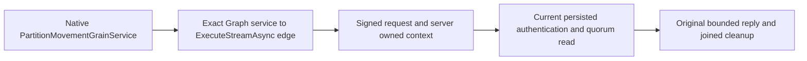

# Native startup Graph authority

This child requirement belongs to [ClusterRouting](../ClusterRouting.md), the
[GrainService Graph contract](GrainServiceGraph.md) and ADR-036. It records the
R84 source finding and the narrow existing native registration repair. Root owns
the shared feature and ADR append unions.

## Contract

| Requirement | Acceptance |
|---|---|
| REQ-NSTART-GRAPH-001: the actual `PartitionMovementGrainService` may invoke only `IConnectionGrain.ExecuteStreamAsync` through the existing native Graph registration API for its authenticated physical-owner startup work. Preserve all existing graph edges and default-deny enforcement. | AC-NSTART-GRAPH-001: the original six-host lifetime and process operations reach current persisted startup authentication and complete their original positive receipt, cancellation/refusal, replay and same-root cold assertions on a fresh source/image cohort. Other target methods and unconfigured service callers retain Graph denial. |
| REQ-NSTART-GRAPH-002: permitted routing is not database authority. Preserve the original signed native request, actual server-owned connection/request identity, null principal for Authenticate, current persisted administrator validation, quorum read barrier, bounded stream admission and joined original cleanup. | AC-NSTART-GRAPH-002: original Recovery10 peer-discovery cancellation, signed stale-generation refusal, nonce replay, capacity and healthy continuation checks remain unchanged; the original movement lifetime flow verifies attributed failed construction and all eighteen actual owner locks before its existing stop/cold/replay operation. |
| REQ-NSTART-GRAPH-003: distinguish the source mismatch from runtime causality. | AC-NSTART-GRAPH-003: retain R11's original eight passes/two failures and R82's bounded Stage/Kind observation. Fresh execution must record its actual result and failure chain; the missing edge alone is not evidence that the old R11 failure was repaired. |

## Source finding and ownership

The pinned ManagedCode.Orleans.Graph 10.4.4 source registers incoming/outgoing
filters, defaults to denying unconfigured transitions, and resolves native
outgoing service identity from the actual Orleans context. A missing transition
throws `InvalidOperationException`; the owning hosted service regression
`NativeServiceCallbackUsesConcreteSourceAndOnlyConfiguredTargetsAsync` retains
configured-success, exact unconfigured-denial and joined service-stop oracles.
This is a source mapping, not a newly executed dependency test.

KeyLoad's actual `PhysicalOwnerStartupRequests.AuthenticateAsync` is invoked by
the physical-owner probe receiver inside the native movement service, and routes
through `IConnectionGrain.ExecuteStreamAsync`. The existing KeyLoad registration
omitted this legitimate edge. Add only the exact service implementation and target
method using the published `AddGrainServiceTransition` API. No package version,
alias, field ID, public API, trusted role, filter, default policy, deadline or
provider changes are part of this repair.

The R84 retained native review is
`/private/tmp/keyload-native-graph-auth-audit-r84-20261012/review.md`, SHA-256
`43a73876d5a1037c5b5927df830ed106c5ca785c379fabd8819eca296e750b6a`.
Its pinned-library source comparison establishes the actual enforcement contract;
it does not identify R11's unobserved exception branch.

## Original operation mapping and evidence

The existing native selector remains:
`/*/*/(PeerDiscoveryOwnershipTests|PeerDiscoveryReplayTests|ControlledPartitionMovementNativeHostLifetimeTests|ControlledPartitionMovementNativeProcessTests)/*`.

The two startup-dependent original operations are:

- `ControlledPartitionMovementNativeHostLifetimeTests.CanceledOriginalStopJoinsAllSixOwnersThenOriginalColdOutcomeAndHealthyReplayRemainExact`.
- `ControlledPartitionMovementNativeProcessTests.GenuineSixHostOriginalPrepareSurvivesKilledOwnerAndColdOutcomeObservationWithoutRedispatch`.

The remaining eight original PeerDiscovery operations retain their declarations,
arguments and full signed authority/refusal/capacity/cleanup assertions. No new
UID is introduced. Authentic prior ten-instance discovery is retained under
`TestResults/stage60-native-originals/recovery-r11-focused-current/discovery.stdout.original.json`;
fresh discovery, source/DLL/PDB/MVID binding and canonical native50 execution are
required after the next coherent build. Default mandatory SIMD remains enabled.

R11 completion SHA-256
`b728a5a7041824457f34efc11319b08b5f8d51fe3f0029cf4521620d17b431bc`
records eight passes/two startup failures with no source/image drift. It did not
reach the two cold operation oracles and did not qualify eighteen lock settlement.
R81 root attribution and R82 bounded stream-stage/type evidence are retained
successors. No build, fresh runtime, Linux RF3, coverage percentage, power-loss or
task-closure result is claimed by this document.

Frontend, new SDK/MCP syntax and persisted-format changes are N/A: this is existing
internal native startup routing. Original public clients and complete process
flows remain the qualification surfaces.
