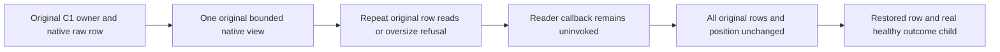

# Actual original full-outcome view budget regressions — before C#

Root freezes focused unchanged Source14 read-through adapter tests using actual C1OutcomeInspectionFixture/native ZoneTree store, actual generated operation seed and Ann complete process Source4r3 whole-cut/healthy helpers. No mock view, fake context/role, substitute store, byte-cap change or old C1 schema change. New scoped Unit roles returned fresh NotFound at eab575a781234d4491ec8f7129768b08.

REQ-OBUDGET-001 / AC001: insert ONE fixture-owned bounded raw test row (4096 actual bytes) through ordinary native transaction. Snapshot every original row/position via existing bounded complete-cut helper. Open SAME original existing owner, one gated store.Read -> Source14 C1SubmissionOutcomeInspectionView; repeat reads of same original row until cumulative32768 refuses. Native charge is actual encoded key bytes plus value bytes, not value length alone. Exercise ReadValue and ReadOwnedValue. Final denied ReadValue callback remains uninvoked and subsequent ReadOwnedValue refusal remains exact. No repeated-lookup budget reset. Complete original cut/position unchanged; genuine healthy original full-outcome child afterward.

REQ-OBUDGET-002 / AC002: actual8193-byte persisted raw row, same original key/store, denied before actual copy callback. Both ReadValue/ReadOwnedValue refuse; complete original native cut/position unchanged by reads. Restore original4096 bytes through actual native transaction and verify healthy original bounded read/full-outcome child. Seed/corruption/restoration commits are explicit test effects; no-effects assertion begins AFTER each setup commit.

REQ-OBUDGET-003 / AC003: dispose actual opened existing native owner before cut/child inspection, preserve primary+disposal/fatal failure aggregation via actual ServerFailureObserver. Reuse unchanged fixture and original process join assertions; phase observation must stay within original32 lines. Adapter unit proof and following real child healthy flow are separately labelled; these cases do not demonstrate child-side cumulative denial or RF3/power-loss qualification. All compiler/process/LinuxRF3/runtime gates OPEN. Main/SDK/Git untouched.

Canonical source map: Unit Features/ClusterRouting/Cases/NativeSubmissionOutcomeBudgetCases.cs and Helpers/NativeSubmissionOutcomeBudgetFlow.cs; selected unchanged Source14 CrashHost view, original C1OutcomeInspectionFixture and Ann full process Source4r3 helpers. Independent test contract constants32768/8193 prevent silently adapting expected refusal to a widened implementation cap. One actual reopened original owner is disposed with actual primary/cleanup/fatal preservation before every next cut/child read. This is the original fixture volume and identity, never a replacement fixture/store.

## Native owner flow

REQ-OBUDGET-001 maps to parameterized repeated ReadValue/ReadOwnedValue cases; REQ-OBUDGET-002 maps to actual oversize and restoration; REQ-OBUDGET-003 maps to the actual opened store disposal and original child/lock assertions in the same flow. Source-only review cannot satisfy runtime acceptance.
