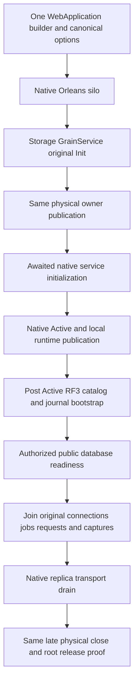

# One native host and partition publication

Status: accepted [ADR-136](../../ADR/ADR-136-native-orleans-partition-ownership.md) contract; prepared source is not integrated compilation or runtime qualification. Refines KL-014/018/019 and REQ-FOUNDATION-003..006/009/010 in [FoundationDelivery](../RepositoryGovernance/FoundationDelivery.md). Preserve the complete task and qualification inventory.

## Scope and invariants

One production WebApplication owns the native Orleans silo and its one service container. The existing silo-local storage GrainService opens the one physical PartitionHost during its awaited Init. Migratable activations borrow physical execution; they never acquire files. Native membership, directory and activation movement remain separate from RF3 majority acknowledgement, ordered canonical apply, atomic command journal and ZoneTree WAL.

ServerConfiguration.BuildAsync binds the original canonical NodeOptions postconfiguration and validation through native OptionsFactory, resolves the original DNS/IPv4 policy asynchronously, and registers UseOrleans on the same builder. It neither builds another production service provider nor opens storage. Existing authentication, strict JSON, HTTP/SQL/MCP framing, request observers, ServiceDefaults and OpenTelemetry stay on that same application. The physical PartitionHost is never a DI service: actual post-publication factories and request handlers borrow through its original owner. Disposable physical components and separately owned native work are exposed only through bounded typed access delegates returning the same component, so the container cannot capture their results for independent disposal. Genuine DI-created clients and runtime observers retain their original ownership.

## Requirements and acceptance

| Requirement | Concrete completion gate |
|---|---|
| REQ-ONEHOST-001: use one host and canonical validated options. | AC-ONEHOST-001: actual production BuildAsync completes with no node directory or lock acquisition; resolving all native hosted-service and selected journal constructors does not open storage. Invalid original settings and DNS/cancellation errors preserve their exact original outcomes. |
| REQ-ONEHOST-002: native Init publishes the original physical owner. | AC-ONEHOST-002: actual storage Init completes the same retained opening task; every dependent Init awaits the same IPartitionStoragePublication before resolving database/endpoint/router aliases. Concurrent initialization cannot open a second owner or resolve a premature null router. |
| REQ-ONEHOST-003: separate local runtime publication from database readiness. | AC-ONEHOST-003: native Active publication makes genuine silo services available without waiting for peer quorum. Post-Active database bootstrap starts the existing coordinator and verifies catalog/runtime journals/RF3 before public database admission. Missing or conflicting authority stays closed; no Host.Start self-wait or second host occurs. |
| REQ-ONEHOST-004: close original borrowers before physical ownership. | AC-ONEHOST-004: connection operations, node request work, native jobs and accepted administration captures join while their storage and transport remain live. The same late storage lifecycle operation joins replica transport and original physical close. The native maintenance producers, original connection registry and captured node borrowers also join before physical close, including direct container disposal. Only a settled original Closing and actual CanReleaseRoot permit container disposal; unknown close retains the application/root and original failures. |
| REQ-ONEHOST-005: recover actual acquisition failures. | AC-ONEHOST-005: pre-canceled creation acquires no physical resources and preserves the independently captured complete root inventory. A distinct genuine post-Init failure proves actual acquired lock exclusion, original error plus every cleanup failure, joined release, same-root cold recovery and healthy complete operations. Never-started silo cleanup retains its native guard. |
| REQ-ONEHOST-006: preserve real multi-node callers and native ownership. | AC-ONEHOST-006: actual six-owner process fixtures start all required native members before readiness waits; bounded cold inspections use a joined real native cohort. Original stored models, receipts, fences and no-effects oracles remain exact. Separate Aspire Docker RF3 SDK/official MCP tests retain their real topology, clients, cancellation and joined cleanup. |
| REQ-ONEHOST-007: preserve observer and authorization identity. | AC-ONEHOST-007: the original three SiloOwnerPurposeRegistration cases preserve exact borrowed/explicit observer identities. Effective omission-purpose precedence and native phase observer survive merging the former two containers. Each actual database operation still checks fresh persisted authority; no caller role is trusted. |

Frontend, new public SDK methods, SQL grammar, storage formats, migrations, packages and alternate transports are N/A: this is an internal ownership refactor. The optional internal lifecycle-participant factory enrolls a fixture-owned native observer in the original builder before Build; it does not create an alternate host, storage provider or authority.

## Ordered implementation and ownership

1. Register canonical options, serialization, identity and telemetry before acquisition. ServerConfiguration and OrleansSiloConfiguration own the single-builder join. Preserve every existing protocol/serializer alias and numeric field identity.
2. Register PartitionStorageRegistration first among native GrainServices. StorageRecovery owns the same original opening/publication/closing tasks and physical root fences. All GrainService constructors remain inert. Native service initialization explicitly awaits original publication; do not confuse sequential native service initialization with ordering of independent lifecycle callbacks.
3. Node-local runtime initialization creates the existing bounded movement/model/graph helpers once after storage publication. Native Active publication captures the same original silo factory/services. Outside native Host.Start, post-Active database bootstrap performs the existing RF3/catalog/journal checks. Cold inspection does not masquerade as successful database admission.
4. Shutdown closes admission and joins original operation/capture producers before native teardown. Native jobs retain their own shutdown. Existing replica transport drains at RuntimeStorageServices; the same physical lifecycle closes below it. Failed-start callers may join that same retained late-close operation after the original host stop attempt; they never directly dispose another physical PartitionHost.
5. Adapt the existing genuine CrashHost and late native owner fixtures together. Forward original cancellation through async configuration; remove manual pre-opening and coordinator ownership. Preserve all-start-before-quorum behavior, scope-bound fault injection, exact cold receipts and cleanup ownership. Correct the pre-cancellation acquisition oracle together with the genuine accepted-acquisition lock oracle.
6. Join the complete guarded source batch, review constructor graphs and cleanup failures, then run the canonical integrated analyzer-enabled Release build and formatter, focused complete native operations, process recovery and Aspire RF3 through real SDK/official MCP. Main integration owns shared source/build outputs, test execution and Git delivery; worker numeric checks cannot qualify this stage.

## Existing operation mapping and open evidence

| Acceptance | Existing or coordinated complete operation |
|---|---|
| AC-001/002 | The real production host/journal pre-start operation, actual selected provider admission cancellation and the StorageRecovery original-owner publication/concurrent-close regressions. Embedded pre-opened TestDatabase fixtures alone do not establish these criteria. |
| AC-003/006 | Physical owner registration and native membership cases; NativeDatabaseMigrationRf3Tests.ActualIdleMigrationRejectsForeignTargetAndCancelledCallerThenStableSdkMcpColdHealthyContinuation preserves actual replacement activation plus unchanged physical ownership/placement. |
| AC-004/005/006 | ControlledPartitionMovementNativeHostLifetimeTests.CanceledOriginalStopJoinsAllSixOwnersThenOriginalColdOutcomeAndHealthyReplayRemainExact and its CreatedSiloShutdownOperation/failed-creation/18-lock continuations; the separate genuine post-Init failure operates on the production host. |
| AC-006 | ControlledPartitionMovementNativeProcessTests.GenuineSixHostOriginalPrepareSurvivesKilledOwnerAndColdOutcomeObservationWithoutRedispatch; PartitionMovementPublicParentFlowTests.ActualPublicParentMovesAllLinkedModelsAndOriginalReceiptsAcrossTwoRf3OwnersAndBackAfterColdReplay; original current-owner token and RF3 phase-kill flows. Activation movement is not physical partition transfer. |
| AC-007 | SiloOwnerPurposeRegistrationTests.ActualSiloRegistrationPreservesBorrowedAndExplicitPurposeOwnerIdentity, all original argument variants, plus original signed public authorization/revocation/healthy-continuation operations. |

The exact native test discovery, complete selected outcomes, original reports, source/DLL/PDB identity, coverage and cleanup remain open until the joined source executes. Run `dotnet build KeyLoad.slnx --no-restore --configuration Release`, `dotnet format KeyLoad.slnx --no-restore --verify-no-changes` and the current native TUnit selectors under ADR-117; fixtures own Aspire startup/readiness/endpoints and joined shutdown. Required full functional, recovery, Docker RF3, Linux coverage, fault and endurance gates remain mandatory. Process-kill evidence is not power-loss durability or production readiness.

