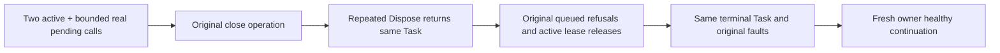

# KL-070 original bounded apply shutdown

SOURCE_N only; no native admission/compiler/runtime/Linux pass.

REQ-CAPPLACE-004/005 and AC-CAPPLACE-004/005 require the Control-silo active/pending admission owner to close admission and join original active/queued operations without renewing quotas, cancellation or deadlines. The owning shutdown is one retained Task: repeated DisposeAsync observes that exact original operation while it is pending and after it settles. It must not allocate wrapper operations that lose original identity or initiating faults.

AC-KL070-SHUTDOWN-001 strengthens the existing PlacementCapacityAdmissionTests whole operation. Preserve genuine native ConcurrencyLimiter active two/pending sixteen saturation, rejected overflow, original queued cancellation/promotion, actual native close refusal, all original lease disposal/queue joins and fresh healthy continuation. While active leases keep shutdown pending, a second disposal must return the same Task; after original lease release and original shutdown await, another disposal returns that same Task. This is a deterministic old-code-failing original-operation oracle, not fabricated Task/exception injection or a new test declaration.

No claim that native limiter.Dispose actually failed in the observed run. Preserve actual ServerFailureObserver original close errors then same joined.Task errors in order. No suppression, fallback, timer, resource limit, principal/placement/persisted record or public API changes. Original Case/Args remain; discovery UID/compiler/runtime qualification OPEN. This local native admission control does not replace six-owner SDK/MCP, tenant-level fairness, durable cold receipts, Linux resource/fault/endurance or complete KL-070.

Canonical ClusterRouting. ADR-129/030/117/125. Frontend N/A. All sources remain under their existing admission/lifetime role.

