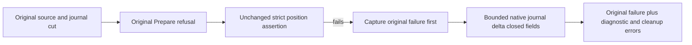

# Original native Prepare strict position delta witness

REQ-PREPARE-DELTA-001: Preserve the original PrepareFlow Store.Position equality and full state/result/receipt oracles. A witness never makes an unauthorized effect or unrelated write acceptable.
AC-PREPARE-DELTA-001: The same original Case/UID/token/setup/cleanup still fails when position changes; actual primary AssertionException and all original cleanup errors remain first in the original ledger.
REQ-PREPARE-DELTA-002: Use only existing node-local durable journal evidence APIs authenticated in the current assertion owner. Before/after journal bounds are independently captured around the original operation. No fabricated API, private key scan, extra command, redispatch or timeout widening.
AC-PREPARE-DELTA-002: On the real failed equality only, one bounded diagnostic records actual index/term/kind and boolean equality to an independently retained original operation/authority when that source binding is proven. No payload, raw bytes, keys, principal, GUID, path or secret is output. Missing journal entry, no journal growth or unavailable original operation is explicitly unobserved rather than inferred cause.
REQ-PREPARE-DELTA-003: Diagnostic enumeration and every actual writer Task are observed through existing ServerFailureObserver; original operation task and multifault/cancellation/disposal errors are retained with original order. No parallel logger implementation or swallowed diagnostic failure.
AC-PREPARE-DELTA-003: Complete native type preview and self-review demonstrate error-first capture, bounded diagnostic and original strict rethrow; compiler/native/runtime admission remain separate OPEN gates.

Canonical slice ClusterRouting; existing UnitTests original Prepare case is the regression map, no new Test/deadline. Requirements are frozen before code. Exact current flow and native entry-reader API bodies are now bound; cause, native admission, compiler and runtime qualification remain OPEN. The diagnostic cannot assert independent admitted-authority versus unauthorized-effect cause without actual emitted evidence. Product/public API/provider/SDK/MCP changes: N/A, diagnostic-only original-case support.

The source-proven failure window is original Prepare/replay, then a freshly constructed changed revision request, captured source/target images and cuts, real Conflict reply, and the original six strict unchanged assertions. Their first thrown error is retained before diagnostics. The witness captures local failure-time position and journal State before its read barrier; it inspects only beforeIndex+1 if that index is within the captured committed prefix. It never enumerates the tail, changes a command, or infers that a kind/ID match is causal. A missing/uncommitted candidate prints available=False; original/changed operation-ID comparisons and independently held original-versus-changed request identity are boolean only; request identity is emitted even when the entry is unavailable. Diagnostic barrier/metadata/read/writer faults are secondary and preserved. No production behavior change, new Test, qualification, or timeout increase is claimed.
