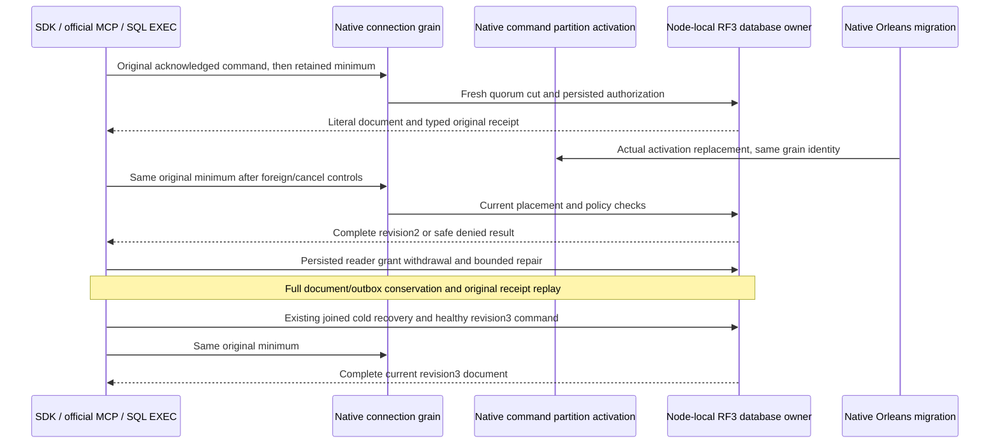

# Original session token across native Orleans activation movement

KL021 extends REQ/AC-ROUTE-002, REQ/AC-SESSIONREAD-001..004 and the current ADR-125 connection-owned execution contract. Orleans10.4 distributed grain directory, activation repartitioner and native activity propagation are already registered. The native connection grain carries separately signed operations; the node-local PartitionHost and RF3 coordinator retain storage, journals and read/apply authority. This continuation adds no grain, provider, dispatcher, placement algorithm, dependency, persisted format or public endpoint.

The SAME original NativeDatabaseMigrationRf3Tests declaration, six actual Aspire-owned nodes (two independent RF3 physical groups), persisted ordinary identity, exact first CommandRequest and complete CommitReceipt remain. Freeze the actual first typed receipt/token before any migration controls. Construct the independent expected receipt from the literal command identity, putDocument mutation/revision, quorum durability, current actual placement incarnation/epoch and the positive observed original committed position. Compare every typed public field and require each hidden CompositionReferences.IsEmpty as a Boolean only; never expose private reference values. Re-encoding public receipts is not original wire or persisted-byte evidence. Direct .NET SDK GET, official MCP GET and both canonical SQL EXEC routes must read the full independently literal revision2 document using that original minimum. Every read conserves the complete original scoped OutboxStatus and literal administrative document. The exact original complete command receipt replays through all four routes without a second model/outbox effect.

Repeat after the unchanged foreign-target and selected-cancellation controls, then require the existing actual native MigrateOnIdle result: a replacement activation with the same grain digest and exact intended compatible voter/SiloAddress, distinct activation identity, unchanged placement and physical owner identities. Requested/advisory migration alone is never counted as movement. The original receipt token must still read the full same document through all four routes.

One fresh ordinary read-only subject is genuinely configured in the same tenant/resource at epoch1, and its exact returned persisted definition is retained. Use this same reader and its actual SDK/official MCP callers throughout the continuation. Withdraw its DocumentsRead grant at persisted epoch2, keeping every other literal field unchanged. The same authenticated SDK/official MCP callers must refuse token-bearing direct/EXEC reads with no value and the complete closed safe PermissionDenied Problem. Every denial independently conserves the literal administrative document and complete scoped outbox. The token grants no authority. The original command writer and its epoch remain unchanged: native CommandOutcomes validates the original writer epoch, so changing that writer would correctly invalidate the old outcome rather than test read-token continuity. This is separation of real persisted actors, not a product compatibility workaround. Restore that exact read-only definition at epoch3 through the original administrator; a bounded independent cleanup attempt restores it even if the original denial phase fails, preserving primary and repair errors. Healthy reads and original receipt replay then use the same original token and identity. No caller-trusted role or alternate principal store is introduced.

The existing genuine stopped-owner cold-outcome operation, native lock checks, actual persisted original outcome scan and its original public receipt comparison, restarted readiness and physical owner/placement assertions remain. Repeat original-token reads and four-route original receipt replay after that cold restart. Retain the existing distinct healthy revision3 command and its NEW-token positive control; subsequently prove that the original minimum still reads the current revision3 document rather than requiring an old snapshot. A minimum is a lower bound under the current quorum/read cut, not an immutable historical snapshot.

The opt-in flag defaults false in the shared migration operation. Only its original migration scenario enables this extension; the TenantPacking caller and its original behavior stay unchanged. Preserve every original UID, foreign/cancel outcome, original receipt, fixed corpus, deadline, cleanup and native ownership assertion. Existing clients and owned topology settle through their current error-preserving teardown; the helper owns only bounded policy-repair cancellation. Reconnecting after restart is normal transport recovery, not proof that one physical connection survived a process restart.

Prepared source is not an executed migration/strong-read receipt. Compiler/analyzers, native selector census, original full native/RF3 operations, exact-source Linux, former-leader/no-quorum and remaining KL021 gates stay OPEN. No performance, release or power-loss durability claim follows.

## Continuation requirements and acceptance mapping

REQ-SESSIONMOVE-001: retain the exact first acknowledged command and typed minimum token through the existing foreign-target/cancellation controls and actual native activation replacement; use that same minimum in direct SDK/official MCP GET and both SQL EXEC routes. AC-SESSIONMOVE-001: all four routes return the complete independent revision2 document and complete original typed receipt, with each public field checked and private CompositionReferences checked only as IsEmpty; current placement and physical owners remain unchanged. Existing genuine persisted cold-outcome proof stays separate from public receipt assertions.

REQ-SESSIONMOVE-002: every read uses current persisted authority independently of the minimum token. AC-SESSIONMOVE-002: the same genuine reader at policy epoch2 without DocumentsRead is refused through all four routes with the full safe Problem and no result; the exact administrator document and complete scoped outbox are conserved. Bounded epoch3 repair preserves primary/repair failures, and the same reader/minimum then succeeds. The original command writer policy is unchanged.

REQ-SESSIONMOVE-003: activation and physical restart do not replace the original minimum with a newly issued token. AC-SESSIONMOVE-003: after the original joined six-owner stopped-store outcome/lock/restart proof, all four original-minimum read/replay routes succeed. The original distinct healthy revision3 command and its new-token control remain; the old minimum subsequently returns the complete current revision3 document. All original resources, producer settlement, client disposal and owned topology cleanup remain joined.

All three acceptance criteria map to the SAME existing TUnit operation: `KeyLoad.IntegrationTests.Features.ClusterRouting.NativeDatabaseMigrationRf3Tests.ActualIdleMigrationRejectsForeignTargetAndCancelledCallerThenStableSdkMcpColdHealthyContinuation`, via NativeActivationMigrationRf3Scenario → NativeActivationMigrationRf3Operation(opt-in) → NativeActivationOriginalSessionReader/Flow/Policy/Conservation. No new declaration, UID or arguments are introduced. Exact-source compiler/analyzers, native selector census, full operation/RF3/Linux and retained former-leader/no-quorum gates remain OPEN.

