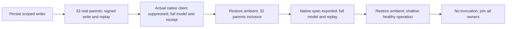

# Native Orleans telemetry ancestry

Canonical slice: [ClusterRouting](../ClusterRouting.md), [native runtime adoption](RuntimeAdoption.md).
Applicable ADRs: [ADR-036](../../ADR/ADR-036-orleans-foundation.md),
[ADR-110](../../ADR/ADR-110-native-orleans-execution-primitives.md),
[ADR-121](../../ADR/ADR-121-exported-telemetry-privacy.md),
[ADR-125](../../ADR/ADR-125-connection-owned-execution.md),
[ADR-117](../../ADR/ADR-117-native-tunit-ci-entry.md).

REQ-ORL-ANCESTRY-001: Before either approved native Activity callback accesses Baggage,
KeyLoad's privacy processor bounds local Parent links by validated MaximumParentLinks (0..32, default32).
The actual .NET10 getter scans ancestors even when every node has no baggage.
Reuse the fixed baggage_limit suppression reason and native Recorded flag; never replace native propagation.

AC-ORL-ANCESTRY-001: The genuine signed native streamed Batch writes a literal document under
33 actual local parent links. A passive listener must observe actual Orleans Application Client spans
with that direct local parent and Recorded=false; those exact SpanIds must not reach the exporter.
The operation and original command replay both return independently complete receipts using the retained
native journal entry Index, literal mutations and pre-operation physical placement. Complete literal
DocumentResult and persisted original outcome are checked after each response; replay preserves store
position and the entire native journal cut. No store-position/logical-token comparison is used.

AC-ORL-ANCESTRY-002: After reverse-joined parent disposal and exact ambient restoration,
repeat the same real flow with exactly32 local Parent links (inclusive) and then one shallow parent.
Actual native client spans must be recorded and those exact IDs exported. Each stage retains all earlier
literal documents. Trace and metric captures must not truncate. The existing original operation timeout,
startup, shutdown and provider flush bounds remain unchanged. No custom Orleans ActivitySource or span.

AC-ORL-ANCESTRY-003: Observe actual body tasks and separately joined cleanup with the existing
ServerFailureObserver. Reverse-dispose every owned Activity and listener, then telemetry provider and
native fixture. Preserve original/cleanup terminal failures exposed by each owner. The existing telemetry
fixture's internal nested-finally disposal semantics are unchanged; no stronger internal conservation claim.

Source-only conditional stage: production MaximumParentLinks option and pre-Baggage hooks are owned
separately by Root and require Main reservation/adoption. Native TestCluster with node-local ZoneTree
and retained native journal is not Docker RF3, SDK/MCP qualification or a CPU/DoS/performance measurement.
The stock Orleans outgoing propagator still injects context and may enumerate baggage independently;
this contract bounds only KeyLoad's privacy processor. No transport/provider/default/deadline changes.
Compiler, Linux execution, existing telemetry regression and whole-operation qualification remain OPEN.
