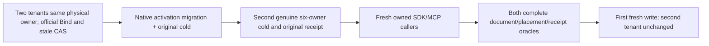

# KL-070 packed small tenants: official placement and second cold

SOURCE_N only. REQ/AC-CAPPLACE-002/003/005/006, architecture KL0701940-1946, ADR-129/030/117/125.

REQ-PACKED-001: the existing PersistedTwoTenantPackingPreservesScopedReceiptsThroughNativeMigrationAndColdRepair must prove placement Bind and original stale CAS through BOTH genuine SDK and official MCP. Each denied/stale call retains its complete fixed SDK problem and canonical five-field MCP problem; each new response is followed by the full public immutable expected placement. False success is not denial. Preserve the original nonadministrator placement-read denial, exact original request IDs, native activation migration, same-GUID distinct tenant outcomes and original complete document/receipt assertions.

REQ-PACKED-002: preserve the original six-owner cold inside NativeActivationMigrationRf3Operation; append a second genuine six-owner native cold via the exact existing NativeActivationRf3ColdOutcome owner. Retain original first scoped seed receipt on all actual owning replicas, absence on the foreign owner, exclusive native file locks and real owner restart. Then fresh nested owned administrator/first/second SDK+official MCP callers independently read both complete literal documents and original full placements, replay both same-GUID seed receipts with complete current after each, and perform the existing real conflict/healthy continuation on first tenant. Current second tenant remains unchanged. Original Case/Args/deadline and outer ownership/error ledger unchanged.

Initial second-cold literals follow existing complete operations: first revision3/original JSON; second revision2/changed JSON. Fresh healthy first revision4/changed JSON. Compare complete DocumentResult reference/revision/JSON/redaction/empty fields via existing full typed DocumentAsync; do not derive expected rows from actual reads. Placements retain original complete authoritative tuples, both explicit row revisions1/global2 and same physical owner with distinct atomic scope.

The new second cold verifies the original first seed outcome, while fresh public full receipts/current validate both tenants. It does not claim full offline second-tenant raw outcome inspection, two physical host anti-affinity, automatic exclusive enrollment, power-loss or Linux qualification. Actual runtime deadline fit, compiler/native census/admission remain OPEN. No new Case/role/grant/profile/transport/package/timeout/budget.

Canonical ClusterRouting. UI N/A. No shared feature docs SourceY; unique childspec only on future admission.

