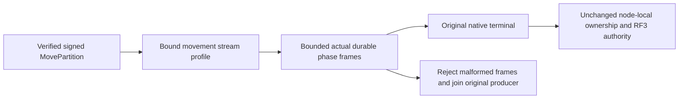

# Native controlled movement stream admission

This corrective contract belongs to ClusterRouting under ADR-082/125 and the existing native CQRS, physical-owner movement and node-local storage contracts. R396 showed the genuine BM25 publication/movement operation returning UnknownWriteOutcome before its Retire borrow. Its first actual durable Prepared progress frame was rejected by the two-frame stream profile. Consumer disposal then cancelled the original writer; shutdown borrower failures followed. The exact R396 receipt is development failure evidence, not a successful movement or RF3 qualification.

| Requirement | Completion gate |
|---|---|
| REQ-MOVESTREAM-001: classify only a bound signed MovePartition operation | AC-MOVESTREAM-001: the existing verified purpose binding admits its movement progress through the configured finite MaximumTotalFrames; an unbound or other operation cannot gain that profile. No lifetime, byte, aggregate, producer or native RPC bound changes. |
| REQ-MOVESTREAM-002: preserve exact native progress shape | AC-MOVESTREAM-002: each Progress has the original request ID, exact sequence, success-only progress result, no final/event ID/other operation payload, fixed actual movement message and event type. Only Prepared, Fenced, Captured, Transferring, Installed, Published and Aborting are emitted. None, Retired, Aborted and unknown enum values are refused. |
| REQ-MOVESTREAM-003: accept persisted suffixes and repeats without inventing phases | AC-MOVESTREAM-003: the existing orchestrator may repeat a current durable phase, resume at any nonterminal persisted phase, or return its original terminal without progress. Abort may report its previous phase then Aborting. Do not infer numeric phase order or require Retired/Aborted progress: RequireTerminal runs first and returns those terminal results without emitting them. Existing shared terminal success/failure rules remain in force. |
| REQ-MOVESTREAM-004: retain whole-operation storage and lifetime proof | AC-MOVESTREAM-004: rerun ActualServerPublicationMovesExactNativeHeadAndStrictValidatorsRefuseWithoutEffects through the Main-owned migration to one genuine Aspire-owned two-RF3-group topology, readiness and discovered native clients, preserving the original native movement receiver, actual publication, retained head, invalid image refusals and healthy continuation. MainA owns that composition; six manually started WebApplications do not satisfy this gate. Preserve original RPC/membership/readiness, journals, ordered apply, checksums, private receipt/reference oracles and joined original borrowers. |

Focused protocol tests use the actual registered Orleans chunk serializer, signed request codec and native admission code to distinguish operation binding, repeated/suffix/no-progress terminal flows, malformed identities/kinds/phases/metadata, frame limits and terminal uniqueness. These are protocol unit assertions, not fabricated physical movement results. The existing BM25 operation remains the complete real-server regression. Main alone adopts source, compiles, discovers and executes the native tests. Process recovery, genuine Aspire Docker RF3 and exact-source Linux qualification stay OPEN.

Status: contract sealed before code; implementation, compiler, native discovery/execution, process recovery, RF3 and Linux qualification OPEN. No timeout increase, optional SIMD mode, protocol fallback, custom network, replacement engine or private owner bypass is introduced.
