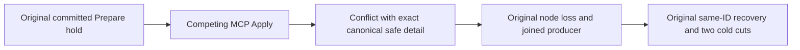

# Placement Apply owner-loss MCP conflict detail

Canonical ClusterRouting / KL-070, REQ/AC-CAPPLACE-005/006, ADR-129/ADR-102. Preserve original OriginalCapacityApplyResumesSameGuidAfterObservedCommittedPrepareOwnerLossAndTwoColdCuts complete real six-owner SDK/official-MCP operation.

REQ-KL070-OWNERLOSS-MCP-001 / AC-001: the actual held ControlPrepare leaves a live Applying claim. Competing official-MCP Apply must return exactly Conflict, dispatched operation identity and the existing five-field canonical safe Problem, with fixed detail `The database operation could not be completed.` Native ClaimPlacementIntent uses Stale, but the actual public MCP closed mapper does not export this native detail. It preserves only selected command-content and unique-index Conflict details; all other Conflict errors use generic safe detail.

The previous assertion expected the native Stale text and could not admit the correct MCP producer reply before genuine Kill/recovery. Correct only that expectation through a named constant. Retain original error code/dispatch/shape, exact applying-state and native journal proof, pending original Task, original node Kill, full lost-reply result, original Move/Apply/receipt replay, fresh owner claim and complete two cold owner/model oracles. SDK native detail is unchanged. No product mapper/alias/API/case/UID/Args/deadline/limit or permission change.

UI N/A: existing administrative operation. No new SQL surface. Source-proven fixture mismatch is not an observed runtime cause or product regression. Native/compiler/runtime/deadline/Linux/fault/resource qualification remains OPEN. The full original owner-loss Case is the meaningful regression, not a new assertion-only Case.
