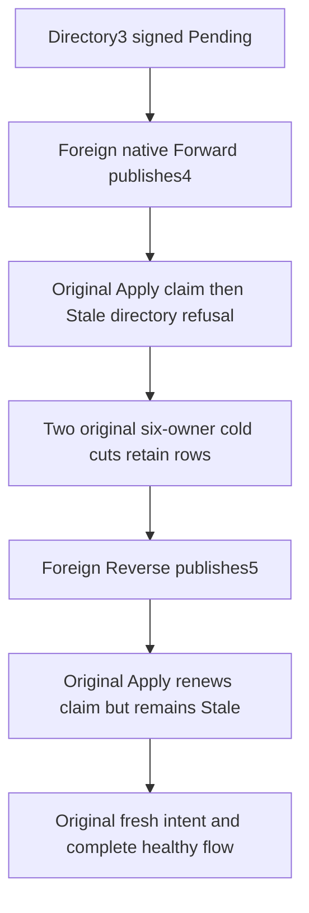

# Late foreign occupancy after persisted placement intent

Canonical ClusterRouting / KL-070; ADR-129. Requirements first: r83-b-kl070-late-occupancy.requirements-first.source-N. No new public API or canonical serializer layout.

REQ-KL070-LATE-OCCUPANCY-001 / AC-001: extend SAME OriginalOccupiedDedicatedOwnerRefusesCapacityPlanThenSiblingRepairRestoresSameTenantPlacementAndColdReplay case. Preserve every original setup, denied call, forward/reverse native Move, receipt/model oracle, unavailable-policy control, two occupied six-owner cold cuts and original healthy continuation. After actual shared packing and Control binding, collect genuine complete signed primary plan at directory3 and persist distinct immutable Pending through actual SDK/official MCP before existing foreign Forward.

REQ-KL070-LATE-OCCUPANCY-002 / AC-002: genuine foreign Forward publishes directory4. Original Apply commits its real Applying claim, then exact native current-directory Conflict/Stale precedes exclusivity ResourceExhausted. SDK checks full native problem/no result; official MCP checks exact safe generic detail/dispatch identity. Each response is followed by full original primary models/receipts and phase-correct foreign document/receipt/current placement; then full current intent identity. No absent-outcome or byte-identical whole-store assertion across legitimate claim writes.

REQ-KL070-LATE-OCCUPANCY-003 / AC-003: on EACH original actual stopped cold cut, existing pure PendingPolicyRows observer requires three-Control-only exact Applying intent and original Persist success bytes, unchanged policy, absent new Move parent and zero actual grants. Compare both complete retained intent/Persist rows exactly. No new cold cycle, file copy, synthetic store/clock/provider, UID, deadline, quota or output limit.

REQ-KL070-LATE-OCCUPANCY-004 / AC-004: after original foreign Reverse publishes directory5 and old claim owner is absent due actual cold restart, same Apply may legitimately renew its claim to revision3 but cannot execute the directory3 Move. Full models remain phase-correct. Original successful Persist replays unchanged. Continue original genuinely fresh directory5 plan/intent, primary Move publication6, original forward/reverse/seed replays, complete healthy writes and existing later cold flows. Outer Apply error is NOT described as a cached durable failure; private phase49 claim and original Persist outcome are durable.

This proves current-directory late-occupancy fencing, not automatic future exclusive-enrollment reservation or per-tenant fairness. Current product already contains the guard; this is a missing whole-operation acceptance cell. Raw first Persist fingerprint independence and complete outbox equality after EACH new refusal are not newly qualified by row/model checks. Original complete checks remain. Native/compiler/runtime/unchanged deadline/Linux/fault/endurance/resource acceptance stays OPEN. UI N/A: existing administrator operation; SQL N/A for these existing dedicated placement SDK/MCP routes.

