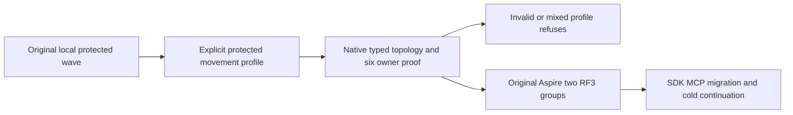

# Local protected movement diagnostic enrollment

REQ-CRS-LOCAL-MOVE-001 / AC-CRS-LOCAL-MOVE-001: the existing protected movement wave explicitly selects `KeyLoadTests:ProtectedMovementProbe=true` for a genuine locally built image on its original first start and every cold continuation. The typed AppHost profile requires ephemeral two-RF3 membership, physical registration, both remote read/query selectors, protected movement and the original request-probe owner. It rejects false, nested, absent prerequisite and foreign diagnostic composition before launching resources. Absent selection keeps the original ordinary-local refusal, including the existing omission and EventVector negative controls. Only `TwoRf3MembershipLocalImageLifetime.StartProtectedAsync` opts its actual wave into the selector; that immutable wave selection survives the original cold restarts. Other wave constructors remain unselected, including native blob wire, frame observation, omission, EventVector and membership diagnostic owners. It does not enroll an unrelated profile.

REQ-CRS-LOCAL-MOVE-002 / AC-CRS-LOCAL-MOVE-002: the original native six-owner request-probe validator retains exact session, private files, Unix modes and exclusive local/GitHub image validation. No mixed or missing image pair is admitted. Existing image receipt authentication, six actual Aspire containers, native membership, signed SDK/official MCP requests, migration, original session receipt, all cold restarts and joined shutdown remain mandatory.

Automated owners: `ProtectedMovementLocalProfileTests.ExplicitProtectedMovementRefusesForeignProfilesWithoutEffectsThenEnrollsSameSixOwners` proves actual native profile admission, all-owned-file conservation, refusals and repair. Existing `NativeCapabilityLocalProfileTests` and `EventVectorReservedLocalProfileTests` retain their exact complete negative/healthy flows. The existing `NativeDatabaseMigrationRf3Tests` case is the runtime owner; the original R173 pre-start membership-invalid failure is retained and does not prove a six-node start. Compiler, runtime and exact-source Linux acceptance are OPEN until executed. Frontend and public API/schema changes are N/A; no product privilege, storage format, timeout or new dependency is introduced.

The existing application-stop/disposal statements are extracted into the feature-owned `TwoRf3ApplicationShutdown` while the wave retains its state publication and original failure ordering. This preserves the original deadline, cancellation, actual close-result gate and callback join while respecting the200-code-line type limit; no limit exception or compressed block is introduced.
