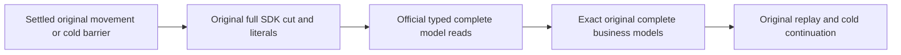

# PublicMovementOfficialModelCut within ClusterRouting

REQ-PMOVE-PUBLIC-MCP-CUT-001 refines REQ-MOVE-001/006/007 and the original public parent RF3 acceptance: after settled movement/cold/policy-repair barriers, official MCP must read the same complete transferred document, graph, vector, event, queue, sample and blob business corpus as the original SDK oracle.

AC-PMOVE-PUBLIC-MCP-CUT-001: the original SDK model capture and independent literal checks remain unchanged. Every actual official result compares the complete corresponding original model (reference/revision/JSON/redaction/omitted paths; graph order/full edges; ranks; full event records/head; all message body/metadata; sample records; blob metadata/offset/bytes). Null/failed/denied results are never an empty success. Fresh single-page stream reads require exact Stream, full Head/Events, HasMore=false, Cursor=null, positive opaque local cut and SnapshotCutPosition equal to that same page-local cut. No physical/logical receipt-position comparison.

AC-PMOVE-PUBLIC-MCP-CUT-002: reuse all original public parent and policy flows, same six Aspire owners/two RF3 groups, original SDK/MCP commands/receipt replays/old-minimum controls, cold cuts/cleanup and unchanged whole deadlines. The additional reads occur at existing settled barriers; no test producer writes between SDK/MCP waves. Sequential public reads do not claim a single atomic cross-model image or numerically equal cuts across nodes. Full stopped native cuts remain the existing separate oracle.

Mapped existing Cases: PartitionMovementPublicParentFlowTests.ActualPublicParentMovesAllLinkedModelsAndOriginalReceiptsAcrossTwoRf3OwnersAndBackAfterColdReplay; PartitionMovementPolicyEpochColdRf3Tests through existing RequireCurrentModelsAsync; existing CurrentOwnershipTokenAfterMovementRf3Tests whole original flow. No new Case/Args/UID or timeout. Native semantic preview/compiler/current discovery/real Linux RF3 and deadline-fit remain OPEN until actual execution.

Applicable ADRs: ADR-016, ADR-017, ADR-101, ADR-106, ADR-117, ADR-125. Frontend/product API/provider/migration: N/A; ClusterRouting caller acceptance only. Root owns parent specs/status/product.

