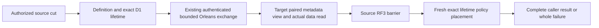

# Resource lifetime read fence

Contract: [ADR-139](../../ADR/ADR-139-resource-lifetime-read-fence.md). Status: implementation and qualification OPEN.

- REQ-LIFETIME-READ-001: Capture the native D1 definition/lifetime pair with fresh persisted identity, policy and placement in one authorized source cut. Exact native coverage is mandatory for every selected V2 read.
- REQ-LIFETIME-READ-002: Authenticate the complete internal V2 proof through the existing native Orleans exchange; preserve original expiry, bounded work ownership, cancellation and joined shutdown. No V1 fallback, renewed timeout or parallel transport is allowed.
- REQ-LIFETIME-READ-003: Validate exact resource/domain/partition coverage before target data access and overlay the authenticated source definition and lifetime together in the actual bounded target view. Retain destination placement/publication and local technical-principal admission. Ordinary document/query/search V2 retains BOTH independent native principal/resource authorities in the same actual target cut: require both scope/field/schema decisions and both row visibility decisions before predicates, statistics and ranking; project through both native projectors and disclose redaction paths only under both schema policies. Do not require equal epochs/records or merge grants/roles. Final source validation includes the complete source principal and policy snapshot.
- REQ-LIFETIME-READ-004: Withhold all results until the original source RF3 barrier and a fresh exact lifetime, principal/policy and placement check succeed. Changed authority fails the whole operation without rebinding or partial results, including cached/query/search paths.
- REQ-LIFETIME-READ-005: Ordinary and controlled documents, controlled blob Metadata/UploadInfo/Range/List, partition-query/SQL leaves, all distributed-search phases and native ANN reads are separate required path inventories. Blob Outcome is a command observation and retains its own effect semantics.
- AC-LIFETIME-READ-001: Real native tests reject missing, malformed and another genuinely configured resource's coverage before candidate/data access; literal healthy results, original receipts and byte bounds remain exact. Cover both asymmetric source/target denial directions and preserve the existing independent-epoch repair/healthy assertions.
- AC-LIFETIME-READ-002: Existing bounded armed NativeModelAfterDispatch holds the same original read task after the actual reply. A real persisted source policy/placement change produces whole-read refusal, no partial SDK/MCP result and joined original producer settlement; healthy repair and actual cold cycles succeed.
- AC-LIFETIME-READ-003: Required solution build, TUnit native/recovery and Aspire-owned RF3 tests pass on the final source cohort. Native ANN has its own mandatory proof before total acceptance. Prepared source, package presence and syntax checks do not satisfy these gates.
- AC-LIFETIME-READ-004: Real DROP/recreate and exclusive retirement/name-reuse admission remain OPEN dependencies. Direct storage replacement, fabricated lifetime rows or a local snapshot held across the network cannot qualify them.

