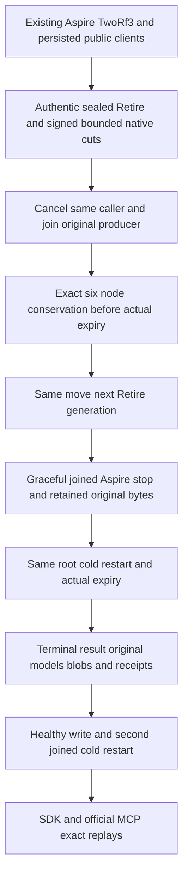

# Aspire ownership of the original native Retire operation

Parent: [PartitionTransfer](PartitionTransfer.md); [ADR-106](../../ADR/ADR-106-partition-owner-movement.md), [ADR-117](../../ADR/ADR-117-native-tunit-ci-entry.md) and [ADR-125](../../ADR/ADR-125-connection-owned-execution.md). The current root policy controls native Aspire ownership and connection execution.

This contract replaces only the direct-host composition of `ControlledPartitionMovementNativeRetireTests.OriginalNativeRetireCallerCancellationAndHostStopRetainAuthorityThenResumeReplayMixedModelsAndTwoColdOwners`. Its existing cancellation, authority, exact error, model, receipt and cold-recovery requirements remain mandatory. Shared direct-host helpers still used by other separately tracked tests are not declared migrated by this operation.

| Requirement | Completion gate |
|---|---|
| REQ-KL036-RETIRE-ASPIRE-001 / AC-KL036-RETIRE-ASPIRE-001 | Start the existing TwoRf3MembershipWave through its native Aspire fixture with six actual nodes in two explicit RF3 groups. Use the real SDK and official MCP clients, current persisted administrator and authentic current owner discovery. No manual application/silo, substitute cluster, caller container lifecycle or new provider is permitted. |
| REQ-KL036-RETIRE-ASPIRE-002 / AC-KL036-RETIRE-ASPIRE-002 | Observe the exact original native sealed Retire operation under the existing finite immutable diagnostic arm. Preserve native signature/authority, principal, derived command ID, move/partition, original nonce/expiry, generation and authentic Install entry/committed receipt. Every observation is bounded and freshly administrator-authorized. Signing keys are represented only by their digest; diagnostics create no database authority or mutation. |
| REQ-KL036-RETIRE-ASPIRE-003 / AC-KL036-RETIRE-ASPIRE-003 | Cancel the original public SDK caller while its actual Retire producer is held. Join that same producer and its native probe disposal, preserve the exact public SDK UnknownWriteOutcome Problem contract (including its actual transport-specific safe detail) and compare every original node's complete bounded canonical model bytes, store position, replica tail and store/key identity before the authentic expiry. Retiring a diagnostic arm must not erase the evidence needed for this comparison. |
| REQ-KL036-RETIRE-ASPIRE-004 / AC-KL036-RETIRE-ASPIRE-004 | Wait against the actual signed expiry with ordinary TimeProvider. Resume the same move and observe a distinct authentic Retire cleanup generation with the same expected result. Gracefully stop the existing Aspire-owned cohort, join the original producer and every owned resource, prove all eighteen node/database/replica locks released, and read the same persisted original pending phase and absent outcome. Do not substitute SIGKILL for this graceful-stop step. |
| REQ-KL036-RETIRE-ASPIRE-005 / AC-KL036-RETIRE-ASPIRE-005 | Restart through the existing same-root Aspire wave. Retain exact phase bytes/authority and current persisted principal, then wait for the second authentic expiry, finish the same move, replay every original command and full receipt, and verify every original mixed model and blob. Make a distinct healthy write, complete a second real joined cold cohort, and verify exact same-move, original data/blob and healthy-write replays through SDK and official MCP. |
| REQ-KL036-RETIRE-ASPIRE-006 / AC-KL036-RETIRE-ASPIRE-006 | Preserve all original failure tasks and cleanup errors. A producer-first race observes that same task before emitting bounded task-state evidence. Release/cancel admitted holds, join original producers/clients/application/readers/controls and retain roots on any unjoined work or failure. No timeout increase, delegated clock, new runtime fallback, fabricated UID or ignored failure is permitted. |

The mixed-model oracle includes the original exact document JSON/revision, graph, queue metadata and payload, Topic publication/cursor exhaustion, time-series values, raw vector and vector search, and original blob bytes, hash, metadata, full and partial reads. Existing richer public-parent models and chunked-blob replays are additional collateral, not replacements for the original corpus. Read cuts from independent public calls are opaque; their contract does not require equality across nodes.

Source preparation and review do not establish compilation or execution. The new integration namespace requires actual native TUnit discovery; the removed Unit UID is historical. Only the main integrator runs canonical formatting/build, focused Unit/recovery and the real Aspire operation. The bounded signed diagnostic observations are selected only by the existing private probe profile; they are not MCP operation tools or an authorization source. UI is not applicable: this is a native fixture and public-client correctness flow. No package, provider, clock, execution timeout, public transport schema or persisted database format changes.

Current-source Linux RF3, fault/endurance, coverage and complete KL-036 qualification remain open until their original required evidence exists. Graceful-stop or process-kill evidence does not establish power-loss durability.
