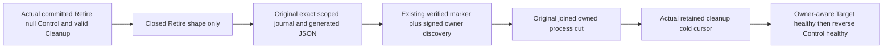

# Closed native Retire journal reachability

REQ/AC-KL071-RETIRE-JOURNAL-001: the existing committed cleanup RF3 Case arms only original first Retire SubmitReturned. A real successful Core ExecuteMoveCleanup returns PhaseResult Retire, null Control/Fence/Installed/Publication/Grant, valid Source Cleanup and journal. Current private capture accepts only three nonnull Control stages, so this actual result fails before the verified marker and cannot authorize the intended kill. This is a source-proven diagnostic reachability defect, not an observed runtime cause.

Permit ONLY this native Retire shape in addition to byte-conserved existing Control admission. Require same armed full Partition, nonempty MoveId, Journal command identity, version, exact Source role/Retire stage, control-intent digest, bounded family and positive next batch. All non-cleanup payload fields stay null. Journal applied position is positive; physical owner nonempty stable ID/incarnation/epoch and actual emitting voter membership remain validated in the existing inventory. Progress Completion may be null; terminal Completion must be the same complete native journal at the terminal family, with no last key omitted. No arbitrary StagePage, Install, Abort, ControlAdvance or other stage becomes admissible. Original arm, identity, private authentication, signed discovery, native callback, bounded record JSON schema/size and marker matching/publication/retention remain unchanged. Consumer independently requires exact Source physical owner/incarnation/voters before authorizing actual kill; no owner is invented from a voter string.

REQ/AC002: focused native Unit regression runs complete original ControlledPartitionMovementTerminalTrial against real native ZoneTree source/target journals, publication, retirement, cold original models/receipts. Then reads its genuine terminal Retire stored outcome under exact partition/principal/phase ID, maps that actual native result through production capture, validates arm+marker+inventory and exact generated JSON serializer/read roundtrip. Typed corrupted variants of that genuine outcome reject unsupported/null/mismatched/extra fields; these validation controls are not fake storage/RF3 claims. The existing real RF3 committed-first-Retire Case remains the end-to-end progress/null-completion regression and keeps original Case/UID/deadline/kill/receipt/model/cold oracles.

REQ/AC003: that existing producer also calls shared FaultOwner.ResumeAsync, whose pre-merge Healthy incorrectly expects Control incarnation and reuses post-merge fixed document ID. Change ONLY this scoped caller to the reviewed NonRetiredR2 generic owner-aware continuation: original forward replay/placements/cold, distinct full Target healthy operation, reverse merge, original Control healthy once. This is an explicit unadopted dependency; no silent shared helper change or partial admission. Preserve all primary and cleanup errors. Native NF/N/NS/compiler/runtime/unchanged-deadline/Linux/full071 remain OPEN; no SourceY/SDK or public authority/transport/schema API changes. Frontend N/A.

