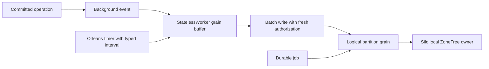

# ClusterRouting: native runtime adoption

Date: 2026-10-06. Status: implementation in progress; no stage below is
qualified, and source presence does not close a runtime criterion. Decision:
[ADR-110](../../ADR/ADR-110-native-orleans-execution-primitives.md). The
[ExecutionPrimitives](ExecutionPrimitives.md) specification owns the REQ/AC
inventory; the cluster concept is in
[ADR-136](../../ADR/ADR-136-native-orleans-partition-ownership.md).

## Scope and primitive selection

Adopt native mechanisms only where the production path needs their guarantees.
Preserve the client's connection grain, fresh persisted authorization, silo-local
ZoneTree owners, ordered apply and acknowledgement from every configured copy of the ReplicaCount
copies. Frontend and new public SDK/MCP schemas are N/A for these stages;
existing public commands, queries and inspection qualify their outcomes.

Memory streams and broadcast trampolines are not used for background work: native
broadcast does not target every silo-local service, and memory-stream cache
rewind is not durable restart replay. Persistent Streams remain their own
provider, subscription/outbox and consumer workstream; no generic dispatcher is
added.

## Background work: REQ/AC-ORL-011

Queue work (deadlines, due and recurring messages, remote queue transfers), ANN
projection and time-series chunk work run in Orleans `[StatelessWorker]` grains.
A worker accepts events, buffers them in bounded memory and, on an Orleans grain
timer (for example every 5 seconds; the interval is a typed option), writes the
batch through the normal grain -> silo-local ZoneTree owner path. Orleans owns
activation scheduling; each worker processes its own admitted buffer.

The buffer is disposable: it holds no store handle and is never the authority
for an acknowledged write. Coalesce events instead of starting a task per commit.
Each batch reloads the persisted creator and current authorization and keeps
stable idempotent command identities, so a repeated event produces at most one
canonical effect. The timer callback is bounded; activation deactivation and silo
shutdown join it, and caller cancellation never authorizes work. Scheduled work
that must survive restart uses Durable Jobs (persisted, at-least-once, idempotent
effects). The interval is a resource bound, not a measured latency or throughput
result.

Acceptance for AC-ORL-011 under this pattern: real committed operations produce
events that workers buffer and write on the timer; coalesced events keep the
final state; cancellation, deactivation and shutdown leave no leaked work; due,
recurring and saga outcomes, creator revocation and restoration, restart and
single-effect identities hold through the .NET SDK and the official MCP client;
no worker consults leadership.

## Native telemetry: REQ/AC-ORL-012

Enable native AddActivityPropagation on the production silo. Subscribe the
existing process-wide OpenTelemetry provider to Microsoft.Orleans metrics and the
Microsoft.Orleans.Application / Microsoft.Orleans.Lifecycle activities; do not
create a second exporter or provider inside the silo host. No new dependency is
needed. Native source names and RPC keys are verified against v10.4.0.

Before every exporter, a processor bound to the exact native sources removes
unapproved tags, raw target/source/grain/activation/enumerator IDs, exception
messages and stack traces, status description and tracestate. Span names and
retained service/method/type values become closed named protocol constants;
native trace/span/parent identity and success/error status are preserved, and
native baggage is not exported. Central typed options bound work to 32 tags,
24 events, 8 baggage items, 256 characters per inspected tag value and zero
links. Only reviewed lifecycle event names without attributes survive; unexpected
events, links or oversized metadata suppress the span by clearing Recorded before
the OpenTelemetry 1.19.1 export processor, with a fixed low-cardinality reason.
A suppressed span is a diagnostic gap, never a claimed complete trace.

A meter-scoped view with TagKeys=[] aggregates each Microsoft.Orleans instrument
without dimensions; other meters keep their views. AlwaysOff exemplar filtering
keeps stripped tags from reappearing as exemplar attributes. This adds
observability, not performance or durability claims.

Native telemetry details:

- Streamed requests: the test client registers native AddActivityPropagation
  alongside the silo. The pinned 10.4.0 filter tags methods as interface/method
  and routes IAsyncEnumerableGrainExtension calls to the Application source.
  Only `Orleans.Runtime.IAsyncEnumerableGrainExtension/StartEnumeration<T>` maps
  to the existing `request.execute` value; MoveNext, DisposeAsync and unknown
  methods keep the generic closed classification. Extension calls are not
  separate database requests.
- Inherited baggage: after the configured removal attempts, a one-item presence
  probe checks for remaining baggage; residual inherited or unremovable baggage
  suppresses the span with the fixed `baggage_limit` reason before export. Never
  mutate a caller-owned parent, raise the bound or export raw values.
- Caller boundary: the test caller creates its provider-backed parent Activity
  from an independent valid remote W3C ActivityContext, so it inherits no ambient
  baggage, while native Start/Dispose restore the previous Activity.Current.
- Repeated metric observations: the test exporter (`OrleansMetricCaptureExporter`)
  keeps one copy of an observation whose meter/name and complete ordered tag and
  exemplar arrays compare equal ordinally and structurally. Every distinct
  observation, including an earlier unsafe one, is retained; a new distinct
  observation beyond the validated 256-record bound still sets WasTruncated and
  fails the operation.

AC-ORL-012 executes real signed writes, reads and a genuine native failure
against the actual store, verifies terminal outcome and state, captures exported
metrics and trace parentage, and proves that no payload, SQL, credential,
principal, raw routing ID, private exception text or exemplar attribute escapes.
Concurrent principals keep distinct request contexts. Immutable privacy sentinels
in an actual operation span prove fail-closed suppression while the operation
keeps its correct outcome. Capture is bounded and every provider is flushed and
joined. `OrleansRuntimeTelemetryTests` on `RequestCqrsClusterFixture` own the
native cases; no synthetic exported span, raw-tag export, relaxed assertion, new
provider or higher limit is permitted. SDK/MCP cluster qualification remains
mandatory.

## Verification and rollout

After code changes: `dotnet build KeyLoad.slnx --no-restore --configuration Release -warnaserror`,
`dotnet format KeyLoad.slnx --verify-no-changes --no-restore`, and the unit,
unit-scalar, recovery and cluster TUnit suites with Aspire-owned resources and the
real .NET SDK and official MCP clients. Focused filters are development evidence
only. Tests run real operations and assert state and errors; no mocks, manual
Docker topology or property-only tests.

Rollout changes no persisted, public or generated contract. Disabling a worker
joins its timer and admitted work first; canonical schedules, creator identity,
receipts and recovery journals stay intact. The native journal provider and the
already-due saga handoff follow [RuntimeJournal](RuntimeJournal.md). Transaction
and further worker stages need their own contracts and proof.

