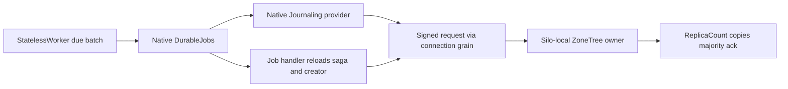

# ClusterRouting: replicated runtime journal

Decision: [ADR-110](../../ADR/ADR-110-native-orleans-execution-primitives.md); cluster concept: [ADR-136](../../ADR/ADR-136-native-orleans-partition-ownership.md). Related: [runtime adoption](RuntimeAdoption.md), [journal lifetime](NativeRuntimeJournalLifetime.md), REQ/AC-ORL-013.

## Authority and execution

KeyLoad uses the native Orleans Journaling and DurableJobs APIs from the centrally pinned packages with the explicit `orleans-binary` journal format. A named KeyLoad provider implements the native storage and catalog interfaces. Every journal read and write is a freshly signed request through the connection grain's native CQRS stream (`IConnectionGrain.ExecuteStreamAsync`). The silo-local ZoneTree owner applies the canonical records; writes are replicated through ordinary Orleans calls to the ZoneTree owners on `ReplicaCount` silos and acknowledged after every configured copy confirms durable local apply. No provider commits storage directly.

The journal is internal infrastructure state, distinct from logical user partitions. A protected persisted `keyload-internal-runtime-journal` identity has no public credentials, user grants, administrator role or SchedulerManage, and can execute only the closed journal commands and reads. A private identity-creation command, run under a freshly revalidated persisted administrator, creates it; a missing or inconsistent identity afterwards is a recovery failure. Public principal/API-key changes and normal request purposes cannot configure or invoke this identity. Journal metadata authority never authorizes saga effects, which use the persisted creator.

## Canonical storage contract

One internal `RuntimeJournal` OperationKind is appended without renumbering existing values. Its generated mutation has closed actions for identity creation, Create, UpdateMetadata, Append, Replace and Delete. Private reads return a header, one bounded opaque byte page or the complete bounded journal catalog. No public SDK/MCP tool, SQL opcode or parallel dispatcher is introduced. Generated header/chunk/capacity records use stable v1 aliases and field IDs. Exact user content, the storage codec and recovery journals keep their current contracts. The private journal key family uses a version-1 marker under the sole current native format in [CurrentFormat](../StorageRecovery/CurrentFormat.md).

Both exclusively owned server stores carry a store identity whose minimum reader contract is `StoreReaderContract.RuntimeJournal`. Startup validates both stores before snapshot recovery or silo admission without modifying that identity. Missing, zero or unknown capabilities and unsupported identity magic are rejected before any file mutation. Checkpoint, backup, restore and reopen preserve the required capability, and installing a snapshot into a non-current store is rejected. A physically absent native field decodes as unsupported and never inherits a permissive default. No alternate reader, automatic promotion or conversion exists.

Each journal has a nonempty instance GUID, owner generation, independent content revision and metadata ETag. Create is atomic and idempotent; delete and recreate produce a new instance. Append, replace and delete compare the captured instance, owner generation and content revision under the atomic apply gate. Metadata writes use full ETag compare-and-swap, and mismatches return null through the native metadata API. An explicitly null metadata ETag keeps the native unconditional-update contract under the same gate and never revalidates a stale content writer. Metadata reads return a fresh snapshot without replacing the captured version, and content version mismatches map to native `InconsistentStateException`.

Changes to the tagged native `DurableJobsOwner` property, including release, reclaim and poison transitions, increment owner generation. Same-owner `DurableJobsClosed`, adoption bookkeeping and format updates do not invalidate the current writer. Every successful content write advances its captured revision, so an old handle cannot refresh itself into a new owner. Reads pin the header and content revision across bounded pages and fail on change. One native ArcBufferWriter retains incomplete binary entries across page boundaries until the consumer reports completion, bounded by journal capacity. Stable command identity resolves unknown write outcomes through existing receipts.

Native payload bytes stay opaque and never use JSON fallback. The centrally validated `RuntimeJournalOptions` admits at most 32 journals, 2 MiB per journal, 64 MiB total data, 64 KiB chunks/read pages and 8 KiB UTF-8 metadata per journal; journal names and metadata keys/values have explicit byte limits. Admission and catalog reads enforce these limits on committed state, not only on callers. The provider owns a bounded striped asynchronous gate set sized by the validated maximum journal count. Handles for the same journal borrow the same gate and each keeps its own captured instance, owner generation and content revision. Native `IJournalStorage` has no disposal contract, so handles never allocate an owned disposable gate; provider disposal follows native shutdown and joined work and idempotently releases the gate set. The native catalog materializes all selected entries before its claim budget, so the provider returns the whole bounded catalog or a terminal error and never a truncated one. Delete releases capacity atomically.

## Startup and shutdown

Native startup begins journal catalog discovery without awaiting it; asynchronous provider calls await a separate cancellable readiness gate. After silo startup, a dedicated signed request creates the journal identity if it is absent, verifies the identity and the journal catalog, then opens that gate. Shutdown closes public and due scheduling first, keeps private journal routing alive and decorates only the native manager's exact public Active lifecycle subscription. Its observer completes native cleanup and joins `NativeRequestWorkOwner` before grain deactivation. The native start and every lifecycle property are forwarded unchanged; an unexpected descriptor, subscription or stage fails closed, no reserved lifecycle stage is repurposed and the native receiver stays registered unchanged.

REQ-ORL-JOURNAL-STARTUP-015 / AC-ORL-JOURNAL-STARTUP-015: journal identity creation keeps one deterministic command ID for its whole startup lifetime. After an `UnknownWriteOutcome` it waits the configured poll interval and re-enters canonical verification under the same linked deadline and shutdown token: the protected-identity read comes first, and an existing identity is verified together with its complete journal catalog before admission opens. A lost response after a committed creation never produces a new command, identity, principal or storage authority. Credential, permission, corruption, format, quota and capability failures are not retried, no deadline is extended, and cancellation or terminal failure keeps admission closed. Automated regression: pending.

## Native jobs consumer and recovery

The first consumer hands already-due sagas to native jobs, and the canonical Waiting saga record is the persistent pending-work intent. Due discovery uses the accepted background pattern: Orleans `[StatelessWorker]` grains accept due-saga events, buffer them in memory and, on an Orleans timer whose interval is a typed option, write the batch through the normal grain → ZoneTree owner path, scheduling at most one native job attempt per due saga per cycle. No leadership check gates this work. The saga stays Waiting until expiry. A lost schedule acknowledgement may produce a duplicate native job on a later cycle, without immediate unbounded retry, and strict journal quotas bound retained work and fail explicitly under pressure. Native snapshot compaction lets completed jobs shrink the journal, and due discovery recovers work after restart. Immediate future-deadline registration and single persisted job handles need a separate atomic wake-intent/uncertainty contract.

Job metadata contains only canonical IDs, revision and deadline: no roles, credentials, signed envelopes, user JSON or timeout message content. Each schedule request supplies a fresh valid unsampled W3C trace parent and an empty trace state, independent of the ambient activity. In the pinned Orleans version an empty trace parent triggers ambient inheritance, so empty strings cannot opt out; the returned native job must prove that caller trace state was not retained.

The native `IDurableJobHandler` grain that receives saga expiry jobs keeps only invocation-local state, and its native receiver extension may AlwaysInterleave. It reloads canonical saga and creator state and creates the existing creator-authorized expiry request through the connection grain's native CQRS stream. Expected saga revision, phase/deadline checks and timeout-message identity guard the effect; stale, canceled, completed and revoked jobs have no effect. Transient unknown or no-majority outcomes retry only within an explicit bounded policy.

## Graph caller identity

Default-deny ManagedCode.Orleans.Graph rules and native Orleans call tracking stay. The existing DirectedGraph/GrainTransitionManager descriptor is extended by copying every existing edge and adding the exact `RuntimeJournalClient` ReadCoreAsync → `IConnectionGrain.ExecuteStreamAsync` and SendCommandAsync → `IConnectionGrain.ExecuteStreamAsync` transitions, plus the job handler's `ExecuteJobAsync` → `IConnectionGrain.ExecuteStreamAsync` edge for its saga effect. JournaledStateManager runs a context-suppressed background loop, so `RuntimeJournalClient` establishes its provider caller identity through Graph's `RunWithCurrentCallerAsync` around the complete request-stream drain and restores prior context on success, error and cancellation. `NativeJobGraphRegistration` uses the client's closed method identities instead of duplicated literals. No AllowAll, AnyMethod allowance, manager wildcard or replaced receiver extension is used, and no grain or Grain Service identity is impersonated.

## Requirements and acceptance

REQ-ORL-013 requires bounded native journal-backed jobs whose state flows through the connection grain's native CQRS path into the replicated ZoneTree owners, with owner-generation checks and creator-authorized idempotent saga expiry. AC-ORL-013 requires real canonical create/append/replace/read/reopen/delete, metadata CAS and same-owner updates, stale and recreated-handle failures, capacity exhaustion without partial writes, a complete catalog, identity and credential denial, unknown-outcome receipt resolution and actual native job execution. Process restart and shard adoption, loss of a write majority, creator revocation, schedule-acknowledgement uncertainty and a single timeout effect must pass through the Aspire replicated cluster with the real .NET SDK and official MCP client.

Source owners are [RuntimeJournalStartupRequests](../../../src/KeyLoad.Clustering/ClusterRouting/Hosting/RuntimeJournalStartupRequests.cs), [RuntimeJournalStartup](../../../src/KeyLoad.Server/ClusterRouting/Hosting/RuntimeJournalStartup.cs), [OrleansNodeRequestExecutor](../../../src/KeyLoad.Server/ClusterRouting/Execution/OrleansNodeRequestExecutor.cs), the exact native lifecycle registration/observer and both store reader checks. The executor keeps its execution deadline and the complete native CQRS stream and adds no dispatch or storage owner.

Automated AC-ORL-013 cases:

- [native storage and binary DurableGrain replay across new activations](../../../tests/KeyLoad.UnitTests/ClusterRouting/Cases/RuntimeJournal/RuntimeJournalNativeStorageTests.cs);
- [canonical quota and protected identity](../../../tests/KeyLoad.UnitTests/ClusterRouting/Cases/RuntimeJournal/RuntimeJournalQuotaAndIdentityTests.cs);
- [journal reopen](../../../tests/KeyLoad.UnitTests/ClusterRouting/Cases/RuntimeJournal/RuntimeJournalReopenTests.cs);
- [reader backup/checkpoint/reopen lifecycle](../../../tests/KeyLoad.UnitTests/StorageRecovery/Cases/RuntimeJournal/RuntimeJournalReaderLifecycleTests.cs) and [reader rejection](../../../tests/KeyLoad.UnitTests/StorageRecovery/Cases/RuntimeJournal/RuntimeJournalReaderFenceTests.cs);
- [Graph caller identity](../../../tests/KeyLoad.UnitTests/ClusterRouting/Cases/RuntimeJournal/RuntimeJournalGraphCallerTests.cs): RuntimeJournalGraphCallerProbe observes caller identities during real journal operations and wrong-method/wrong-target calls; rejected calls leave committed content unchanged, prior context is restored and an append/reopen/read follow-up succeeds;
- [native saga expiry, stale completion and creator revocation](../../../tests/KeyLoad.UnitTests/Messaging/Cases/NativeSaga/NativeSagaTimeoutFunctionalTests.cs), including NativeJobExpiresCanonicalSagaAndEnqueuesExactlyOneStableTimeout (duplicate dispatch, exactly one canonical timeout and message effect);
- [native runtime restart and retained-shard reclaim](../../../tests/KeyLoad.UnitTests/Messaging/Cases/NativeSaga/NativeSagaTimeoutRestartTests.cs): after the first Orleans runtime stops through its native lifecycle with the canonical store kept, a fresh runtime claims the same shard, advances owner generation, recovers the held job without rescheduling and commits exactly one timeout effect; waits are bounded and both runtimes are joined.

The in-process restart case is unit evidence only; real-process restart, schedule-acknowledgement uncertainty and the complete Aspire SDK/MCP fault and resource gates are still required before AC-ORL-013 is accepted. Rollback is the scoped source change, never an alternate journal route or data conversion.
