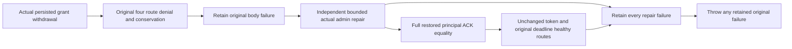

# Session minimum read: persisted policy repair ownership

KL021 / REQ/AC-SESSIONREAD-001..004 and ADR-125 retain the actual original `DocumentSessionReadRf3Tests.Kl021AcknowledgedDocumentTokenSurvivesElectedFailoverAndRejectsInvalidReads` declaration and full failover/no-quorum/invalid-token/SDK/official MCP/SQL continuation. No new test declaration, UID, token, clock, authorization provider or public API is introduced.

REQ-SESSION-REPAIR-001: after issuing the original persisted reader grant withdrawal, any actual original denial-body error or cancellation must still attempt bounded persisted restoration through the existing real administrator. Use the existing RequestCqrsRf3Protocol.CleanupDeadline and TimeProvider.System independent of the expired body token. Preserve the original initiating/HTTP/MCP/assertion failure together with every repair failure via the existing ServerFailureObserver. A repair failure must never yield wrapper success.

REQ-SESSION-REPAIR-002: only after actual successful repair ACK and full independent restored PrincipalRecord equality may healthy original-minimum reads run. Their token is the unchanged original body token; cleanup does not renew the read deadline. Denial/repair do not change the original writer, command/token, data, replication cuts or original election/no-quorum controls. An uncertain first withdrawal still requires an owned repair attempt; no inference from a failed caller wait substitutes for persisted authority.

AC-SESSION-REPAIR-001 maps to the SAME existing original operation and its DocumentSessionReadRf3Authorization helper: withdraw grant, retain every original direct SDK/official MCP and both EXEC denial oracle, literal administrator document conservation, independently bounded persisted grant repair, complete expected restored record, then existing full original-minimum healthy routes. The selected NativeDatabaseMigrationRf3Tests original minimum/token/actual activation replacement/conservation/cold operation already has its own bounded policy repair and remains unchanged.

AC-SESSION-REPAIR-002 requires the original actual Linux RF3 run to preserve all returned errors and cleanup ownership on failure. This source repair does not fabricate HTTP, admin or cleanup faults, manufacture success, add a mock provider or claim that such failures were executed. Compiler/native discovery, original full RF3/failover/no-quorum/migration operations and exact-source Linux qualification remain OPEN. The source trace proves the prior failure path skipped restoration; it is not a historical runtime-failure attribution.

