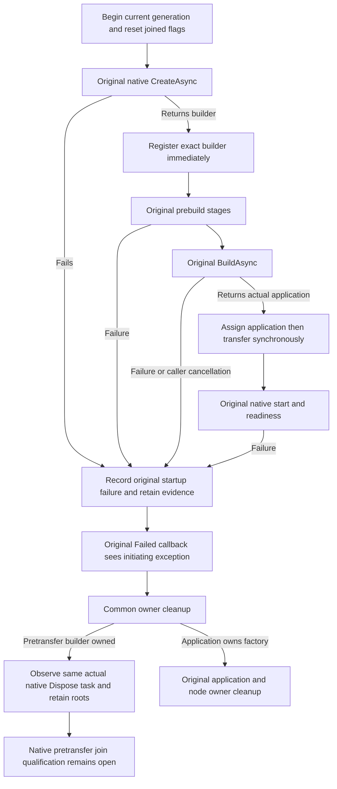

# Testing builder ownership before application transfer

This ClusterRouting test-owner contract supports the actual six-owner TwoRf3MembershipWave used by EventStreams, Messaging, StorageRecovery and other RF3 scenarios. [ClusterRouting](../ClusterRouting.md), [ADR117](../../ADR/ADR-117-native-tunit-ci-entry.md) and [ADR125](../../ADR/ADR-125-connection-owned-execution.md) retain real native TUnit fixtures, Aspire resources and connection-owned execution. It adds no product operation, provider, SDK, readiness substitute or test case. Frontend and benchmarks are N/A.

## Actual native contract

The centrally pinned Aspire.Hosting.Testing 13.6.1 package identifies repository commit 3751e615ad660621f2a7aa4c390ef48e08a0eed8. Its actual generic [testing builder](https://github.com/microsoft/aspire/blob/3751e615ad660621f2a7aa4c390ef48e08a0eed8/src/Aspire.Hosting.Testing/DistributedApplicationTestingBuilder.cs) returns a disposable builder over a suspended factory. Native Create failure awaits its factory disposal before returning an error; the unsuccessful-application branch does not await entrypoint exit and therefore does not establish native join. A successful Build returns an application using the same factory; disposing the builder after transfer would dispose that application too.

Before this correction, StartCore retained the builder only in a local variable and Wave owned only the application assigned after BuildAsync. Failure after Create returned, or cancellation of the Build wait, could leave no KeyLoad path requesting actual builder disposal. This is a confirmed source ownership omission; no native process leak is claimed from source inspection.

The pinned [factory](https://github.com/microsoft/aspire/blob/3751e615ad660621f2a7aa4c390ef48e08a0eed8/src/Aspire.Hosting.Testing/DistributedApplicationFactory.cs) cancels its state and can return from Dispose before an application has completed successfully. Its successful-application branch also uses bounded shutdown waits. The [entrypoint invoker](https://github.com/microsoft/aspire/blob/3751e615ad660621f2a7aa4c390ef48e08a0eed8/src/Aspire.Hosting.Testing/DistributedApplicationEntryPointInvoker.cs) owns an actual background thread and diagnostic subscription. Awaiting the actual Dispose task is required; its completion is not proof that every underlying thread, listener or native process joined. Caller Build cancellation likewise proves only that caller wait ended.

## Requirements and acceptance

- REQ-CLUSTER-BUILDER-001 / AC-CLUSTER-BUILDER-001: begin the current generation before original startup work. Reset applicationDisposed, nodeLocksReleased and startAttempted so earlier successful shutdown flags cannot authorize current evidence deletion. Refuse overlapping application ownership or restart after unresolved pretransfer ownership. Keep root retention and cleanup-failure state sticky.
- REQ-CLUSTER-BUILDER-002 / AC-CLUSTER-BUILDER-002: immediately register the exact native builder returned by the unchanged generic CreateAsync before any callback or await. Use the original arguments, settings, token, stage order, image admission/preparation owner, enrollments, parameters/endpoints, protected peer key, readiness and deadlines. A failed Create has no returned builder to invent or dispose at the callsite.
- REQ-CLUSTER-BUILDER-003 / AC-CLUSTER-BUILDER-003: transfer ownership synchronously immediately after assigning the actual BuildAsync result to Wave. No callback, await or validation separates assignment and transfer. Never dispose the builder after application ownership transfers; preserve existing application Stop/Dispose, callback Join and node-owner cleanup.
- REQ-CLUSTER-BUILDER-004 / AC-CLUSTER-BUILDER-004: record the original initiating startup exception before retention work. Preserve that exact exception for the existing Failed callback even if RetainRoots fails and the wrapper throws an aggregate. Evaluate the cancellation boolean at the original callback boundary. Keep initiating, retention, callback and actual cleanup errors in the ordered ServerFailureObserver ledgers; do not replace or suppress them.
- REQ-CLUSTER-BUILDER-005 / AC-CLUSTER-BUILDER-005: request pretransfer native DisposeAsync through the common DisposeApplicationAsync boundary used by initial and restart callers. Memoize its original Task, including synchronous native invocation failure, and observe that same task on subsequent cleanup. Do not substitute a later no-op native Dispose, detach work or enlarge deadlines. Preserve original admission/isolation/application/lock/control/image cleanup order.
- REQ-CLUSTER-BUILDER-006 / AC-CLUSTER-BUILDER-006: retain failed startup roots and control evidence before native cleanup. A lifetime retention veto is sticky, including after successful native Dispose. Never set applicationDisposed or nodeLocksReleased from builder disposal, and never use stale prior-generation flags to delete adjunct evidence. Native pretransfer joinedness stays unresolved; no fabricated cleanup exception is added merely because source lacks join proof.

## Ownership and qualification

TwoRf3MembershipBuilderLifetime owns only acquisition, current-generation reset, failure retention, transfer and the original disposal task. Wave contains the field and common cleanup/root-veto hooks. The existing TwoRf3ApplicationShutdown helper retains its current actual native application Stop/deadline/Dispose sequence and success result unchanged; Wave keeps current flag bookkeeping and callback Join after that sequence. Current startup arguments, protected-movement selection and feature enrollments remain intact. Startup keeps its original ordered stages and Failed callback before real owner cleanup. Existing OwnerJoin and Capacity sources remain unchanged; both initial disposal and Capacity restart failure already reach the common application cleanup boundary. Direct StartCore owners still must settle their owned Wave after failure. The initial StartOwned path invokes Failed; Capacity retains its original callback behavior and does not gain a synthetic Failed invocation.

Existing TwoRf3MembershipProfileTests exercises real six-silo startup and membership. NativeCapabilityOmissionRf3Trial and RemoteTransferDistinctTrial exercise actual startup capture and public operations through real SDK/official MCP clients. PhysicalShardCleanupRestartRf3Trial and the native Blob cold flow preserve real original-owner restart paths. These remain mandatory regressions; none independently proves pretransfer native builder thread/listener/process joins. NativeClusterStartupEvidenceTests covers a different native in-process cluster owner, and AspireFailureStartupTests covers BeforeStart on an already built application; neither substitutes for this gap.

AC-CLUSTER-BUILDER-001..006 map to the existing scenarios above as regression coverage with this explicit evidence exception: no exact generic Wave pretransfer failure/cancellation regression with full native closure observability was established. Source inspection proves retention before Register even when Create fails, but supplies no runtime join witness. Native compiler/IDE/format checks, genuine startup/restart/failure execution, original exception and cleanup evidence, and exact-source Linux qualification remain open. No fake builder, mock provider, synthetic readiness or artificial Build/Run is accepted as closure. This source correction requests required native disposal and conservatively retains uncertain ownership evidence; it does not qualify full native shutdown.
