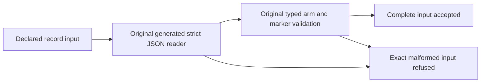

# WaitForIndex private witness validation

Future source proposal over coherent FTS41; no source apply or compiler/runtime result. These declared parser/record inputs qualify only the private validation contract. They do not prove an actual silo, physical owner, applied horizon, caller, provider lifetime or RF3 operation.

REQ-FTS-WITNESS-VALIDATION-001 / AC-FTS-WITNESS-VALIDATION-001: preserve all 24 typed fields through the real generated strict JSON reader at the original byte boundary. A canonical native Orleans ActivationId is parsed by the original validator. Independently valid AppliedPosition may exceed StorePosition: these are different coordinate spaces. Test: DeclaredWaitWitnessRoundTripsAllFieldsAndKeepsIndependentHorizons.

REQ-FTS-WITNESS-VALIDATION-002 / AC-FTS-WITNESS-VALIDATION-002: malformed required/unknown/duplicate/escaped fields, invalid UTF8, original limit plus one, mismatched applied incarnation/atomic partition, invalid authority, digest or native activation refuse. After every rejection the complete original record remains valid. Tests: MissingUnknownDuplicateEscapedAndOversizedRecordsRefuse; MismatchedTokenIdentityAndInvalidAuthorityRefuse.

REQ-FTS-WITNESS-VALIDATION-003 / AC-FTS-WITNESS-VALIDATION-003: require the same arm/request/session/voter/silo and both original RequestStarted Observed/Released markers plus one typed wait marker. Reject orphan/foreign/duplicate/wrong-owner pairs, foreign principal/readkind/target and attempts to arm the captured adjunct phase. Tests: OrphanForeignSessionDuplicateAndWrongOwnerMarkersRefuse; DifferentArmContractAndCapturedPhaseCannotQualifyAWait.

Slice map: Unit ClusterRouting/Scenarios/RequestExecution/RequestCqrsWaitForIndexValidationInput.cs; Cases/RequestCqrsWaitForIndexValidationTests.cs. Product code remains the coherent FTS41 Search capture and ClusterRouting probe. UI N/A: private test-only validator. No resources are acquired. Compiler, analyzer, native TUnit, Linux, callback lifecycle and public SDK/MCP RF3 gates remain OPEN.

