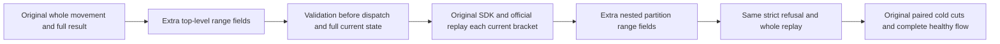

# Whole atomic movement input boundary

Canonical slice: ClusterRouting; KL069 architecture section 28.2 and task KL069. Applicable ADR-001/016/101/117/125.

REQ-WHOLE-INPUT-001: the public movement request selects a complete four-field atomic partition. A caller cannot narrow that identity with additional key-range properties, including properties nested inside the partition. Existing strict input decoding rejects this shape before dispatch. No range API, new bucket format or routing algorithm is introduced.

AC-WHOLE-INPUT-001: in the existing CurrentOwnershipTokenAfterMovementRf3Tests declaration, retain the original retired movement request and originally returned complete result. Submit the same request/MoveId via official MCP with two additional literal range boundaries at the request level, then at the partition level. Each returns complete native Validation Problem, null execution request ID, followed immediately by the complete current migrated models, placement, independent other-domain fallback/empty outbox and frozen current original outbox.

REQ-WHOLE-INPUT-002: rejecting a fragment-shaped input does not invalidate the original whole-partition request or its terminal outcome.

AC-WHOLE-INPUT-002: after each rejection, replay the unchanged whole request via source SDK and official MCP, compare the complete original result and separately bracket each success with the same full current oracle. Repeat in all four existing migrated-domain phase checks, including the original dirty and healthy cold boundaries. Preserve the original four restart calls, paired physical cut equality, original Test/Args and deadline. New calls remain outside those paired raw-cut captures.

N/A: typed SDK malformed request, because the genuine typed request has no range fields. The genuine SDK proves positive whole-request replay. HTTP malformed-body acceptance is not claimed by this test. Native atomic fragment splitting, bucket placement planning and directory-range cardinality qualification remain separate. No product defect is claimed: current strict decoding already implements this refusal.

Qualification: authored SourceN only. Native freshness/admission, semantic compiler, runtime, same original deadline fit, Docker/Aspire RF3 and Linux remain OPEN.

Current source proof: JsonDefaults disallows unmapped properties; McpArgumentDecoder deserializes before constructing a decoded operation; McpToolDispatcher invokes CanonicalOperationGateway only after decode. Validation uses the fixed GenericFailure detail through McpReplyProtocol/McpReplyWriter. The expected move outcome is the retained original response already verified by PhysicalShardPartitionMovementRf3Placement, not a new response-derived oracle. Full literal model/current outbox contracts are the existing migrated-domain and transferred-scope observers.
