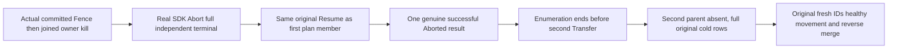

# Ordered whole-partition plan stops on a successful aborted terminal

TASK-KL071-NONRETIRED-TERMINAL-001 / REQ-ROUTE-005 contributor. REQ/AC001: obtain a genuine independent complete Aborted result through existing committed AcceptFence fault→joined owner kill→real public Abort; never synthesize Result.Success or change product behavior. The first SAME original MoveId/Partition/destination/CAS with Mode.Resume is accepted by native parent replay identity and returns the identical retained Aborted terminal before any new phase. REQ/AC002: enumerate [that first Resume, second original Transfer] through real SDK MoveWholePartitionsAsync. It must yield exact successful Aborted once, then end. Full mixed seed model/receipt/blob success and SDK+official complete placement remain unchanged after first result and after stream end. Every node's SECOND original header/pending/last/stagepages and outstanding move grants remain absent/zero in the original stopped cold cuts. This exercises the explicit successful-non-Retired branch, not a failed Conflict/PermissionDenied control.

REQ/AC003: preserve complete original fenced source/target/sourcecut/null-installed/null-published Aborted DTO, actual cancellation cleanup grants, original SDK/officialMCP/selectedSQL abort/Resume replay, raw before/after cold equality, second-original nonadmission and fresh-ID full healthy forward/reverse movement. No original Case/UID/Args/helper is edited. Existing FaultScenario owns actual two-seed six-node RF3, controls, original Task/gate evidence, killed-owner joins, ParentDeadline, real clients and every cleanup resource. Original observer retains failure before iterator disposal and captures the actual original MoveNext Task's complete fault list; no timer/delay/retry/alternate Task or deadline renewal.

Native source first: SDK Snapshot allows Transfer/Resume and bounded immutable same-destination distinct identities. Execute yields the actual reply then stops on !IsSuccess OR phase != Retired. Parent RequireReplayScope requires same principal and complete original request identity while accepting defined non-None mode; orchestrator RequireTerminal runs BEFORE mode-specific Abort/transfer phases and returns retained Retired OR Aborted after original observation/current-cut checks. Existing standalone Abort replay tests do not enumerate a whole plan whose first SUCCESS is Aborted. Existing plan tests cover dispose/cancel/error and Retired success, not this branch.

SourceN only. Native NF/creation/compiler/runtime/deadline-fit/Linux and whole KL071 remain OPEN. No SourceY, SDK execution, new public API, topology/provider, fake fault/result or authority relaxation. Frontend N/A. Canonical group provisioning/all-stage interruption and endurance are separate remaining gates.

Corrective continuation contract: shared FaultOwner.ResumeAsync contains a post-merge-only Healthy oracle before reverse Merge. This new case therefore uses feature-local Resume: identical restart/Execute/complete forward placement/original models/cold replay; a DISTINCT Target document ID checks full Target-incarnation/publication-epoch mutation receipt and SDK/MCP/SQL replay/current under actual Target ownership; only then the unchanged original reverse Merge performs its legitimate Control-owner fixed-ID Healthy. Read the distinct Target document through Source/Target/official/SQL again after reverse merge. Do not manufacture Control tokens on Target or write the post-merge fixed ID twice. Old original receipt and every original mixed model/cold assertion remain.
