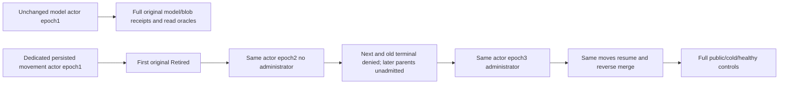

# Fresh persisted movement authority between ordered whole partitions

TASK-KL071-PER-ITEM-AUTHORITY-001: a NEW dedicated persisted movement operator owns all three original move requests, original terminal replay and reverse merge. Root persists its credential/principal on both physical RF3 groups at epoch1/administrator true, removes ONLY its administrator bit at epoch2, then repairs SAME subject/key/credential at epoch3. Seed/model/blob principal remains untouched at epoch1. No caller-supplied roles, epoch reset, credential replacement, product API or transport change.

AC001: first original partition reaches complete Retired with exact placement/receipt/models; assert actual retained header identifies dedicated operator and zero outstanding grants before epoch2. AC002: next original iterator member and completed first request both return full canonical SDK PermissionDenied before cached success; iterator terminates, second/third parents unadmitted, full scoped model rows/header/pending/last unchanged. AC003: repair epoch3 permits same original unadmitted IDs; first parent historical result stays exact. Dedicated SDK/official MCP/selected SQL callers replay actual parent terminals, changed-original Conflict and Resume results; every response gets current complete original model/receipt success proof through UNCHANGED seed actor. AC004: reverse merge returns all three partitions to original physical owner, preserving independent complete installed/published DTOs, original mixed-model/blob outcomes and healthy post-merge SDK/MCP/SQL operations through original seed identity, with joined native cold controls. Parent terminal and ordinary model outcome epoch laws stay separate: this case does not rotate the model actor or claim ordinary changed-epoch cache qualification.

Native cut resolves principal counters from actual retained operator/grant header; compaction has no fixed seed-principal predicate. No private root/credentials/payload logged. Deliberate persisted policy and startup/applied-clock metadata are distinct from full scoped domain no-effects. Original ParentDeadline, RF3 six owners, same request/MoveIDs and real caller/cleanup contracts remain. Linux/compiler/native/runtime/deadline qualification OPEN; whole arbitrary group creation/all-stage fault/endurance KL071 remains OPEN. R5 excessive32k refusal expansion is held historical, not adopted.

Caller lifetime freeze: the same SDK/HTTP object is retained across the original iterator's yields and joined cold restarts. Only the movement official MCP session is replaced after disposing its original owned session; SDK disposal occurs after the original iterator joins, then all remaining owners join. Each replay response checks the full current SDK/official mixed-model cut for THAT request partition, and complete original three-seed success replay/model oracles and native raw cuts bracket each whole cold stage. No affected partition or model oracle is reduced; unrelated command replay is not multiplied after every other partition's response.
