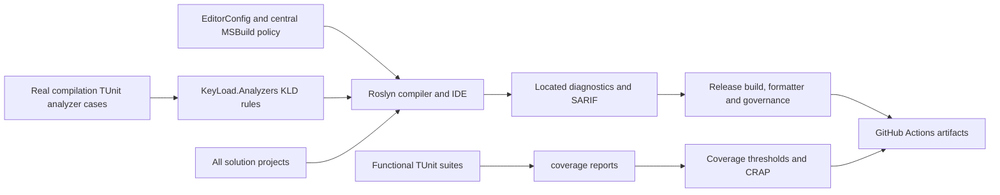

# CodeQuality

CodeQuality is KeyLoad's compile-time and CI quality contract. It makes the
repository's rules executable: one strict build policy for every project,
source-owned Roslyn rules (`KLD*`), numeric maintainability limits, a canonical
formatter gate and a measured, functional-only coverage policy. It has no runtime
entry point, database operation or stored state.

Decision record: [ADR-033](../ADR/ADR-033-code-quality.md). Related decisions:
[ADR-108](../ADR/ADR-108-typed-synchronization.md) (typed synchronization),
[ADR-111](../ADR/ADR-111-magic-runtime-values.md) and
[ADR-113](../ADR/ADR-113-centralized-runtime-options.md) (literals and options),
[ADR-115](../ADR/ADR-115-time-provider.md) (clock access) and
[ADR-117](../ADR/ADR-117-tunit-ci-entry.md) (TUnit entry).

## Scope

In scope: build policy, the formatter, `KeyLoad.Analyzers`, its tests, the numeric
limits, coverage and CRAP rules, retained compiler and coverage reports, and the
Roslynk development tool. Out of scope: product behaviour, public contracts,
persistence, cluster topology and performance claims. Frontend, database/API
contracts and persistence are `N/A` because the slice runs only at build time.

Slice map:

- Analyzer source: `analyzers/KeyLoad.Analyzers/`
- Analyzer tests: `tests/KeyLoad.AnalyzerTests/`
- Shared build policy: `Directory.Build.props`, `Directory.Build.targets`,
  `.editorconfig`, `KeyLoad.slnx`, `global.json`
- Coverage and identity tooling: `scripts/Features/CodeQuality/`,
  `build/CodeQuality/FunctionalCompilationIdentity.targets`
- Product-side coverage tests: `tests/KeyLoad.FunctionalTests/CodeQuality/`
- CI: `.github/workflows/build-and-tests.yml`

## Requirements and acceptance

Test names below exist under `tests/KeyLoad.AnalyzerTests/Cases/`
unless stated otherwise. A criterion with no automated case names its evidence.

| Requirement | Acceptance (pass condition) | Verified by |
|---|---|---|
| REQ-CQ-001: the repository EditorConfig is the source of truth and every project builds with strict SDK/style analysis | AC-CQ-001: `TreatWarningsAsErrors`, `CodeAnalysisTreatWarningsAsErrors`, `EnableNETAnalyzers`, `EnforceCodeStyleInBuild`, all `RunAnalyzers*` switches, `AnalysisLevel=latest-all` and XML documentation are on; the shared build properties configure these policies; every project explicitly references the analyzer, and the analyzer project checks its own compiled source | Debug solution build with `-warnaserror`; Linux CI records delivered-source qualification separately |
| REQ-CQ-002: KeyLoad-owned Roslyn rules are editable and proven by real compilations | AC-CQ-002: compiler cases assert diagnostic ID, severity and exact span for the rules they exercise. AC-CQ-004: nineteen rules have unique enabled IDs and expected severities. Each rule selects its generated-code contract; KLD0038, KLD0039 and KLD0040 analyze generated code. | `DiagnosticContractTests` (`AllRulesHaveUniqueEnabledIdsAndExpectedSeveritiesAsync`) and the existing compiler case folders; focused compiler execution evidence for KLD0038/KLD0039 remains open. |
| REQ-CQ-003: compiler SARIF is retained, including for failed builds | AC-CQ-003: each project writes `artifacts/code-quality/<project>/<configuration>/<framework>/diagnostics.sarif`; CI uploads `code-quality-<os>` even when the build fails, and an upload never turns a failed build green | Workflow review of `Directory.Build.targets` and the `Save build diagnostics` step (explicit review exception) |
| REQ-CQ-004: quality gates are enforced and qualification is stated honestly | AC-CQ-005: no required gate is skipped, disabled or downgraded to pass. AC-CQ-006: documentation and status record source configuration, local checks and exact-source Linux evidence separately. AC-CQ-022: the complete solution passes the strict Release build and `dotnet format --verify-no-changes`; repairs preserve public signatures, persisted bytes, signed identities, cancellation and lifetime rules. AC-CQ-023: every source-bound method with cyclomatic complexity above 20 is reviewed and, where it helps, split along a real responsibility | Governance check `node scripts/Features/RepositoryGovernance/verify.mjs`; review of `docs/implementation/status.json`; Release build and formatter gates (AC-CQ-022) |
| REQ-CQ-006: maintainability limits are executable | AC-CQ-008: KLD0030..KLD0033 accept the boundary and reject one past it (file 400, type 200, executable unit 64 including the 63/64/65 edge, nesting 3). AC-CQ-009: the analyzer module reaches the coverage thresholds below from the analyzer suite | `FileCodeLineCountAnalyzerTests`, `AggregateTypeCodeLineCountAnalyzerTests`, `ExecutableUnitCodeLineCountAnalyzerTests`, `ExecutableUnitSpanAndTriviaAnalyzerTests`, `ControlFlowNestingAnalyzerTests`, `ControlFlowNestingExtendedConstructTests`, `NumericAnalyzerSelfInventoryTests`, `SiteAnalyzerCoverage*Tests` |
| REQ-CQ-008: a pull request replaces its own earlier run and no other run cancels another | AC-CQ-017: the Build and Tests concurrency group is the ref for pull requests (with cancel-in-progress) and the run ID otherwise | Workflow expression review (explicit review exception) |
| REQ-CQ-009: functional coverage is source-bound, measured and used to find real gaps | AC-CQ-018..021 and AC-CQ-039..048 below | coverage tooling tests in `tests/KeyLoad.FunctionalTests/CodeQuality/` and CI coverage jobs |
| REQ-CQ-010: no object or Monitor lock; typed synchronization only | AC-CQ-025: KLD0034 fires on object-typed locks, `Monitor` calls and synchronous locks inside grains. AC-CQ-026: short synchronous shared-service sections use `System.Threading.Lock`; asynchronous exclusion uses cancellable `SemaphoreSlim.WaitAsync` released in `finally`. AC-CQ-027: grain-owned state relies on Orleans turn scheduling, while node-local storage, journal and apply gates stay | `TypedSynchronizationTests`, `GrainSynchronizationTests`, `SynchronizationDelegateTests`; existing functional lifecycle suites for AC-CQ-026/027 |
| REQ-CQ-011: runtime-policy numbers and strings use named identities | AC-CQ-029: KLD0035 reports numeric literals (including zero and one) reaching timeouts, delays and deadlines. AC-CQ-030: KLD0036 reports string literals in comparisons and format tokens. AC-CQ-031: fixtures cover aliases, overloads and generated code. AC-CQ-032: the repository has no unreported finding and every migration keeps exact values, formats and persisted bytes | `MagicRuntime*Tests`, `GeneralRuntime*Tests` |
| REQ-CQ-012: no inline runtime string, numeric or character literals | AC-CQ-033: KLD0035/KLD0036 reject runtime literals outside named `const` declarations, enums and attribute metadata; there is no blanket 0/1/-1 exemption and no suppression baseline | `GeneralRuntimeNumericTests`, `GeneralRuntimeTextTests`, `PersistedPolicyLiteralTests` |
| REQ-CQ-013: operational policy is typed, validated `IOptions<T>` | AC-CQ-034: deadlines, retries, capacities and limits are bound and validated centrally and injected as options. AC-CQ-035: raw `IConfiguration` or environment reads exist only in central binding and composition code. AC-CQ-037: KLD0037 rejects policy hidden behind `const`/`static readonly`, direct configuration reads and options clones that overwrite policy with literals. AC-CQ-038: the Release build reports none of these findings | `TypedConfiguration*Tests`, `TypedOptionsExecutionFlowTests`, `OptionsSnapshot*Tests`, `SerializedOptions*Tests`, `ConditionalPolicyProvenanceTests` |
| REQ-CQ-014: tests execute real operations | AC-CQ-049: functional tests run a real operation and assert its outcome and resulting state; source-text, getter/setter and shape-only tests are removed. AC-CQ-050: active requirements cite no removed source-text tests | `GovernanceWorkingFileTests` (real governance CLI accept/reject flows); repository review (explicit review exception for AC-CQ-050) |
| REQ-CQ-LINUX-RUNNER-001 / AC-CQ-LINUX-RUNNER-001: functional CI runs on explicit Linux runners | Build, analyzer, unit, recovery, Aspire-topology and coverage jobs declare `ubuntu-24.04` and Benchmarks jobs declare `ubuntu-22.04`; a runner label alone proves neither a passing job nor a timing result | Workflow review (explicit review exception) |
| REQ-CQ-EXECUTION-EXCEPTION-001 / AC-CQ-EXECUTION-EXCEPTION-001: exception types keep legitimate constructors | KLD0021 resolves `System.Exception` from the compilation and skips direct and indirect subclasses; a lookalike type and ordinary Orleans DTOs still report the located error | `OrleansContractConstructorTests` |
| REQ-CQ-MULTILINE-BLOCKS-001 | AC-CQ-MULTILINE-BLOCKS-001: executable control-flow, method and lambda braces span lines (Allman) and `IDE0055` is an error. AC-CQ-MULTILINE-BLOCKS-002: the expansion preserves behaviour, so existing whole-operation tests stay green. AC-CQ-MULTILINE-BLOCKS-003: newly compact blocks fail the formatter gate | `dotnet format KeyLoad.slnx --verify-no-changes --no-restore` and the Release build |
| REQ-CQ-ROS-001..003 | AC-CQ-ROS-001..003 below | Tool manifest and MCP session (manual evidence for installation) |
| REQ-CQ-NULL-001: operation outcomes use explicit results | AC-CQ-NULL-001: KLD0040 rejects null return values in statements, expression bodies, local functions, lambdas, async bodies and returned conditional/switch branches, including typed nulls, null-forgiving expressions and null-valued defaults. AC-CQ-NULL-002: resolved nullable external interface, override and API callback contracts are preserved; local contracts, unrelated methods and non-nullable external contracts remain checked. | `NullReturnTests`, `ExternalNullReturnContractTests`; complete solution build remains required |
| REQ-CQ-SIMD-PROFILE-001 / AC-CQ-SIMD-PROFILE-001 | Coverage and qualification run the normal SIMD-enabled profile only; inherited intrinsics-disabling variables are refused and no scalar profile is admitted | coverage tooling tests |

## Build policy

- Local development builds every project in Debug with `-warnaserror`; warnings are errors.
  `TreatWarningsAsErrors` and `CodeAnalysisTreatWarningsAsErrors` stay on.
  Diagnostics are repaired at the source, never silenced, lowered in severity or
  turned off.
- `.editorconfig` is the single source of truth for formatting, naming, style and
  analyzer severity. Nested files need a concrete subtree purpose.
- `dotnet format KeyLoad.slnx --no-restore` applies fixes and
  `dotnet format KeyLoad.slnx --verify-no-changes --no-restore` is the CI gate.
  The formatter loads the Debug analyzer, so CI builds
  `analyzers/KeyLoad.Analyzers` in Debug first. CSharpier is not used.
- Multi-line blocks: `csharp_preserve_single_line_blocks = false`,
  `csharp_new_line_before_open_brace = all` and `IDE0055` at error severity.
  Never compact a block to stay under the 64-line limit; extract a cohesive
  responsibility instead.
- No `packages.lock.json`; package versions are pinned centrally.
- `node scripts/Features/RepositoryGovernance/verify.mjs` is the static
  governance check. It is not a runtime test.

## Analyzer rules

Every project references `KeyLoad.Analyzers` explicitly. The analyzer compiles
against centrally pinned Roslyn NuGet packages, without SDK DLL references. Each rule declares its generated-code contract through
the Roslyn API. Analysis is concurrent and cancellable, and diagnostic IDs are
unique and never reused.

| ID | Meaning | Severity |
|---|---|---|
| KLD0001 | Machine keys (dictionary, JSON, header, query, metadata and configuration keys) come from named constants | Error |
| KLD0013 | `Program.cs` in the server maps endpoints only through the `MapKeyLoadApi` aggregate | Error |
| KLD0014 | Every grain interface declares an explicit positive Orleans `Version` | Error |
| KLD0020 | `Program.cs` shows initialization, mode selection, host composition, run and joined shutdown; a forwarding-only call to an `Application` wrapper is rejected | Error |
| KLD0021 | Orleans DTOs have no instance constructors; `System.Exception` subclasses are exempt | Error |
| KLD0022 | Current time and elapsed time come from `TimeProvider`, not `DateTime`/`DateTimeOffset` clocks, `Stopwatch` or `Environment.TickCount` | Error |
| KLD0023 | Orleans DTOs declare `[GenerateSerializer]` | Error |
| KLD0024 | `catch` clauses declare the caught exception type | Warning, promoted to error by the build |
| KLD0030 | A file has at most 400 code lines | Error |
| KLD0031 | A type (all partial declarations) has at most 200 code lines | Error |
| KLD0032 | An executable unit has at most 64 code lines | Error |
| KLD0033 | Control-flow nesting is at most 3 | Error |
| KLD0034 | No object-typed lock or `Monitor`; grain-owned state uses Orleans scheduling, shared services use `System.Threading.Lock` or `SemaphoreSlim.WaitAsync` | Error |
| KLD0035 | Runtime numeric literals, including zero and one, use named constants or typed options | Error |
| KLD0036 | Runtime strings, characters, interpolation text and format tokens use named identities or `nameof` | Error |
| KLD0037 | Operational policy comes from centrally bound, validated `IOptions<T>`, not from raw configuration reads or constants | Error |
| KLD0038 | Implementation terminology requires explicit owner approval; only narrowly approved runtime, domain and testing meanings are allowed | Error |
| KLD0039 | ZoneTree, ZoneTree.FullTextSearch and ZoneTree.Analytics use public synchronous APIs without thread-pool dispatch | Error |
| KLD0040 | Return explicit `ManagedCode.Communication.Result` / `Result<T>` outcomes instead of null; preserve resolved nullable contracts from another project or API | Error |

Rule fixtures (all under `Cases/`): KLD0001 `LiteralMachineKey/`, KLD0013
`Program/ProgramEndpointMappingTests`, KLD0014 `Grain/GrainInterfaceVersionTests`,
KLD0020 `Program/ProgramCompositionRootTests`, KLD0021 and KLD0023 `Orleans/`,
KLD0022 `SystemClock/`, KLD0024 `UntypedCatch/`, KLD0030..KLD0033 `FileCode/`,
`AggregateType/`, `ExecutableUnit/` and `ControlFlow/`, KLD0034
`TypedSynchronization/`, `Grain/GrainSynchronizationTests` and
`Synchronization/`, KLD0035/KLD0036 `MagicRuntime/` and `GeneralRuntime/`,
KLD0037 `TypedConfiguration/`, `TypedOptions/`, `OptionsSnapshot/`,
`SerializedOptions/` and `ConditionalPolicy/`.
The existing diagnostic inventory includes KLD0038 and KLD0039. Focused compiler
execution evidence for their rejected and permitted cases remains open.

Rule behaviour follows these constraints:

- KLD0040 checks explicit null-valued returns in ordinary and generated source.
  Nullable annotations on locally owned methods do not authorize null outcomes.
  Exceptions require a nullable contract resolved from a referenced assembly:
  an implemented interface member, an overridden method/property, or a callback
  passed directly to an external API parameter. The exception belongs to that
  member or callback and does not extend to nested local functions or unrelated
  methods. Nullable payload fields, arguments, iterator elements and arbitrary
  values returned from other expressions are outside this rule's static scope;
  it does not perform whole-program null-flow analysis.
- Use `nameof` for an existing symbol. Immutable protocol, format and mathematical
  identities use meaningful feature-owned constants. Timeouts, deadlines, retries,
  capacities, buffer sizes and operation limits are options, never per-class
  constants. Serializer field IDs and protocol bytes are not deployment policy.
- A literal or policy value hidden behind a constant, a default parameter, a
  getter or an options clone that overwrites policy is still reported.
- Analyzer execution does not select assemblies by name or exclude test projects.
  Project references belong to each `.csproj`. The analyzer implementation checks
  its own source after compilation. Its owner-approved project-local `NoWarn` setting
  disables only literal rules KLD0035/KLD0036 in the analyzer implementation;
  semantic, structural and SDK rules remain enabled.
- Owner-approved project-local `NoWarn` settings also disable KLD0035/KLD0036/KLD0037
  in the six projects marked `IsTestProject`, including the comparison host.
  Structural limits and SDK diagnostics remain enabled. Runtime projects retain
  all three rules.

Authoring a rule: add a public `[DiagnosticAnalyzer(LanguageNames.CSharp)]` class
under the slice, allocate the next unused `KLD` ID, call
`EnableConcurrentExecution`, set an explicit generated-code policy and register the
narrowest symbol, operation or syntax action. Keep metadata and message tokens in
named constants. Add compiler-valid passing and violating TUnit cases that assert
ID, severity and location, then update the catalog above.

## Maintainability limits

| Limit | Value | Rule |
|---|---|---|
| File | 400 code lines | KLD0030 |
| Type (aggregate) | 200 code lines | KLD0031 |
| Executable unit | 64 code lines | KLD0032 |
| Control-flow nesting | 3 | KLD0033 |

The limits are mandatory and apply to the analyzer project and its tests as well.
An exception is allowed only when the nearest ADR, feature document or local
`AGENTS.md` records its reason, scope and removal plan. Review every method whose
cyclomatic complexity exceeds 20 and extract only coherent responsibilities;
moving branches into helpers without a clearer responsibility is not an
improvement. Preserve evaluation order, short-circuiting, errors and side effects.

## Functional coverage and CRAP

Coverage exists to find untested behaviour, not to reach a number.

- Thresholds: at least 80% line and 70% branch coverage for changed production
  code, at least 90% line coverage with explicit success and failure assertions for
  critical flows and public contracts, and no decrease of repository or module
  coverage without a written exception.
- Only functional tests contribute (AC-CQ-018..021). Load, stress, performance and
  comparison runs never contribute. A complete ordinary suite stays mandatory and a
  coverage selection never qualifies it.
- Coverage is collected through the execution `Microsoft.Testing.Extensions.CodeCoverage`
  / `dotnet-coverage` tool (centrally pinned) while the suites run through the
  TestInfrastructure entry. Original reports, TRX files and tool logs are
  retained and uploaded even after a failure.
- Missing, stale, empty or malformed coverage is unmeasured. It is never reported
  as zero, as a pass, or as a passing CRAP score. Branch coverage is merged only
  when the report identifies each branch outcome; otherwise per-run counts
  are kept and the merged branch value is unmeasured.
- CRAP combines source-mapped cyclomatic complexity with the measured functional
  coverage of the same source and build cohort.
- Module closure review: inspect uncovered locations against the requirement and
  acceptance flows, add complete success, failure and edge operation tests, and
  remeasure the same source. A rejected operation must assert its error and the
  preserved state. No fake provider, trivial accessor test, source exclusion or
  ignored failure can close the gate.
- Until a complete source-bound report exists, product coverage and CRAP are
  reported as unmeasured. Process-kill tests do not support any power-loss
  durability claim.

analyzer coverage (AC-CQ-009): CI prepares a source-bound manifest
(`scripts/Features/CodeQuality/site-analyzer-coverage*`), runs the complete
analyzer suite with the collector, requires exactly one TRX with executed
and passed equal to total, and verifies the Cobertura integers against the
captured source hashes and the thresholds above.

Product functional coverage:

| Acceptance | Contract |
|---|---|
| AC-CQ-018 | Contributors are exact functional cases run through the TestInfrastructure entry with the collector; original DLL/PDB hashes are bound before and after collection and a modified build image is never accepted |
| AC-CQ-019 | Reports give per-module and per-file covered and executable lines, branch counts where available, percentages and uncovered locations; normal/replica duplicates are never summed |
| AC-CQ-020 | A source-controlled inventory classifies every production project; load, stress, performance and comparison cases are excluded; server-process coverage is collected from each `KeyLoad` process of the Aspire-owned topology |
| AC-CQ-021 | Module closure follows the review loop above |
| AC-CQ-039 | A closed inventory (`functional-coverage.product-contributors.json`, `functional-coverage.unit-test-inventory.json`) identifies each admitted case by suite, class, method and instance, its REQ/AC and executed modules; omissions, extras, duplicates, changed source, failed or skipped cases are rejected |
| AC-CQ-040 | Original binary coverage files are retained; merging uses an explicit verified report list with identical module identities and repeated-input invariance; denominators are not summed |
| AC-CQ-041 | Server contribution comes from the real server processes of the Aspire-owned topology; fault and restart cases keep their own evidence and cannot assume a final flush |
| AC-CQ-042 | Collector preparation is an Aspire-owned dependency using the pinned tool and a test-only image built from the already compiled server closure; no global tool, second coverage framework or independent Docker deployment |
| AC-CQ-043 | Each production module has a compiled identity: DLL/PDB hashes, module MVID, PDB debug identity and per-document source checksums |
| AC-CQ-044 | Test images carry the same identity and a compile-input receipt emitted into the assembly by `FunctionalCompilationIdentity.targets`; a later filesystem snapshot cannot vouch for an older compilation |
| AC-CQ-045 | Unit, recovery and Aspire-topology groups are separate inputs; tool and process settlement is bounded and joined; a missing group is an open gate, never an invented report |
| AC-CQ-046 | AppHost owns image materialization, source/tool validation, derived-image proof and cleanup around the real topology callers |
| AC-CQ-047 | Each contributing fixture writes one create-only receipt after its application stops and all collectors settle |
| AC-CQ-048 | Child-process witness acquisition and cleanup use the validated option bounds, signal only the owned child and publish no successful terminal receipt on timeout |

Evidence scope: tests that exercise the tooling itself (for example
`CoverageMergeTests`, `ProductionSourceManifestOperationTests`,
`CoverageImageMaterializationTests`, `CompilationIdentityPackageRootTests`,
`PathMapCompilerTests` and `ProcessEvidenceWholeFlowTests` in
`tests/KeyLoad.FunctionalTests/CodeQuality/Cases/`) are tooling controls. They are
required gates but never product coverage contributors.

## Roslynk semantic tooling, owner direction 2026-10-09

- REQ-CQ-ROS-001 / AC-CQ-ROS-001: Roslynk is a local .NET tool restored from
  `dotnet-tools.json` (the manifest version is authoritative) and started with
  `dotnet tool run roslynk -- stdio`; `.codex/config.toml` supplies the stdio
  command and an isolated loopback daemon port. Verify an actual initialize,
  tools/list and `open_solution` against the absolute `KeyLoad.slnx` path, then
  wait until the whole solution reports Ready. Incomplete loading or an installation
  failure fails the criterion and never becomes a clean report.
- REQ-CQ-ROS-002 / AC-CQ-ROS-002: run `get_diagnostics` with compiler errors,
  warnings and analyzers included. Review located findings, use available code
  fixes, preserve behaviour, Orleans contracts, analyzer severities and unrelated
  checkout changes, and recheck after each repair. Informational and hidden
  suggestions are advisory. When no fix exists, repair the source; do not suppress.
- REQ-CQ-ROS-003 / AC-CQ-ROS-003: preserving repairs still pass the canonical
  formatter and the Release build. Roslynk supplements, and never replaces, the
  formatter, build, TUnit suites and Linux qualification.

## Commands

| Purpose | Command |
|---|---|
| Restore | `dotnet restore KeyLoad.slnx` |
| Build | `dotnet build KeyLoad.slnx --no-restore -warnaserror` |
| Analyzer project (Debug, for the formatter) | `dotnet build analyzers/KeyLoad.Analyzers/KeyLoad.Analyzers.csproj --no-restore --configuration Debug -warnaserror` |
| Format (apply, then verify) | `dotnet format KeyLoad.slnx --no-restore`; `dotnet format KeyLoad.slnx --verify-no-changes --no-restore` |
| Governance | `node scripts/Features/RepositoryGovernance/verify.mjs` |
| Analyzer, unit and recovery suites | `node scripts/Features/TestInfrastructure/run-tests.mjs --KeyLoadTests:Suite=<analyzers\|unit\|recovery> --KeyLoadTests:ReportTrx=true` |
| Replicated-topology suite | `node scripts/Features/TestInfrastructure/run-tests.mjs --KeyLoadTests:Suite=cluster --KeyLoadTests:ReportTrx=true` |
| CI | `gh workflow run build-and-tests.yml --repo managedcode/KeyLoad --ref main` |

Run the build first, then the tests, then the formatter and the final build. A
bounded `--KeyLoadTests:Filter` selects development cases only and cannot qualify a
complete suite.

## Qualification boundary

Source configuration, a local build, an authored test or a document review does
not establish a passing gate. A gate is closed only by the original exact-source
Linux GitHub Actions reports (build, formatter, analyzers, unit, recovery,
Aspire-topology SDK/MCP and coverage). Product coverage and CRAP are unmeasured
until a complete source-bound functional report exists. A failed or blocked
required check keeps the work incomplete.
