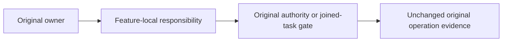

# Clustering and CrashHost responsibility extraction

The multiline CodeQuality limits remain 64 method lines, 200 type lines and 400 file lines. Discovery reply transformation, native discovery payload capture and original ANN configuration become private methods without changing their operation order or cancellation owners. Sample-chunk admission transitions remain subordinate to the original grain's durable state writes. Native cold task joining and retained-owner reopening use feature-local helpers that preserve original tasks, observer failures and cleanup ordering.

The original native snapshot capture remains sequential over the same concrete node list and returns the complete ordered immutable snapshots.

Aliases, serializer field IDs, request identities, deadlines, authorization, read cuts and RF3 authority remain unchanged. Cold owner facts remain consecutive observations, not atomic state or proof of the initiating failure.

AC-CQ-MULTILINE-BLOCKS-001 and AC-CQ-MULTILINE-BLOCKS-002 require the canonical formatter and solution build. Original whole-operation and Linux qualification gates remain required; source extraction and scoped diagnostics alone do not close them.
