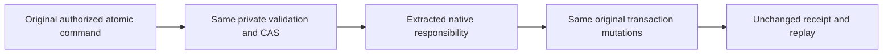

# Messaging and graph native responsibility extraction

REQ-CQ-006 / AC-CQ-008 and AC-CQ-MULTILINE-BLOCKS-001 require the unchanged native 400-file/200-type/64-executable-unit/three-level limits with multiline Allman blocks. The actual Release rows identify SubscriptionGroups file402, ApplyAdvanceQueueTransferRepair method71 and ExecuteRemoteGraphReceive method70. No limit increase, compressed blocks, suppression or qualification claim is permitted.

REQ-CORE-NUMERIC-EXTRACT-001 / AC-CORE-NUMERIC-EXTRACT-001: move exact subscription key encoding responsibility to a feature-local Messaging/Serialization source part, preserving the same private signature, field access, canonical KeySpace encoding and suffix order. Keep every group authorization, generation/window, lease, filter, contiguous checkpoint, inbox/effect/receipt and rollback operation unchanged. REQ-MSG-007/009 and existing Messaging/RemoteTransfers contracts remain authoritative.

REQ-CORE-NUMERIC-EXTRACT-002 / AC-CORE-NUMERIC-EXTRACT-002: extract contiguous cohesive private remote-transfer repair validation or staging statements only after current native producer/dataflow proof. Retain witness authorization, generation CAS, bounded attempt/ceiling state, token validation, transaction owner and exact mutation receipt. The same transaction and caller evaluation/cancellation contract must reach the same original write sequence. No alternate coordinator, authority or persistent/public API is added.

REQ-CORE-NUMERIC-EXTRACT-003 / AC-CORE-NUMERIC-EXTRACT-003: extract cohesive private remote graph receiver validation or staging statements only after current native producer/dataflow proof. REQ-GRAPH-001/002 and existing cross-partition source/destination protocol retain every scope, expiry, prior content/receipt consistency, revision/fingerprint replay refusal and atomic adjacency/receiver receipt operation in original order. No old-syntax fallback, wire or key/serializer format change.

Use native code-actions first for the exact original diagnostics. Whole DatabaseEngine native output was truncated and contained none of the target parts; it is not current source proof. Only complete fresh target members authorize these source hunks. Actual GroupKey52–57, ApplyAdvanceQueueTransferRepair8–78 and ExecuteRemoteGraphReceive11–80 are retained complete. The two private staging helpers remain in their current Commands files, preserving existing imports and namespace binding. Existing full-file afterimages remain UNKNOWN unless a complete authentic native prefix/body image proves them. Normal new-file creation and native existing-only edits are Main-owned after review/admission. The two actual native extract_method checkOnly previews returned applied=N with exact dataflow signatures/calls. Compound existing-source preview, new-method NotFound/new-file admission, build/analyzer/format and existing complete Unit/recovery/SDK/official MCP/RF3 qualification remain OPEN. UI/transport/new public contracts/new libraries: N/A. This extraction changes structure only and claims no speed, fault or historical-cause improvement.
