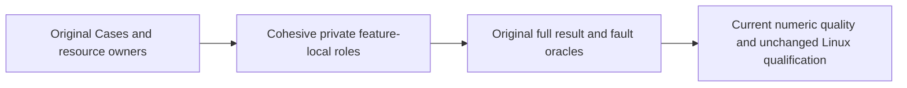

# Integration and recovery responsibility roles

Canonical policy slice: CodeQuality; original test features retain their canonical slices, REQ/AC and unchanged Cases. [REQ-CQ-006 / AC-CQ-008](../CodeQuality.md), [ADR-033](../../ADR/ADR-033-code-quality.md), [ADR-117](../../ADR/ADR-117-native-tunit-ci-entry.md) and [ADR-125](../../ADR/ADR-125-connection-owned-execution.md) govern this preserving extraction.

REQ-TEST-ROLE-001 / AC-TEST-ROLE-001: Integration responsibilities outside ClusterRouting and the Recovery materializer lifecycle fixture must meet original method64/type200/file400 limits through cohesive private assertion, schema, continuation, input or lifecycle helpers. Preserve every Test/Args/UID declaration, sample/request order, real SDK/MCP/process/Aspire provider, complete result/row/privacy/error oracles and existing returned task/ref-state semantics. No new Case mirrors the implementation and no limits, suppression, provider, profile or public API change is permitted.

REQ-TEST-ROLE-002 / AC-TEST-ROLE-002: preserve original gates, authority, cancellation/deadlines, original task joins, initiating and cleanup error order, synchronous callback sampling, genuine fault/cold cycles and physical resource ownership. Pure helpers own no new resource or clock; extracted continuations run inside the original caller scopes. Original namespace/type identity remains unchanged.

The existing Integration whole-operation cases and real Recovery process lifecycle cases are the regression matrix. Current numeric analyzer/formatter/build and exact-source Linux suites remain required; source review and numeric estimates do not qualify runtime, durability, power-loss, endurance or performance. The shared ClusterFixture still owns its original startup/client/shutdown sequence. Frontend, new public contracts and topology changes are N/A because this scope reorganizes existing test responsibilities only.

