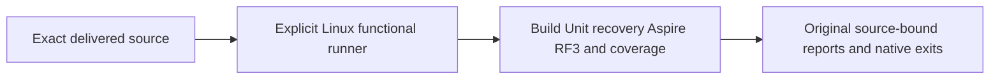

# Linux functional runner identity

[ADR-117](../../ADR/ADR-117-native-tunit-ci-entry.md) owns the native TUnit entry.
REQ-CQ-LINUX-RUNNER-001 / AC-CQ-LINUX-RUNNER-001 retain explicit ubuntu-24.04
functional jobs, unchanged full build, analyzer, Unit, process-recovery, Aspire RF3,
coverage, permissions and original source-bound reports. A runner label does not
prove a passing job, a timing improvement or application readiness.

The owner removed the separate native-clock prerequisite on2026-10-15. Functional
CI has no native clock probe, generated libc tuple or clock-specific manual job.
The ordinary Linux gates and native Orleans/ZoneTree operation tests remain required.

