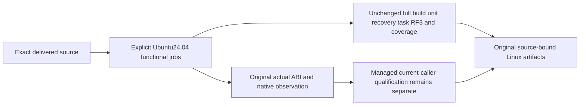

# Linux functional runner identity

Applicable decisions: [ADR-117](../../ADR/ADR-117-native-tunit-ci-entry.md) owns the native TUnit/fixture entry; [ADR-133](../../ADR/ADR-133-node-owned-kernel-clock-phase.md) owns the original ABI and native-clock boundary.

REQ-CQ-LINUX-RUNNER-001: all existing Build and Tests jobs use the explicit `ubuntu-24.04` runner label. The existing native-clock prerequisite already executes there. Ordinary repository, analyzer, full-solution, task and RF3 jobs retain every command, condition, matrix task, timeout, permission, coverage threshold and native TUnit/Aspire resource boundary. Benchmark, Website and Release workflows are outside this change.

AC-CQ-LINUX-RUNNER-001: repository governance and the original dispatched workflow must retain all mandatory jobs and execute on the selected label. Source/YAML review is not execution. The existing successful [native-clock job](https://github.com/managedcode/KeyLoad/actions/runs/38741693654/job/116444759955) provides genuine host/runtime C ABI and bounded read-only observations for the previous exact source; it does not qualify a later managed provider or other jobs.

AC-CQ-LINUX-RUNNER-002: runtime ABI admission still checks the actually loaded native image and its verified tuple. A runner label is neither an immutable VM image nor authority to accept another libc, architecture or native clock state. Reproduce the original prerequisite when the effective platform changes; never invent a tuple or weaken the fail-closed provider.

The original queued job116444760732 reports label `ubuntu-latest`, runner_id0 and no steps; the separate explicit24.04 prerequisite completed. That is an observed scheduling difference, not proof of an outage or the queue's root cause. This pin makes the intended host baseline explicit. Faster dispatch is unproven until original post-change jobs execute; no queued job is cancelled or reported as passing.

