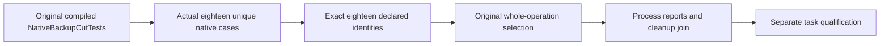

# Exact native backup-cut case admission

TASK-CQ-KL042-CASE-ADMISSION-001 refines the existing CodeQuality exact native case-union gate: an implemented operation is qualified only by its declared original cases and authentic execution. Canonical owner is CodeQuality; this is an inventory correction, not a database/restore or SQL capability change.

REQ-CQ-KL042-ADMISSION-001 / AC-CQ-KL042-ADMISSION-001: the KL-042 unit-native-backup-cut-tests selection must declare precisely the original compiled NativeBackupCutTests case union. Exact7a53cead discovery has eighteen unique native UIDs; the unchanged contract declares sixteen cases and omits only UnsafeNativeBackupDestinationRefusesBeforeCopyThenSamePathRepairRestoresAcrossTwoCold(False/True). Add those two exact existing Boolean instances without changing the original sixteen entries, wildcard, scripts, test declarations, command identities, oracles or bounds. The strict missing/duplicate/outside-union rejection remains mandatory.

REQ-CQ-KL042-ADMISSION-002 / AC-CQ-KL042-ADMISSION-002: qualify the complete original selection only after fresh discovery matches all eighteen identities and the original child process/readers/disposal and native reports join. Both omitted cases passed in the same exact7a53 Unit artifact; that historical result explains declaration availability, but does not retrospectively convert failed task admission into executed task qualification or waive the other failed KL-042 flows.

Slice map: scripts/Features/CodeQuality/task-acceptance.contract.json; existing tests/KeyLoad.UnitTests/Features/BackupRestore/Cases/NativeBackupCutTests.cs remains unchanged. Automated acceptance is the existing strict native task-admission runner and original full NativeBackupCutTests operation class. Product/backend/API/frontend/storage/provider changes: N/A; no new declaration, syntax, topology, library or deadline. Existing ADR-033 and ADR-117 govern evidence and TUnit execution. Compiler/native check-only/source integration/current task rerun/Linux qualification remain OPEN; retained original task failure is immutable.
