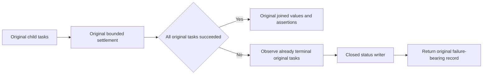

# Original native child settlement

REQ-CQ-009 / TASK-CQ-NATIVE-STDOUT-009 maps to AC-CQ-044/045 and the existing AcCq044CanceledNativeChildJoinsActualExitAndReadersBeforeDisposalAndRootDeletion Case.

REQ-CQ-CHILD-SETTLEMENT-001: Preserve original exit, readiness, stdout and stderr tasks and every failure before the existing failed-task projection produces an empty joined string. Do not replace the genuine PowerShell child, reset the caller deadline or change output allowances.

AC-CQ-CHILD-SETTLEMENT-001: Healthy settlement returns the same exact marker/newline and all original complete-output, cancellation-identity, native-exit, disposal and root-deletion assertions. Failed settlement preserves the original returned failure record and observes only already-terminal original tasks, retains reference-distinct failures in their existing order and emits one closed status row before returning the original failure-bearing joined record. It does not await an unsettled task without the original owner bound.

REQ-CQ-CHILD-SETTLEMENT-002: Diagnostic output contains only completed/succeeded/faulted/canceled booleans and exception counts. It contains no paths, IDs, credentials, exception text or child output. The actual writer task is observed by the existing ServerFailureObserver.

AC-CQ-CHILD-SETTLEMENT-002: The existing Case and strict marker/stdout/stderr/task/cleanup assertions remain unchanged. Qualification must run that exact Case, healthy prefix-bound controls and original failure/cleanup controls. No new Case, timeout, delay or retry is introduced.

The authenticated 319c CI reported an empty joined stdout after its exact readiness assertion. Current native source proves that unsuccessful stdout tasks are replaced by empty strings. Historical live task states and the asynchronous fault cause were not captured; neither a child-output cause nor a timing cause is claimed. Native admission, compilation and current Linux runtime qualification remain open. Product/frontend/API surfaces are N/A: this is existing test-tooling settlement ownership.
