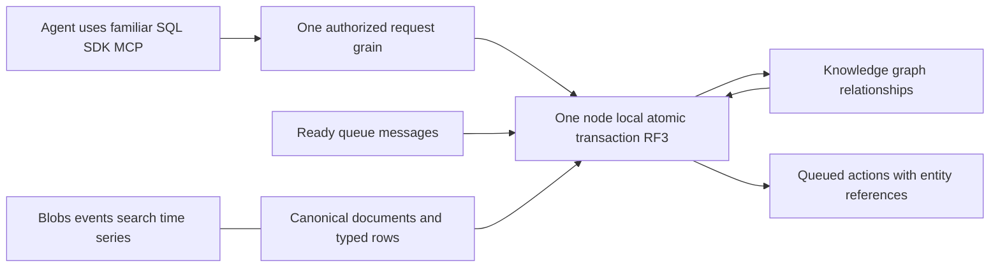
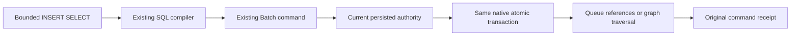

# DatabaseComposition

KeyLoad is one database for AI agents. Documents, typed tables, graphs, blobs,
queues, events, vectors/search and time series coexist and reference one another.
Tables, collections and queues are logical resources inside that database. SQL is
the familiar shared language for reading and combining them and writing results.
The central product flow is queue -> linked entities -> knowledge graph, and the
reverse graph -> queued actions, inside one authorized bounded database request.

Status: bounded procedural source implemented; exact-source GitHub qualification
and full declarative SQL remain pending. Owner direction 2026-10-03.
[ADR-067](../ADR/ADR-067-composable-agent-database.md) fixes the first executable
stage. Full declarative SQL across every model remains required under
[QueryExecution](QueryExecution.md)/ADR-065. This is not independent model stores
joined by a client-side workflow.

| Requirement | Acceptance | Task / automated or manual evidence |
|---|---|---|
| REQ-COMP-001: one database and canonical cross-model identity, SQL central | AC-COMP-001/007 | TASK-COMP-001/003/004; product content tests, native serialization, lead review |
| REQ-COMP-002: queue-to-entity-to-graph server derivation | AC-COMP-002/004 | TASK-COMP-002/004; real ZoneTree + actual SQL SDK/MCP RF3 |
| REQ-COMP-003: graph-to-queue server derivation | AC-COMP-003/004 | TASK-COMP-002/004; real ZoneTree + actual SQL SDK/MCP RF3 |
| REQ-COMP-004: persisted source/target/row/field authorization and stable retries | AC-COMP-005/007 | TASK-COMP-002/004; real policy, replay and scope errors |
| REQ-COMP-005: bounded deterministic same-partition atomic execution | AC-COMP-004/006 | TASK-COMP-002/004; cumulative limits, late rollback, real reopen, real process-kill atomic recovery and identical replica commands |
| REQ-COMP-006: honest syntax, qualification, performance and publication | AC-COMP-001/008 | TASK-COMP-003/005; content tests, integrated checks and exact-source Actions receipts |
| REQ-COMP-007: README and landing present one AI-native product thesis | AC-COMP-009 | TASK-COMP-008 (ADR-067 stage 8); SiteProductThesisTests and lead prose review |

Canonical slice map: Abstractions/Core/UnitTests/IntegrationTests/RecoveryTests/CrashHost
`Features/DatabaseComposition/`; shared Mutation/ApplyMutations/authorization joins
remain genuine shared primitives. Existing QueryExecution SQL CALL, ClientApi SDK
CommitAsync and MCP catalog need no alternate executor. Frontend product copy
lives in the existing BenchmarkComparisons landing entry (global presentation
join); no composition editor is delivered (N/A: API-first stage). Client DTOs are
the shared Abstractions contracts; separate client facade N/A because CommitAsync
already carries these typed mutations. Storage N/A for a new engine: every derived
effect uses existing node-local ZoneTree/native WAL, atomic and RF3 journals.

QueueToGraph and GraphToQueue expand to ordinary UpsertEdge and EnqueueMessage
effects inside the ordered existing transaction. The source payload is a
QueueGraphLink with canonical EntityRef endpoints. Source queue messages remain
Ready; projection does not receive or ACK. Source/target field grants are checked
before copying. Hidden graph neighbors follow existing traversal rules. Derived
IDs are deterministic; overflow, malformed/missing/foreign entities, protected
fields or collision fail all effects. No cross-partition/global snapshot or blob
mutation batching is implied. The acceptance below defines exact states, caps, errors, rollout, rollback and
test mapping; ADR-067 owns ordered implementation and agent join gates.

Qualification requires build, TUnit normal/scalar, real process recovery and
Docker/Aspire RF3 via .NET and official MCP. Local development results remain local;
no performance acceleration, power-loss or production-readiness claim is inferred.

## Source stage acceptance contract

In scope: requirements/ADR/product copy; QueueToGraph and GraphToQueue typed
mutations; existing CommandRequest, SQL CALL, SDK and MCP; real ZoneTree and RF3
tests. Out of scope of this stage: arbitrary SQL joins, PostgreSQL transport,
cross-partition atomicity, queue lease/ACK changes, blob lifecycle batching,
storage/replication format replacement and fabricated performance/publication.

Actors: persisted authenticated agent/admin; public canonical command through
HTTP/.NET/official MCP or SQL envelope. No supplied trusted roles. Orleans keeps
one request grain; physical hosts retain ZoneTree/native WAL and RF3 ownership.

| ID | Pass / fail conditions | Tests / review |
|---|---|---|
| AC-COMP-001 | Rules, ADR, feature, architecture, design, README and site lead with coexistence, canonical links, familiar SQL and both directions; distinguish current stage from complete SQL | SiteDatabaseCompositionTests + lead full doc diff review; prose review is the explicit manual exception |
| AC-COMP-002 | QueueToGraph reads all live Ready messages within the supplied cap at the committed evaluated time; resolves visible same-partition canonical From/To; writes graph edges with deterministic prefix+message IDs; never leases/ACKs/sweeps | real-ZoneTree queue projection/empty/scheduled/expired/overflow/malformed/hidden/missing/cross-partition cases |
| AC-COMP-003 | GraphToQueue uses authorized bounded traversal on the transaction view; enqueues one canonical QueueGraphLink payload per visible edge with deterministic prefix+edge IDs; no hidden attributes/endpoints escape | real-ZoneTree reverse/hidden/permission/field/budget/collision tests |
| AC-COMP-004 | Ordered mixed mutations read prior staged writes; expanded effects, indexes/adjacency, queue counters, outbox and receipt share one commit; any error resets every domain effect | mixed batch success and late-error rollback tests, real store reopen |
| AC-COMP-005 | Each source/target/resource/row/field authority is checked against persisted policy; unchanged-ID replay returns same receipt without duplicate effects; changed payload conflicts; current permission/field revocation denies replay | real principals/field policy/receipt/duplicate cases |
| AC-COMP-006 | One cumulative read-byte budget and expanded MaxBatchMutations bound cover entire batch; overflow rejects all, never truncates silently; reads materialize before writes; replicated derivation uses deterministic bounds without local wall deadlines/cancellation | byte/count/multiple-composition/exact-cap/replica-determinism cases; code review of callbacks and apply clock |
| AC-COMP-007 | Native DTOs have stable aliases/IDs; public polymorphic JSON preserves old shapes; SQL canonical CALL needs no second gateway/operation kind; fresh request routing remains | serializer roundtrip + frozen pre-composition native writer fixtures + SQL compiler + actual RF3 .NET/official MCP forward/reverse/retry/error tests |
| AC-COMP-008 | Build/formatter/governance and relevant TUnit tests pass; exact-source Actions full normal/scalar/recovery/RF3 remain separately recorded, website publication requires existing complete Benchmarks pipeline | retained source/SHA/commands/reports in implementation receipt; no numeric coverage claim without collector |
| AC-COMP-009 | README and landing both state the same theses: KeyLoad is an AI-native database; agents shouldn't need a dozen databases; why we think one database is the future; why .NET, Orleans and ZoneTree. Neither surface claims production readiness. README theses are its section headings and lead sentence, not navigation links; landing theses are visible `<main>` copy, not metadata. Fail if either surface drops a thesis or matches the forbidden-claims pattern | SiteProductThesisTests (README headings, landing main copy, forbidden claims on both, all-missing and one-missing cases); prose and SEO review is the explicit manual exception |

Frozen DTOs: QueueGraphLink(From EntityRef, To EntityRef, Label string,
AttributesJson string = "{}"); QueueToGraph(Graph string, Queue string,
EdgeIdPrefix string, MaxMessages int = 100) : Mutation(Graph);
GraphToQueueMutation(Queue string, Graph string, Start EntityRef, MessageIdPrefix string,
MaxDepth int = 3, MaxVertices int = 1000, MaxEdges int = 100) : Mutation(Queue).
Bounds come from named constants plus configured limits. Queue payload must
strictly deserialize as QueueGraphLink with visible, authorized required fields.
Projection requires all source payload raw-read/raw-use grants and target writes,
including headers for derived enqueue; denial fails the whole command. This first
stage copies an authorized link, not arbitrary document content. Graph traversal
preserves its existing hidden-neighbor omission behavior.

Expansion yields existing UpsertEdge/EnqueueMessage mutations, so receipts and
outbox describe actual effects. Zero selected edges/messages produces no effects.
Source-ready overflow (including expired entries examined) rejects with
BudgetExceeded. Stable command IDs replay the original outcome; a new ID with
colliding derived edge/message IDs rejects (edge ExpectedRevision=0). All resources
must share catalog transaction domain and exact PartitionRef; other scopes reject.
Commands execute deterministic apply, using one frozen monotonic read-budget clock;
public admission/cancellation semantics remain unchanged. New DTOs are additive;
homogeneous binary rollout is required before issuing new types to old nodes.
Rollback removes new producers/advertisement, not committed primitive data.

Reviewed authority refinement: successful composing outcomes retain bounded native
canonical endpoint references (plus explicit reverse starts) privately in the same
StoredOutcome transaction, optional appended field ID5. Internal MutationReceipt
field ID4 retains refs only for explicitly expanded primitive effects and is
ignored in public JSON. This supports later delete/update effects without reading
final target records or guessing effect origins from ID prefixes. Stable replay reauthorizes
those saved rows and source/target grants without reading source selections again.
Missing authority for a composing outcome fails closed. No public JSON authority
field and no trusted caller input. Tests must change RowAccess with unchanged
principal and verify denied retry, and change source data then verify identical
original receipt/no extra effects. GraphToQueueMutation is the pre-delivery C# type
name refinement required by CA1711; discriminator/alias/semantics stay unchanged.

Initial entry boundary: only standalone CommandRequest batches accept composition.
Handler/subscription/projection inbox Effects reject these types explicitly with
UnsupportedCapability before effects; existing primitive effects remain. Future
lease/ACK composition requires a separate inbox saved-authority replay contract.

## Evidence and remaining delivery gates

The source-stage receipt (report removed from repository)
retains the initial source packet and historical development/Actions results. The
latest integrated receipt (report removed from repository)
records original Linux Actions for `ca7e22d9c201304f0b81f59f3a0ae18e4125be37`:
32/32 composition unit cases, 7/7 composition process-recovery cases and both
SQL/.NET/official MCP RF3 composition cases pass. The complete process-recovery
suite passes 194/194 and genuine Docker/Aspire RF3 passes 67/67. Build, formatter,
governance and analyzers pass. The normal unit suite passes 2573/2576 with three
errors; the complete scalar suite is skipped, so full qualification remains open.
Local development results and process kills do not prove GitHub scalar or
power-loss qualification. Website source is updated; publication waits for the
existing complete Benchmarks/site gates. Full model SQL sources/joins/DML, native
client sessions, distributed composition and comparable performance remain
mandatory future stages.

## TASK-KL095-TOPIC-SQL-COMPOSITION-COLD-001 — actual composition cold/current-grant continuation

REQ-COMP and AC-COMP-004/007 retain the existing same-partition native QueueToGraph/GraphToQueue pipeline, fresh per-mutation persisted permissions, bounded staged source reads and atomic original receipts. AC-COMP-SQL-COLD-001 extends the SAME AC_COMP_007 real RF3 case, preserving AC_COMP_004 late invalid-reference rollback, all original arguments/assertions and the original two-minute caller lifetime. It retains the genuine forward AND reverse command/receipt before disposing clients, performs first same-volume cohort cold, compares complete original documents/graph/queue inspection records and replays both receipts through actual SDK, official MCP and both Q1 routes. A separate configured same-partition graph isolates current GraphWrite refusal for a mixed document+QueueToGraph operation. Exact PermissionDenied/no-value across the actual four routes leaves the marker absent, new graph empty and all original models unchanged. After actual persisted policy restoration, replay of the FAILED original command stays failed; a distinct command commits its actual marker plus two graph edges, full receipt/model checks hold, then a second same-volume cold and fresh credential session replay all original and healthy receipts.

Native authority remains unchanged: QueueInspect+GraphWrite for forward; GraphRead+QueuePublish+DocumentsRead for reverse, plus existing source field use/raw read and target write policies. No native provider, signing, activation, schema, dispatcher, source ACK/claim, quotas, clock, timeout, retries or distributed transaction is added. New purpose roles are CompositionSqlColdState/Capture/Assertions/Authority/Trial. Capturing actual public records does not replace independent literal edge/link checks already in the original case. Shared source snapshots and client cleanup reuse original owners/failure ledgers; narrow shared RF3 scheduling stays unchanged and Unit50 remains mandatory.

See QueryExecution TASK-KL095-TOPIC-SQL-COMPOSITION-COLD-001 for TopicEvents=2 using the same native cut, payload/header policy and public cold contracts. Root must compose its exact append with the earlier pending-DLQ SQL guard documents once, preserving both bodies. Source-only authored stage: coherent build, native typed UID discovery and delivered-source Linux normal/scalar/process/RF3 qualification remain OPEN. Declarative queue↔entity model JOIN/DML and full SQL/client-wire conformance remain explicitly unsupported/pending; existing procedural CALL composition is not relabelled as full SQL.

### TASK-KL095-TOPIC-SQL-COMPOSITION-COLD-001 — current Phase2/PendingDeadLetter source rebase

This finite successor preserves the original R1 source contract, all eight Topic query fields and unchanged source/position/generation, current Query+TopicsRead field privacy, original raw/result/cancel budgets, same-generation purge, four actual Unit declarations, four original RF3 route arguments and existing complete CALL composition/cold cases. Preserve the current PendingDeadLetter SQL documentation and Phase2 pending/parked/order/current capability semantics; Topic is a pure existing event-source reader, not a new queue decoder or a replacement query inventory. All original public aliases/field IDs/operation IDs and SQL/Q1 version declarations remain exact; TopicEvents appends after Events/QueueMessages, and full SQL/JOIN/DML/client-wire gates remain OPEN.

Native API preflight establishes SourceHead/SourceRecord in the same DatabaseEngine partial and SourceEventReader's exact Topic source+position validation; IKeyValueView.ReadOwnedValue is an instance member, while StorageRecords.GetRecord is the existing KeyLoad.Storage extension. SqlRf3Protocol belongs to KeyLoad.IntegrationTests.Features.QueryExecution, and original request/AST/event/data/row/permission constructors retain their current shapes. Correct the private composition tuple to global::KeyLoad.GraphTraversal so the sibling GraphTraversal namespace cannot capture the type; materialize the original direct-or-Q1 official MCP request into an explicitly bounded object before generic CallAsync<T>, preserving the exact DTO value and official Arguments serializer. No API/signing/transport/schema/lifetime behavior is changed by these compile-intent corrections.

Root alone joins, builds/analyzes, discovers native identities and executes current-source Linux normal/scalar plus real process and Aspire RF3. Focused canonical selections after coherent build are scripts/Features/TestInfrastructure/run-tests.mjs with Suite=unit or unit-scalar and Filter=/*/*/(TopicSqlNativeTests|TopicSqlNativeRecoveryTests)/*, and Suite=rf3 with Filter=/*/*/(TopicSqlRf3Tests|DatabaseCompositionRf3Tests)/*. Preserve native50 ordinary and existing exclusive RF3 fixture groups, original deadlines, every original required suite and exact source/DLL/PDB/runtime/cleanup artifacts. Declarations/arguments/previews are not native UIDs, compiler success or PASS.

## TASK-KL091-DOCUMENT-CAS-COLD-001 — same original failed command after cold

REQ-MSG-005/AC-MSG-005, REQ-DSTORE-004/006 and AC-DSTORE-004/006 retain the existing native transaction/process gates and the SAME QueueProducerAtomicRf3Tests false/true Args, original deadline, signed authorization, grants, response-cancellation flow and two cold cycles. Original producer17 already covers triad success, event precondition, queue quota/duplicate/domain refusal, complete original and fresh healthy receipt/model/cold operations. This additive test-only edge closes the missing public document-CAS precondition replay: stage a genuinely new event first, then PutDocument of the original existing document with independent ExpectedRevision0; require RevisionConflict before the remaining queue effect. No product/API/schema/persisted IDs or quota change.

Retain the SAME actual CommandRequest and complete original safe five-field Problem. SDK, official MCP and both Q1 routes must return null success body and exactly that semantic Problem before and after first real same-root RF3 cold restart. Each rejection is immediately followed by full four-route original document/event/head/message/scheduled-image equality, refused document/message absence, empty refused stream with independent head0/first1/generation1, then the original full receipt replay and unchanged images. Problem JSON comparison preserves every field/value/null and never compares volatile outer execution IDs. MCP output must omit private credential/payload. Native physical read cuts remain current per real request, not falsely invariant across replicated failure metadata.

Original policy epoch demotion/repair, historical receipt refusal, actual fresh healthy event sequence2 (proving failed event sequence/dedup was rolled back), original ready/scheduled counters, ACK and second same-root cold continuation remain intact. No invented failure, wait, fallback, polling, retry or longer timeout. Ordered integration: this appendix and ADR024/DatabaseComposition source map; two feature-local helper/assertion owners plus the existing Trial and named fixture literal; native previews and guarded join; canonical compiler/analyzers/formatter, original Unit normal/scalar and genuine process cases, full current-image Docker SDK/official MCP/Q1 two Args. Source/native preview does not qualify runtime UID or acceptance; root retains full exact-source/image/PDB/discovery and cleanup gates. Rollback removes only this additive test/doc edge with exact guards, never stored data or product behavior.

## KL095 bounded declarative model insertion — source proposal

REQ-KL095-DML-001 / AC-KL095-DML-001: Add a closed parameterized INSERT…SELECT model-composition grammar to existing SqlOperationCompiler. Forward: `INSERT INTO GRAPH_EDGES(@graph, @prefix) SELECT LINKS FROM QUEUE_MESSAGES(@queue) LIMIT @limit WITH COMMAND @command`. Reverse: `INSERT INTO QUEUE_MESSAGES(@queue, @prefix) SELECT LINKS FROM GRAPH_TRAVERSE(@graph, @start, @depth, @vertices, @edges) WITH COMMAND @command`. Every argument is an explicitly bound JSON parameter, including the original nonempty caller command ID. No generated command identity. Exact bound parameter census; no extra/duplicate placeholders. Existing SQL text/token/depth/parameter/byte/cancellation admission applies unchanged. INSERT accepts only envelope1/dialect1, no cursor/full-scan flag, and no trailing statements.

REQ-KL095-DML-002 / AC-KL095-DML-002: Lower directly to the existing single CommandRequest containing QueueToGraph or GraphToQueueMutation and existing DocumentsCommit descriptor. Preserve native payload encoding, stable identity, persisted current authorization, same atomic transaction/read cut, cumulative observed reads/bytes, expanded mutation cap, lookahead refusal, unknown-write behavior and ordered apply. No new dispatcher, persisted alias/field, schema, policy authority or provider. Same-ID CALL/SDK/MCP replay must return the original complete receipt; changed body remains Conflict under existing authority precedence.

REQ-KL095-DML-003 / AC-KL095-DML-003: A new public whole flow seeds two literal typed rows and one canonical link, refuses malformed/trailing/missing bound input without model effects, executes forward through real SDK and reverse through official MCP, checks complete independent literal references/payload/Ready state/no lease/zero attempts and single mutation receipts, then replays through both surfaces and the original typed SDK API. Reuse actual CompositionSqlColdTrial for both same-root cold cuts, persisted authority revocation/repair and healthy continuation. Existing method declarations and all original CALL cases remain unchanged. New native UID is pending real discovery; source proposal is not runtime qualification.

TASK-KL095-DML-001 maps to QueryExecution, DatabaseComposition and ADR054/067. Reserve only SqlOperationCompiler structural insertion plus the three named new feature-local helper paths and a dedicated DeclarativeCompositionRf3Tests case (original DatabaseCompositionRf3Tests remains untouched). Canonical docs append proposals precede implementation; no Main writes or build/test allowed in this freeze.

This is a bounded KeyLoad model DML extension, not general relational INSERT/JOIN/DML. QueueToGraph validates both endpoint entities and rejects missing or hidden references; it is NOT INNER JOIN row exclusion. Full queue/document/table/graph declarative JOIN remains OPEN and requires a distinct authorized plan with defined endpoint-miss behavior. Existing Q2 join and broader SQL/client-protocol gates remain unchanged. Required Linux/SDK/MCP/source-image tests remain OPEN.

The dedicated `DeclarativeCompositionRf3Tests.AcKl095DeclarativeInsertRefusesMalformedInputThenReplaysBothModelsAcrossColdAuthorityRepair` declaration is proposed, not discovered or executed. Original CALL cases remain unchanged. It preserves SDK/official MCP/refusal/replay/conflict and reuses original same-root two-cold authority/healthy continuation, then independently replays both INSERT statements after cold. Compiler/native50/SIMD/Linux/RF3 and new UID qualification remain OPEN. Required deterministic cancellation/point+range budget refusal coverage must be verified in the owning operation cohort; existing cancellation gates are preserved and no new result claim is made.

# KL095 controlled cancellation and native lookahead successor

REQ-KL095-DML-004 / AC-KL095-DML-004: Preserve the actual native cancellation boundary. An already-cancelled SDK caller token before SendAsync returns the existing complete UnknownWriteOutcome Problem, with the original safe write-response detail. Fresh authorized full source/target observations prove no effects. The exact same original nonempty command ID then succeeds under the ordinary SQL request and retains the complete receipt through SDK/MCP/typed replay and both genuine cold cuts. This is pre-send caller cancellation, NOT proof of cancellation during traversal/replicated apply. Core composition expansion intentionally constructs its deterministic ReadExecutionBudget without caller cancellation; never mutate that invariant or add a test product callback.

REQ-KL095-DML-005 / AC-KL095-DML-005: Configure two distinct fixture-owned resources using existing current SDK commands, seed exactly two genuine ready links from the literal typed rows, and execute INSERT with MaxMessages1. Native charged range lookahead refuses BudgetExceeded through SDK and official MCP. Keep the SAME failed command and verify exact replay. Every failure must leave complete source message records/payload/state/attempts/lease and empty target graph unchanged. A NEW explicit caller command with MaxMessages2 produces exactly two edges with independently literal sorted IDs, references, label, attributes and revision1, while preserving both full original messages. It is a changed-body command, not generic random retry authority or cap widening.

REQ-KL095-DML-006 / AC-KL095-DML-006: Add only a feature-local test cold owner helper. Reuse actual ModelSqlRf3Cold, original CompositionSqlColdAuthority/Assertions, and fixture-owned RequestCqrsRf3Callers. The helper observes complete main-model and budget-model state, original SQL and typed receipt replay, and retained failed command refusal AFTER EACH of the two original same-volume cold cuts. Every original CALL method and CompositionSqlColdTrial remains untouched. No clock, timeout, quota, health, provider, persisted DTO/alias or dispatcher change. Authenticated SDK/MCP/real Aspire/native50/SIMD/Linux/compiler/UID gates remain OPEN until executed. Source is a conditional successor to immutable READY9, not a passed operation.

## KL095 read-only typed SELECT composition boundary

REQ-KL095-SELECT-001..003 map to QueryExecution and ADR118. The next finite SELECT slice reuses the existing authorized bounded two-typed-table INNER JOIN, adding complete native safe LEFT predicates with literals and bound parameters and existing source-qualified projection. It performs no writes or client-side join. New raw-byte/no-effects, current predicate field Use, redaction, native work/refusal, original receipt and two cold whole-operation oracles are declared in SqlLeftFilteredJoinTests and LeftFilteredJoinRf3Tests. The typed endpoint atomic queue-to-graph INSERT proposal and broad queue/document/graph SELECT JOIN remain distinct OPEN scopes; no full SQL claim follows. Current-source compiler, real native UIDs, SDK/official MCP/RF3 and Linux artifacts remain required.

## TASK-KL095-TYPED-ENDPOINT-JOIN-001 — atomic typed endpoint selection

REQ-KL095-TYPED-ENDPOINT-JOIN-001 / AC-KL095-TYPED-ENDPOINT-JOIN-001: A closed SQL Q2 INSERT selects canonical queue links, INNER JOINs two declared distinct typed collections by canonical same-partition Text primary-key identity, and writes derived graph edges in the original authorized atomic transaction. Missing, deleted or row-denied endpoint records omit only that pair. Both actual endpoint probes are charged; malformed link or stored identity mismatch refuses the transaction. Declared collection existence, typed schema, current DocumentsRead and primary-key Use authority are mandatory even for an empty queue. No queue ACK, lease, body, order or counter mutation occurs.

REQ-KL095-TYPED-ENDPOINT-JOIN-002 / AC-KL095-TYPED-ENDPOINT-JOIN-002: QueueToGraph keeps alias keyload.contract.queue-to-graph.v1, Resource/Graph and Ids0..3, appending nullable FromCollection Id4 and ToCollection Id5. Both null preserve ordinary required-visible-endpoint behavior and exact existing JSON/payload fingerprint through JsonIgnore(WhenWritingNull); one-null/empty/equal declarations refuse. This is an additive unpublished current-format typed record layout, with no migration, legacy reader, new mutation discriminator or provider. Same transaction read budget charges source scans/lookahead, catalog/field authorization and every endpoint attempt, including missing/hidden rows. Scoped grants complete only after their original leases exit. Ordinary nonjoin byte/source-count semantics remain unchanged.

REQ-KL095-TYPED-ENDPOINT-JOIN-003 / AC-KL095-TYPED-ENDPOINT-JOIN-003: Current authorization precedes native stored outcome lookup. Successful replay uses only original selected references through a charged native read view, validates the original principal epoch/current resources, returns the original complete receipt, and never rescans queue sources. Failed outcomes remain failed; explicit new caller commands are required for repaired work. Resource-policy CAS revoke/repair preserves the same principal epoch and cannot rewrite retained outcomes. Changed body remains Conflict under original authorization order.

The one new whole RF3 method TypedEndpointJoinRf3Tests.AcKl095TypedEndpointInnerJoinRefusesPolicyAndPartialFailureThenReplaysLiteralModelsAcrossTwoColdCuts maps all three criteria: genuine SDK/official MCP; literal matched/missing/row-hidden corpus plus empty selection; denied primary-key Use -> actual resource CAS repair -> same-ID original failed Problem; new exact one-edge/zero-edge receipts; one-null/unconfigured declaration, charged lookahead, changed-body and late mixed atomic rollback with full model no-effects; current PK revoke/repair; newly inserted missing endpoint proves old replay has no rescan while an explicit new command produces two literal edges; a genuine wrong-declared-endpoint message is appended after the empty receipt, the original zero-effect ID replays without rescan while a new explicit ID retains Validation/no-effects; complete SDK/official MCP graph parity accompanies every snapshot; both genuine same-volume cold cuts retain original receipts/problems and full source/target observations. RequestCqrsRf3Callers owns and joins every original client; ModelSqlRf3Cold owns the unchanged RF3 restart. New UID/compiler/runtime/Linux evidence remain pending. Existing CALL and COMPLETE12 declarations stay unchanged.

The finite syntax and implementation are mapped in QueryExecution and ADR-067. Scheduled/expired/deleted endpoint and arbitrary cross-model JOIN projections remain separate required edge/full-language qualification; this source case does not claim those additional runtime gates or full SQL/client protocol compatibility.

## Canonical queue-reference SELECT composition

REQ-KL095-QUEUE-SELECT-001..003 / AC-KL095-QUEUE-SELECT-001..003 (canonical detailed contract in QueryExecution) add the finite Q2.QueueEntityRefJoin.v1 read composition. Queue metadata/body and a full canonical EntityRef select a declared typed document inside one native read view; raw payload ids cannot substitute for partition/collection authority. SDK Query, unified SQL and official MCP lower to the same authorized bounded QueryEngine/ModelQueryExecutor path. No mutation, ACK, retry id, stored outcome or authority restamping is introduced by SELECT.

The complete Unit and public cases named in QueryExecution prove denied/malformed/missing-resource no effects, current persisted resource/field/row authority, masked and literal projected rows, a genuine missing target repair and unchanged original command replay, all clients joined before both native cold cuts. Scheduled/terminal/dead-letter source edge qualification remains governed by existing native model-view acceptance and is not claimed from the ready-only corpus. Arbitrary cross-model JOIN/DML and full SQL/protocol qualification remain OPEN.

KL095 Q2.EventEntityRefJoin.v1 extends the one-database composition to retained events resolving their full canonical EntityRef into declared typed documents. Exact REQ/AC-KL095-EVENT-SELECT-001..003 and original whole Unit/RF3/cold mapping live in QueryExecution.md. EventStreams readers/history/authority remain native; no full SQL or RF3 qualification follows from authored source.

## R28 saved canonical composition receipt authority

REQ-COMP-001/004/005 and AC-COMP-005 also require the actual retained DocumentRecord.Reference to match every saved canonical endpoint when returning an ordinary forward or reverse successful receipt. Preserve the existing saved-reference validation, fresh persisted resource/row authorization and charged VisibleVertex probe before the identity comparison. A partition, collection or id mismatch detected by the original VisibleVertex probe refuses with Corruption and the fixed canonical graph vertex consistency detail before the later composition identity comparison. Preserve the distinct TypedJoinRecordMismatch contract for initial typed endpoint/retained JSON primary-key validation. Replay never rescans current queue or graph sources and cannot replace the historical receipt.

Implemented no-Args native member: KeyLoad.UnitTests.Features.DatabaseComposition.DatabaseCompositionReplayTests.AcComp005SavedCanonicalEndpointFaultRefusesReplayAndOutcomeThenRepairsAcrossTwoColdOwners. Six genuine ZoneTree whole flows first commit actual SQL CALL-lowered forward and reverse operations with independent full receipts, private canonical references and literal model values. A raw retained endpoint fault then makes both original-GUID Apply and ResolveOutcome refuse; each call preserves complete ordered raw image, position and identity. Two dirty same-directory cold owners repeat the original refusals. Exact fault-owned bytes repair the record, restoring both unchanged original successful receipts. A distinct next GUID commits a literal continuation document plus reverse Ready message, followed by two healthy cold owners checking all three original receipts, seed receipt and complete literal models. Original operations, deadlines, budgets and public API remain unchanged. Inner ServerFailureObserver captures the operation failure before the using owner exits; outer Observer captures one Dispose failure and joins the complete ledger.

The source guard and whole-operation regression are implemented; fresh native discovery and execution remain pending. No native UID, test pass, Linux/RF3 or delivery qualification is claimed.

## R28 canonical retained QueueToGraph authority

Ordinary QueueToGraph retains the actual observed Ready-index key in a bounded owned byte array, preserving the existing original VisitRange lookahead, charged key/value reads and configured maximum messages. After the original eligible metadata/body reads and existing closed id/state checks, call the existing native RequireQueueReadyAuthority(lane, id, actualKey, metadata, body). An observed index key that disagrees with metadata.ReadySequence refuses with the existing RecoveryRequired/StaleDecision contract. Original numeric authority checks of this same native helper also apply; no duplicate authority implementation, extra scan/probe, queue eligibility change, Messaging edits, timeout, budget, public API or serializer change.

After the original ordinary endpoint VisibleVertex probes, compare both returned DocumentRecord.Reference values against the requested full canonical link.From/link.To. Preserve both original persisted resource/row authorization checks and charged probes before the identity guard. Partition, collection or id mismatch detected by the original VisibleVertex probe refuses with Corruption and the exact canonical graph vertex consistency detail. The later comparison cannot replace that initiating refusal; initial typed endpoint and retained JSON primary-key guards retain their separate TypedJoinRecordMismatch detail. Typed endpoint join and GraphTraversal remain unchanged.

Both failures are excluded by existing ExecuteAndBuildOutcome from stored failures. Same original command GUID re-refuses while dirty, without any committed image, physical cut or store identity change. There is no newly persisted failure or permanently poisoned GUID after repair. Exact fault-owned original native bytes repair the retained source. A distinct next GUID commits the independent literal marker plus graph edge; complete original documents and source queue inspection remain correct, and the full original seed/healthy receipts replay across two genuine healthy same-directory cold owners.

Implemented no-Args member: KeyLoad.UnitTests.Features.DatabaseComposition.DatabaseCompositionSafetyTests.AcComp002RetainedQueueAndEndpointIdentityRefuseAtomicallyThenRepairAcrossTwoColdOwners. Seven genuine full-operation subflows: both endpoint records × partition/collection/id, plus Ready-index/metadata sequence disagreement. All operations are lowered by the existing SQL CALL keyload_documents_commit compiler; exact command id/kind and complete native CommandRequest image are checked before real DatabaseEngine ordered apply. Each compound command stages a marker before projection, so refusal proves rollback of document/index/outbox as well as graph effects. Every refusal compares the complete ordered raw store image, actual position and identity, absent marker/edge and complete source message. Two dirty cold opens re-refuse the original GUID; exact repair is checked byte for byte; a distinct healthy GUID has independent complete expected document/graph/message/receipt values and private canonical references; two further cold opens retain original seed and healthy complete native receipts and full image/cut. Original case declarations/Args remain unchanged. Every primary and disposal failure is retained through existing ServerFailureObserver.

Source is implemented. Fresh native discovery, compiler, runtime, Linux and RF3 qualification remain required; no full SQL or completed KL095 claim follows from source integration.

## Typed saved canonical endpoint replay identity

REQ-KL095-TYPED-ENDPOINT-JOIN-003 and REQ/AC-COMP-005 require every saved canonical endpoint observed by the typed composition replay read grant to match its actual retained DocumentRecord.Reference. Keep the existing current persisted authority, charged VisibleVertex probe and read grant lease settlement. A retained Reference mismatch already rejected by that probe preserves its data-free Corruption/canonical graph vertex consistency detail; a later comparison never replaces the original refusal. Initial typed retained JSON primary-key validation remains Corruption/TypedJoinRecordMismatch; compare only after that same original probe. No source rescan, changed receipt, schema/alias, public protocol, clock, quota, scheduling or GraphTraversal change.

TypedQueueGraphReplayTests.AcKl095TypedSavedEndpointFaultRefusesOriginalReplayThenRepairsAcrossDirtyAndHealthyColdOwners owns six genuine two-typed-collection PK seeds and canonical SQL CALL-lowered forward receipts, alongside original reverse receipt controls. Independently literal initial records, graph and queue models are checked before partition/collection/id raw faults on each endpoint. Original-GUID Apply and ResolveOutcome must refuse without full ordered native image/position/identity effects; two dirty same-root cold owners preserve refusals, exact raw bytes repair restores full original receipts, a distinct next GUID writes the literal healthy continuation and reverse message, and two fresh healthy cold owners preserve all receipts and models. Reuse the existing full assertion/lifetime helpers without weakening original cases. Source implementation joined. New NoArgs native identity, compiler/Unit/Linux/RF3 execution remain pending; source integration makes no public RF3 or full SQL claim.

## Typed initial retained JSON primary identity

REQ-KL095-TYPED-ENDPOINT-JOIN-001 / AC-KL095-TYPED-ENDPOINT-JOIN-001 and REQ-REL-001/003 require each visible retained typed endpoint's JSON object to contain its declared Text primary key equal to the canonical EntityRef.Id before it participates in a new QueueToGraph edge. Missing/deleted/row-denied endpoints retain existing omission; a malformed, non-object, missing, non-Text or foreign retained primary key refuses the entire original mixed command with existing Corruption/TypedJoinRecordMismatch. Caller write validation and its Validation category remain unchanged. Catch only native JsonException from retained parsing. Use the original owner MaxJsonDepth and dispose the original parsed document.

Carry the exact primary-key names returned by the existing current persisted schema/field-Use authorization into the same typed selection. This private call-local metadata does not create a cache, new authority or API and performs no extra native resource reads. All four existing authorization call sites retain their complete checks; the typed forward selection consumes the returned keys. Preserve both charged endpoint probes, current same-transaction view/cut, shared byte/record grants, limits, cancellation and settled lifetime.

TypedQueueGraphPrimaryIdentityTests.AcKl095TypedRetainedPrimaryJsonRefusesAtomicCompositionThenRepairsOriginalIdAndColdContinuation owns ten independent real retained faults across the two declared typed endpoints. Each fresh native owner seeds literal typed rows and a canonical queue link through the existing SQL CALL compiler. The original mixed marker+QueueToGraph command must refuse twice with complete native image/position/identity and unchanged queue/empty graph; two dirty same-root owners retain refusal, exact original raw bytes repair restores the original GUID's literal full receipt, and two healthy cold owners replay it. A distinct genuine reverse command and next continuation GUID produce complete independent queue/document receipts/models, then two additional healthy cold owners replay all original/continuation receipts. Outer/inner native observers retain both initiating and disposal failures. Source implementation joined. Compiler, native discovery, Unit/Linux/RF3 qualification remain pending; no delivered full SQL claim.

## TASK-KL095-RETAINED-PRIMARY-UNIQUENESS-001

REQ-REL-001/003 and REQ/AC-KL095-TYPED-ENDPOINT-JOIN-001 require exactly one declared Text primary property in each visible retained endpoint JSON object. Canonical typed writes already reject duplicate property names. A foreign first value followed by a canonical last value cannot become a valid retained identity through last-wins JSON lookup. Refuse with existing Corruption/TypedJoinRecordMismatch after the same authorized charged visible probe; preserve omission for missing/deleted/row-denied endpoints, the admitted schema tuple, original read cut, shared limits/bytes, MaxJsonDepth and parsed-document disposal. No additional store/schema probes, public contract or storage-format changes.

TypedQueueGraphPrimaryIdentityTests retains its original declaration and adds independent duplicate-primary literals to the existing real-store full operation flow on both declared endpoint positions. Original mixed marker+forward GUID refusal/no effects, exact raw-byte repair/full receipt, reverse and distinct continuation commands, two dirty cold and subsequent healthy cold owners remain mandatory. Source implemented; the new fault literals require fresh current-source native execution and Linux gates.

## TASK-KL095-TYPED-FORWARD-REVERSE-PUBLIC-001

REQ/AC-KL095-DML-002/003/006 and REQ/AC-KL095-TYPED-ENDPOINT-JOIN-001/003 are joined by the original TypedEndpointJoinRf3Tests.AcKl095TypedEndpointInnerJoinRefusesPolicyAndPartialFailureThenReplaysLiteralModelsAcrossTwoColdCuts. After real SDK declarative forward JOIN across the two distinct typed collections, official MCP executes existing declarative GraphToQueue against that same graph. The existing empty target queue keeps the original forward source census and bounds unchanged. No syntax, dispatcher, product instrumentation or admission allowlist is added.

A separately persisted reverse subject keeps the original forward principal's OwnerId, row/field grants and restricted visibility, but has its own authenticated identifier, credential and policy epoch. The original forward subject and every forward receipt remain unchanged. Both real clients initially refuse the original reverse GUID without model/message effects. Advancing the reverse subject's persisted QueuePublish epoch fences that GUID with PermissionDenied and the exact native policy-changed detail through SDK and official MCP; do not compare its old scope-denial Problem with the later epoch-fence Problem. A distinct GUID commits one independently literal canonical reverse message and complete QuorumProcessDurable receipt. At the same epoch SDK SQL, official MCP SQL and the native command replay that receipt, while changed body remains Conflict. QueuePublish revoke then restore advances the epoch again: the successful original GUID remains fenced, its captured original receipt stays unchanged, and a distinct current-epoch GUID/prefix commits the independently literal second message with ReadySequence2 beside the original ReadySequence1. Both original same-root cold cuts retain the exact fenced Problems, current-epoch full receipt and both complete messages alongside every original forward, rollback, bounds, missing/hidden target and healthy continuation assertion. Cached original GUIDs must not rescan later graph additions. Original caller disposal, fixture-owned Aspire RF3 readiness/shutdown and deadline remain unchanged.

This is integrated source and a public-operation regression, not delivered-source Linux RF3 qualification. Current exact Linux RF3, process/fault/resource/endurance and SQL client-protocol gates remain open; neither source nor local Unit proof claims complete SQL or KL-095 acceptance.

## TASK-KL095-REVERSE-TARGET-QUOTA-PUBLIC-001

REQ-COMP-003/005, AC-COMP-003/004 and REQ/AC-KL095-DML-002/003/006 require the existing declarative reverse to keep all derived enqueue effects atomic when a persisted target stored-message quota is reached. DeclarativeCompositionReverseQuotaRf3Tests.AcKl095ReverseQueueQuotaRefusesAtomicallyThenRepairsAndReplaysLiteralModelsAcrossTwoColdCuts keeps its original declaration and exact two-edge forward corpus. A target WorkQueue has fixed native QueuePolicy.MaxStoredMessages2 and one independently literal pre-existing quota-holder message at ReadySequence1. The second derived enqueue must refuse ResourceExhausted because one holder plus two derived messages exceeds that unchanged bound. Both target IDs remain absent through SDK and official MCP, and the complete holder, source documents/queue/graph and original receipts remain unchanged. The first same-volume cold retains the complete original-GUID failure and all complete models.

Capacity recovery uses authorized SDK Receive and official MCP ACK of that genuine holder. Compare the complete original Receive through both clients while its lease is current, then preserve the captured result and require StaleLease after ACK and through cold restart. Full holder metadata advances Ready1/version1 to Leased/attempt1/version2 and Acked/version3 with no retained body; independently literal enqueue and ACK receipts replay through both clients. The target resource, schema version and every quota stay unchanged under ADR-093: ResourcePolicyUpdates is not a quota mutation API.

The failed original reverse GUID keeps the complete original Problem after capacity release. A distinct GUID succeeds through official MCP with exactly two independently literal canonical messages and the complete QuorumProcessDurable enqueue receipt; SDK SQL, official MCP SQL and the native command replay that same receipt. ReadySequence2/3 independently verifies that the rolled-back staged enqueue did not advance counters beyond the original holder. Complete original documents, source queue/graph, seed and forward receipts remain unchanged. The second same-root cold retains the original refusal, holder/ACK histories, both derived messages and every complete receipt. Original ClusterFixture/keyed RF3 topology, caller-owned clients, native failure/cleanup observers and declared deadline remain mandatory. The original R34 UnsupportedCapability failure remains immutable evidence until this corrected whole flow executes successfully; source preparation is not acceptance.

This integrated public-operation regression adds no product API, SQL syntax, provider, clock, quota bypass or architecture. Native new-file creation was admitted only after fresh NotFound/NotSupported; coherent compiler/native discovery/runtime and exact-source Linux RF3/fault/resource gates remain required. Unit quota evidence and authored RF3 source are not delivered qualification.

The original R33 public quota and typed-policy flows stopped at their failed SDK result oracle. ExecuteSqlAsync returns Result<JsonElement>; its absent failed value is the default JsonElement with ValueKind.Undefined, not a JSON null token. These complete operation flows now assert that exact native absence representation while retaining IsFailed, the exact ResourceExhausted/PermissionDenied code, complete original Problem replay, official MCP dispatched refusal, every no-domain-effect assertion, repair and both cold continuations. This changes no result API, serialization, database policy or original test identity. The original failures remain recorded until the corrected complete flows actually execute; source review is not acceptance.

AC-DC-ORIGINAL-DENIAL-DIAGNOSTIC-001: retain the original TypedEndpointJoinAuthority whole operation and exact PermissionDenied expectation. Attach only the actual public Problem.Detail to the existing native TUnit assertion reason, so a mismatched UnknownWriteOutcome preserves the returned safe diagnostic in the original report. Keep failed/value/no-effect/full-model/MCP/current-policy repair/replay/two-cold assertions and original case identity unchanged. This diagnostic does not repair transport behavior or qualify the unresolved original failure.

## Selected EXEC caller preserves canonical endpoint fault/replay flows

REQ-COMP-001/004/005 and AC-COMP-002/004/005/007 preserve both original canonical QueueGraphIdentityFlow and QueueGraphReplayFlow complete operations. Authenticated Linux source45e855f8 failed before their seed because the helper still sent retired CALL syntax. Use selected ADR130 EXEC keyload_documents_commit @arguments with the same original JsonObject request envelope, command GUID/body, supplied evaluatedAt and private native CommandRequest bytes. Keep full decoded command equality, receipt identities, source/endpoint corruption refusal, no-effects canonical images, exact repair, original retained replay/outcome and both dirty/healthy cold cuts. No second envelope, trusted caller role, duplicate compiler, changed production protocol or changed failure oracle is admitted. Original failure identities remain immutable; compilation/runtime/Linux gates require fresh originals.

## Native model/reference-join column binding correction

REQ-COMP-001/002/004 and AC-COMP-002/004/005/007 preserve original queue/event canonical reference joins and derived projection lineage. Parser source context must keep their LEFT /id or /revision fields as ordinary model/schema columns; document-only SQL continues to use native /@id and /@revision metadata. No model bind validator, stored schema, canonical reference, persisted row/field authority, target grant, read budget, receipt or public AST is widened. The original ComposedProjectionLineage, queue/event reference, source-binding, alias-collision and retained event-integrity whole cases remain unchanged, including refusal→repair→same-ID replay→cold/healthy outcomes. Only a fresh actual original run can qualify this source correction.
