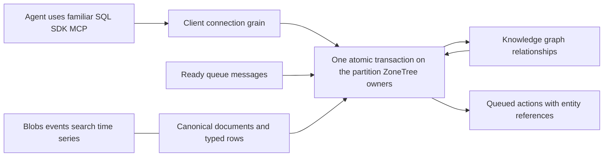

# DatabaseComposition

KeyLoad is one database for AI agents. Documents, typed tables, graphs, blobs,
queues, events, vectors/search and time series coexist and reference one another.
Tables, collections and queues are logical resources inside that database. SQL is
the familiar shared language for reading and combining them and writing results.
The central product flow is queue -> linked entities -> knowledge graph, and the
reverse graph -> queued actions, inside one authorized bounded database request.

| Requirement | Acceptance | Task / automated or manual evidence |
|---|---|---|
| REQ-COMP-001: one database and canonical cross-model identity, SQL central | AC-COMP-001/007 | Product content tests, native serialization, lead review |
| REQ-COMP-002: queue-to-entity-to-graph server derivation | AC-COMP-002/004 | Real ZoneTree + actual SQL SDK/MCP replicated-cluster tests |
| REQ-COMP-003: graph-to-queue server derivation | AC-COMP-003/004 | Real ZoneTree + actual SQL SDK/MCP replicated-cluster tests |
| REQ-COMP-004: persisted source/target/row/field authorization and stable retries | AC-COMP-005/007 | Real policy, replay and scope errors |
| REQ-COMP-005: bounded deterministic same-partition atomic execution | AC-COMP-004/006 | Cumulative limits, late rollback, real reopen, real process-kill atomic recovery and identical replica commands |
| REQ-COMP-006: honest syntax, qualification, performance and publication | AC-COMP-001/008 | Content tests, integrated checks and exact-source Actions receipts |
| REQ-COMP-007: README and landing present one AI-native product thesis | AC-COMP-009 | SiteProductThesisTests and lead prose review |

Canonical slice map: Abstractions/Core/UnitTests/IntegrationTests/RecoveryTests/RecoveryHost
`Features/DatabaseComposition/`; shared Mutation/ApplyMutations/authorization joins
remain genuine shared primitives. Existing QueryExecution SQL CALL, ClientApi SDK
CommitAsync and MCP catalog need no alternate executor. Frontend product copy
lives in the existing BenchmarkComparisons landing entry (global presentation
join); no composition editor is delivered (N/A: API-first stage). Client DTOs are
the shared Abstractions contracts; separate client facade N/A because CommitAsync
already carries these typed mutations. Storage N/A for a new engine: every derived
effect uses existing node-local ZoneTree/native WAL, atomic and cluster journals.

QueueToGraph and GraphToQueue expand to ordinary UpsertEdge and EnqueueMessage
effects inside the ordered existing transaction. The source payload is a
QueueGraphLink with canonical EntityRef endpoints. Source queue messages remain
Ready; projection does not receive or ACK. Source/target field grants are checked
before copying. Hidden graph neighbors follow existing traversal rules. Derived
IDs are deterministic; overflow, malformed/missing/foreign entities, protected
fields or collision fail all effects. No cross-partition/global snapshot or blob
mutation batching is implied. The acceptance below defines exact states, caps, errors, rollout, rollback and
test mapping; ADR-067 owns ordered implementation and agent join gates.

Qualification requires build, TUnit normal/scalar, real process recovery and
Docker/Aspire cluster via .NET and official MCP. Local development results remain local;
no performance acceleration, power-loss or production-readiness claim is inferred.

See [all-model cold-reopen contract](DatabaseComposition/FunctionalDatabaseColdReopen.md) for its requirements, test mapping and qualification boundaries.

## Source stage acceptance contract

In scope: requirements/ADR/product copy; QueueToGraph and GraphToQueue typed
mutations; existing CommandRequest, SQL CALL, SDK and MCP; real ZoneTree and cluster
tests. Out of scope of this stage: arbitrary SQL joins, PostgreSQL transport,
cross-partition atomicity, queue lease/ACK changes, blob lifecycle batching,
storage/replication format replacement and fabricated performance/publication.

Actors: persisted authenticated agent/admin; public canonical command through
HTTP/.NET/official MCP or SQL envelope. No supplied trusted roles. Requests run in the
client's connection grain; the silo-local ZoneTree owners retain ZoneTree/native WAL ownership.

| ID | Pass / fail conditions | Tests / review |
|---|---|---|
| AC-COMP-001 | Rules, ADR, feature, architecture, design, README and site lead with coexistence, canonical links, familiar SQL and both directions; distinguish current stage from complete SQL | SiteDatabaseCompositionTests + lead full doc diff review; prose review is the explicit manual exception |
| AC-COMP-002 | QueueToGraph reads all live Ready messages within the supplied cap at the committed evaluated time; resolves visible same-partition canonical From/To; writes graph edges with deterministic prefix+message IDs; never leases/ACKs/sweeps | real-ZoneTree queue projection/empty/scheduled/expired/overflow/malformed/hidden/missing/cross-partition cases |
| AC-COMP-003 | GraphToQueue uses authorized bounded traversal on the transaction view; enqueues one canonical QueueGraphLink payload per visible edge with deterministic prefix+edge IDs; no hidden attributes/endpoints escape | real-ZoneTree reverse/hidden/permission/field/budget/collision tests |
| AC-COMP-004 | Ordered mixed mutations read prior staged writes; expanded effects, indexes/adjacency, queue counters, outbox and receipt share one commit; any error resets every domain effect | mixed batch success and late-error rollback tests, real store reopen |
| AC-COMP-005 | Each source/target/resource/row/field authority is checked against persisted policy; unchanged-ID replay returns same receipt without duplicate effects; changed payload conflicts; current permission/field revocation denies replay | real principals/field policy/receipt/duplicate cases |
| AC-COMP-006 | One cumulative read-byte budget and expanded MaxBatchMutations bound cover entire batch; overflow rejects all, never truncates silently; reads materialize before writes; replicated derivation uses deterministic bounds without local wall deadlines/cancellation | byte/count/multiple-composition/exact-cap/replica-determinism cases; code review of callbacks and apply clock |
| AC-COMP-007 | Native DTOs have stable aliases/IDs; public polymorphic JSON preserves old shapes; SQL canonical CALL needs no second gateway/operation kind; fresh request routing remains | serializer roundtrip + frozen pre-composition native writer fixtures + SQL compiler + actual cluster .NET/official MCP forward/reverse/retry/error tests |
| AC-COMP-008 | Build/formatter/governance and relevant TUnit tests pass; exact-source Actions full normal/scalar/recovery/cluster remain separately recorded, website publication requires existing complete Benchmarks pipeline | retained source/SHA/commands/reports in implementation receipt; no numeric coverage claim without collector |
| AC-COMP-009 | README and landing both state the same theses: KeyLoad is an AI-native database; agents shouldn't need a dozen databases; why we think one database is the future; why .NET, Orleans and ZoneTree. Neither surface claims production readiness. README theses are its section headings and lead sentence, not navigation links; landing theses are visible `<main>` copy, not metadata. Fail if either surface drops a thesis or matches the forbidden-claims pattern | SiteProductThesisTests (README headings, landing main copy, forbidden claims on both, all-missing and one-missing cases); prose and SEO review is the explicit manual exception |

Frozen DTOs: QueueGraphLink(From EntityRef, To EntityRef, Label string,
AttributesJson string = "{}"); QueueToGraph(Graph string, Queue string,
EdgeIdPrefix string, MaxMessages int = 100) : Mutation(Graph);
GraphToQueueMutation(Queue string, Graph string, Start EntityRef, MessageIdPrefix string,
MaxDepth int = 3, MaxVertices int = 1000, MaxEdges int = 100) : Mutation(Queue).
Bounds come from named constants plus configured limits. Queue payload must
strictly deserialize as QueueGraphLink with visible, authorized required fields.
Projection requires all source payload raw-read/raw-use grants and target writes,
including headers for derived enqueue; denial fails the whole command. This first
stage copies an authorized link, not arbitrary document content. Graph traversal
preserves its existing hidden-neighbor omission behavior.

Reviewed authority refinement: successful composing outcomes retain bounded native
canonical endpoint references (plus explicit reverse starts) privately in the same
StoredOutcome transaction, optional appended field ID5. Internal MutationReceipt
field ID4 retains refs only for explicitly expanded primitive effects and is
ignored in public JSON. This supports later delete/update effects without reading
final target records or guessing effect origins from ID prefixes. Stable replay reauthorizes
those saved rows and source/target grants without reading source selections again.
Missing authority for a composing outcome fails closed. No public JSON authority
field and no trusted caller input. Tests must change RowAccess with unchanged
principal and verify denied retry, and change source data then verify identical
original receipt/no extra effects. GraphToQueueMutation is the pre-delivery C# type
name refinement required by CA1711; discriminator/alias/semantics stay unchanged.

Initial entry boundary: only standalone CommandRequest batches accept composition.
Handler/subscription/projection inbox Effects reject these types explicitly with
UnsupportedCapability before effects; existing primitive effects remain. Future
lease/ACK composition requires a separate inbox saved-authority replay contract.

## Actual composition cold/current-grant continuation

REQ-COMP and AC-COMP-004/007 retain the existing same-partition native QueueToGraph/GraphToQueue pipeline, fresh per-mutation persisted permissions, bounded staged source reads and atomic original receipts. AC-COMP-SQL-COLD-001 extends the SAME AC_COMP_007 real cluster case, preserving AC_COMP_004 late invalid-reference rollback, all original arguments/assertions and the original two-minute caller lifetime. It retains the genuine forward AND reverse command/receipt before disposing clients, performs first same-volume cohort cold, compares complete original documents/graph/queue inspection records and replays both receipts through actual SDK, official MCP and both Q1 routes. A separate configured same-partition graph isolates current GraphWrite refusal for a mixed document+QueueToGraph operation. Exact PermissionDenied/no-value across the actual four routes leaves the marker absent, new graph empty and all original models unchanged. After actual persisted policy restoration, replay of the FAILED original command stays failed; a distinct command commits its actual marker plus two graph edges, full receipt/model checks hold, then a second same-volume cold and fresh credential session replay all original and healthy receipts.

## Same original failed command after cold

REQ-MSG-005/AC-MSG-005, REQ-DSTORE-004/006 and AC-DSTORE-004/006 retain the existing native transaction/process gates and the SAME QueueProducerAtomicClusterTests false/true Args, original deadline, signed authorization, grants, response-cancellation flow and two cold cycles. Original producer17 already covers triad success, event precondition, queue quota/duplicate/domain refusal, complete original and fresh healthy receipt/model/cold operations. This additive test-only edge closes the missing public document-CAS precondition replay: stage a genuinely new event first, then PutDocument of the original existing document with independent ExpectedRevision0; require RevisionConflict before the remaining queue effect. No product/API/schema/persisted IDs or quota change.

## Bounded declarative model insertion — source proposal

REQ-COMP-DML-001 / AC-COMP-DML-001: Add a closed parameterized INSERT…SELECT model-composition grammar to existing SqlOperationCompiler. Forward: `INSERT INTO GRAPH_EDGES(@graph, @prefix) SELECT LINKS FROM QUEUE_MESSAGES(@queue) LIMIT @limit WITH COMMAND @command`. Reverse: `INSERT INTO QUEUE_MESSAGES(@queue, @prefix) SELECT LINKS FROM GRAPH_TRAVERSE(@graph, @start, @depth, @vertices, @edges) WITH COMMAND @command`. Every argument is an explicitly bound JSON parameter, including the original nonempty caller command ID. No generated command identity. Exact bound parameter census; no extra/duplicate placeholders. Existing SQL text/token/depth/parameter/byte/cancellation admission applies unchanged. INSERT accepts only envelope1/dialect1, no cursor/full-scan flag, and no trailing statements.

REQ-COMP-DML-002 / AC-COMP-DML-002: Lower directly to the existing single CommandRequest containing QueueToGraph or GraphToQueueMutation and existing DocumentsCommit descriptor. Preserve native payload encoding, stable identity, persisted current authorization, same atomic transaction/read cut, cumulative observed reads/bytes, expanded mutation cap, lookahead refusal, unknown-write behavior and ordered apply. No new dispatcher, persisted alias/field, schema, policy authority or provider. Same-ID CALL/SDK/MCP replay must return the original complete receipt; changed body remains Conflict under existing authority precedence.

REQ-COMP-DML-003 / AC-COMP-DML-003: A new public whole flow seeds two literal typed rows and one canonical link, refuses malformed/trailing/missing bound input without model effects, executes forward through real SDK and reverse through official MCP, checks complete independent literal references/payload/Ready state/no lease/zero attempts and single mutation receipts, then replays through both surfaces and the original typed SDK API. Reuse actual CompositionSqlColdTrial for both same-root cold cuts, persisted authority revocation/repair and healthy continuation. Existing method declarations and all original CALL cases remain unchanged.

## Controlled cancellation and native lookahead

REQ-COMP-DML-004 / AC-COMP-DML-004: Preserve the actual native cancellation boundary. An already-cancelled SDK caller token before SendAsync returns the existing complete UnknownWriteOutcome Problem, with the original safe write-response detail. Fresh authorized full source/target observations prove no effects. The exact same original nonempty command ID then succeeds under the ordinary SQL request and retains the complete receipt through SDK/MCP/typed replay and both genuine cold cuts. This is pre-send caller cancellation, NOT proof of cancellation during traversal/replicated apply. Core composition expansion intentionally constructs its deterministic ReadExecutionBudget without caller cancellation; never mutate that invariant or add a test product callback.

REQ-COMP-DML-005 / AC-COMP-DML-005: Configure two distinct fixture-owned resources using existing current SDK commands, seed exactly two genuine ready links from the literal typed rows, and execute INSERT with MaxMessages1. Native charged range lookahead refuses BudgetExceeded through SDK and official MCP. Keep the SAME failed command and verify exact replay. Every failure must leave complete source message records/payload/state/attempts/lease and empty target graph unchanged. A NEW explicit caller command with MaxMessages2 produces exactly two edges with independently literal sorted IDs, references, label, attributes and revision1, while preserving both full original messages. It is a changed-body command, not generic random retry authority or cap widening.

REQ-COMP-DML-006 / AC-COMP-DML-006: Add only a feature-local test cold owner helper. Reuse actual ModelSqlClusterCold, original CompositionSqlColdAuthority/Assertions, and fixture-owned RequestCqrsClusterCallers. The helper observes complete main-model and budget-model state, original SQL and typed receipt replay, and retained failed command refusal AFTER EACH of the two original same-volume cold cuts. Every original CALL method and CompositionSqlColdTrial remains untouched. No clock, timeout, quota, health, provider, persisted DTO/alias or dispatcher change.

## Read-only typed SELECT composition boundary

REQ-QUERY-JOIN-FILTER-001..003 map to QueryExecution and ADR118. The next finite SELECT slice reuses the existing authorized bounded two-typed-table INNER JOIN, adding complete native safe LEFT predicates with literals and bound parameters and existing source-qualified projection. It performs no writes or client-side join. New raw-byte/no-effects, current predicate field Use, redaction, native work/refusal, original receipt and two cold whole-operation oracles are declared in SqlLeftFilteredJoinTests and LeftFilteredJoinClusterTests. Current-source compiler, real native UIDs, SDK/official MCP/cluster and Linux artifacts remain required.

## Atomic typed endpoint selection

REQ-COMP-TYPED-ENDPOINT-JOIN-001 / AC-COMP-TYPED-ENDPOINT-JOIN-001: A closed SQL Q2 INSERT selects canonical queue links, INNER JOINs two declared distinct typed collections by canonical same-partition Text primary-key identity, and writes derived graph edges in the original authorized atomic transaction. Missing, deleted or row-denied endpoint records omit only that pair. Both actual endpoint probes are charged; malformed link or stored identity mismatch refuses the transaction. Declared collection existence, typed schema, current DocumentsRead and primary-key Use authority are mandatory even for an empty queue. No queue ACK, lease, body, order or counter mutation occurs.

REQ-COMP-TYPED-ENDPOINT-JOIN-002 / AC-COMP-TYPED-ENDPOINT-JOIN-002: QueueToGraph keeps alias keyload.contract.queue-to-graph.v1, Resource/Graph and Ids0..3, appending nullable FromCollection Id4 and ToCollection Id5. Both null preserve ordinary required-visible-endpoint behavior and exact existing JSON/payload fingerprint through JsonIgnore(WhenWritingNull); one-null/empty/equal declarations refuse. This is an additive unpublished current-format typed record layout, with no migration, legacy reader, new mutation discriminator or provider. Same transaction read budget charges source scans/lookahead, catalog/field authorization and every endpoint attempt, including missing/hidden rows. Scoped grants complete only after their original leases exit. Ordinary nonjoin byte/source-count semantics remain unchanged.

REQ-COMP-TYPED-ENDPOINT-JOIN-003 / AC-COMP-TYPED-ENDPOINT-JOIN-003: Current authorization precedes native stored outcome lookup. Successful replay uses only original selected references through a charged native read view, validates the original principal epoch/current resources, returns the original complete receipt, and never rescans queue sources. Failed outcomes remain failed; explicit new caller commands are required for repaired work. Resource-policy CAS revoke/repair preserves the same principal epoch and cannot rewrite retained outcomes. Changed body remains Conflict under original authorization order.

## Canonical queue-reference SELECT composition

REQ-QUERY-QUEUE-SELECT-001..003 / AC-QUERY-QUEUE-SELECT-001..003 (canonical detailed contract in QueryExecution) add the finite Q2.QueueEntityRefJoin.v1 read composition. Queue metadata/body and a full canonical EntityRef select a declared typed document inside one native read view; raw payload ids cannot substitute for partition/collection authority. SDK Query, unified SQL and official MCP lower to the same authorized bounded QueryEngine/ModelQueryExecutor path. No mutation, ACK, retry id, stored outcome or authority restamping is introduced by SELECT.

## Saved canonical composition receipt authority

REQ-COMP-001/004/005 and AC-COMP-005 also require the actual retained DocumentRecord.Reference to match every saved canonical endpoint when returning an ordinary forward or reverse successful receipt. Preserve the existing saved-reference validation, fresh persisted resource/row authorization and charged VisibleVertex probe before the identity comparison. A partition, collection or id mismatch detected by the original VisibleVertex probe refuses with Corruption and the fixed canonical graph vertex consistency detail before the later composition identity comparison. Preserve the distinct TypedJoinRecordMismatch contract for initial typed endpoint/retained JSON primary-key validation. Replay never rescans current queue or graph sources and cannot replace the historical receipt.

## Typed saved canonical endpoint replay identity

REQ-COMP-TYPED-ENDPOINT-JOIN-003 and REQ/AC-COMP-005 require every saved canonical endpoint observed by the typed composition replay read grant to match its actual retained DocumentRecord.Reference. Keep the existing current persisted authority, charged VisibleVertex probe and read grant lease settlement. A retained Reference mismatch already rejected by that probe preserves its data-free Corruption/canonical graph vertex consistency detail; a later comparison never replaces the original refusal. Initial typed retained JSON primary-key validation remains Corruption/TypedJoinRecordMismatch; compare only after that same original probe. No source rescan, changed receipt, schema/alias, public protocol, clock, quota, scheduling or GraphTraversal change.

## Typed initial retained JSON primary identity

REQ-COMP-TYPED-ENDPOINT-JOIN-001 / AC-COMP-TYPED-ENDPOINT-JOIN-001 and REQ-REL-001/003 require each visible retained typed endpoint's JSON object to contain its declared Text primary key equal to the canonical EntityRef.Id before it participates in a new QueueToGraph edge. Missing/deleted/row-denied endpoints retain existing omission; a malformed, non-object, missing, non-Text or foreign retained primary key refuses the entire original mixed command with existing Corruption/TypedJoinRecordMismatch. Caller write validation and its Validation category remain unchanged. Catch only native JsonException from retained parsing. Use the original owner MaxJsonDepth and dispose the original parsed document.

## Retained primary uniqueness

REQ-REL-001/003 and REQ/AC-COMP-TYPED-ENDPOINT-JOIN-001 require exactly one declared Text primary property in each visible retained endpoint JSON object. Canonical typed writes already reject duplicate property names. A foreign first value followed by a canonical last value cannot become a valid retained identity through last-wins JSON lookup. Refuse with existing Corruption/TypedJoinRecordMismatch after the same authorized charged visible probe; preserve omission for missing/deleted/row-denied endpoints, the admitted schema tuple, original read cut, shared limits/bytes, MaxJsonDepth and parsed-document disposal. No additional store/schema probes, public contract or storage-format changes.

## Typed forward reverse public

REQ/AC-COMP-DML-002/003/006 and REQ/AC-COMP-TYPED-ENDPOINT-JOIN-001/003 are joined by the original TypedEndpointJoinClusterTests.AcTypedEndpointInnerJoinRefusesPolicyAndPartialFailureThenReplaysLiteralModelsAcrossTwoColdCuts. After real SDK declarative forward JOIN across the two distinct typed collections, official MCP executes existing declarative GraphToQueue against that same graph. The existing empty target queue keeps the original forward source census and bounds unchanged. No syntax, dispatcher, product instrumentation or admission allowlist is added.

## Reverse target quota public

REQ-COMP-003/005, AC-COMP-003/004 and REQ/AC-COMP-DML-002/003/006 require the existing declarative reverse to keep all derived enqueue effects atomic when a persisted target stored-message quota is reached. DeclarativeCompositionReverseQuotaClusterTests.AcReverseQueueQuotaRefusesAtomicallyThenRepairsAndReplaysLiteralModelsAcrossTwoColdCuts keeps its original declaration and exact two-edge forward corpus. A target WorkQueue has fixed native QueuePolicy.MaxStoredMessages2 and one independently literal pre-existing quota-holder message at ReadySequence1. The second derived enqueue must refuse ResourceExhausted because one holder plus two derived messages exceeds that unchanged bound. Both target IDs remain absent through SDK and official MCP, and the complete holder, source documents/queue/graph and original receipts remain unchanged.

AC-DC-ORIGINAL-DENIAL-DIAGNOSTIC-001: retain the original TypedEndpointJoinAuthority whole operation and exact PermissionDenied expectation. Attach only the actual public Problem.Detail to the existing native TUnit assertion reason, so a mismatched UnknownWriteOutcome preserves the returned safe diagnostic in the original report. Keep failed/value/no-effect/full-model/MCP/current-policy repair/replay/two-cold assertions and original case identity unchanged. This diagnostic does not repair transport behavior or qualify the unresolved original failure.

## Selected EXEC caller preserves canonical endpoint fault/replay flows

REQ-COMP-001/004/005 and AC-COMP-002/004/005/007 preserve both original canonical QueueGraphIdentityFlow and QueueGraphReplayFlow complete operations. Keep full decoded command equality, receipt identities, source/endpoint corruption refusal, no-effects canonical images, exact repair, original retained replay/outcome and both dirty/healthy cold cuts. No second envelope, trusted caller role, duplicate compiler, changed production protocol or changed failure oracle is admitted.

## Native model/reference-join column binding

REQ-COMP-001/002/004 and AC-COMP-002/004/005/007 preserve original queue/event canonical reference joins and derived projection lineage. Parser source context must keep their LEFT /id or /revision fields as ordinary model/schema columns; document-only SQL continues to use native /@id and /@revision metadata. No model bind validator, stored schema, canonical reference, persisted row/field authority, target grant, read budget, receipt or public AST is widened. The original ComposedProjectionLineage, queue/event reference, source-binding, alias-collision and retained event-integrity whole cases remain unchanged, including refusal→repair→same-ID replay→cold/healthy outcomes. Only a fresh actual original run can qualify this source correction.

## Resource-lifetime identity for composition

A name-only `EntityRef` inside an opaque user-supplied `QueueGraphLink` is an explicit lookup input. Composition resolves it against the authorized, visible row in the operation's transaction view and binds the derived graph endpoint to that collection's actual resource incarnation. An explicitly bound lookup must match that incarnation. Projection does not rewrite the stored source message, the original native command, its GUID, or its fingerprint.

Graph-to-queue output is generated from canonical bound graph endpoints. Its strict JSON envelope permits the current `lifetime.incarnation` field with exactly 64 lowercase hexadecimal characters; malformed, duplicate or unknown properties remain invalid. The existing JSON admission boundary can reject malformed payloads before enqueue. A valid generated bound payload can be consumed by the same forward composition operation without a second parser or a name-only fallback.

Derived native receipt references and retained composition outcome authority contain bound references. Replay checks their binding and current persisted authorization before returning a result; it never converts a missing stored binding into a lookup of the current collection name. Unsupported stored bindings refuse with `FormatUnsupported`, and a changed incarnation refuses with `OwnershipLost`. The reverse traversal's authorized start is retained even when no edge is selected. Capturing that authority uses the same actual catalog view and does not re-read the final row image after a later mutation in the same batch has deleted that row.
