# Optional authoritative-model cold-reopen gate

This gate covers the authoritative database models, original command outcomes,
current persisted authorization and actual native node identities after restart.
User AnalyticsStore event rows remain canonical; each aggregate is derived from
a fresh authorized capture under the current owner.

## Requirements

REQ-DBCOLD-001 defines a separate selected recovery gate after the working
single-instance/cluster pair. It does not change either existing FunctionalDatabaseGateTests
case, their 10,000-success minimum, their three-resource rotation or their current
execution flow. Both optional cases use the existing 30-minute cancellation bound.
Current-source build, complete native TUnit/process recovery, actual Aspire
SDK/MCP execution and exact-source Linux delivery remain separate gates.

REQ-DBCOLD-002 requires the same original Aspire application, physical roots,
container names and verified source/image selection. ContainerRuntimeControl owns
native fault-command kill receipts, exited identities, native Start acceptance,
changed process generation and health settlement. All nodes exit before any starts;
all native starts are accepted before Orleans cluster-readiness waits. Existing joined shutdown,
retained failure evidence and released-storage checks remain mandatory. One replica is
its actual development acknowledgement topology; three replicas are the default replicated cluster.
The native ContainerRuntimeOwnedReceipt scenario namespace is reused unchanged;
no new public, persisted or Orleans serializer alias is introduced.

REQ-DBCOLD-007 requires the explicit cold-only test profile. StartColdAsync passes
both --KeyLoadTests:FunctionalColdReopen=true and the existing
--KeyLoadTests:ContainerFaults=true argument with FunctionalNodeCount exactly 1 or 3.
The owning AppHost validator admits only the exact value true without nested children;
it rejects a cold selection without faults or an admitted functional node count. All
existing ephemeral=true, absolute owned data-root and exclusive-profile restrictions
remain. Ordinary StartAsync selects cold=false and supplies neither argument, so the
existing working single-instance/cluster gates retain their no-fault profiles.

This profile depends on the AppHost's native fault-command registration for the cold profile: the fixture registers the native fault command and the owning validator admits ContainerFaults together with the cold selection. Adding only ContainerFaults, bypassing the validator or invoking Docker directly does not satisfy it.

REQ-DBCOLD-008 extends the existing manual Build and Tests workflow task
functional-gates, preserving the original normal single-instance case then its
original receipt, followed by the normal cluster case then its original receipt. The
same task must next run the six native FunctionalColdReopenProfileTests controls
and four native NativeTUnitSelectionTests controls with strict TRX evaluation and
no skips. It then runs the exact single-instance cold case with a strict native
one-case result and original receipt, followed by the exact cluster cold case and its
receipt. Existing source/executable/image verification, joined cleanup and every
other mandatory suite remain unchanged. No ignored helper, new workflow
or fabricated 10,000-operation cold counter is an execution substitute. Linux CI
runtime qualification remains OPEN until the actual original workflow outcomes.

REQ-DBCOLD-003 provisions three real resources in each advertised model family.
Cold-only persisted writer, reader and tenant-local queue operator identities retain
their original private secrets in memory. All original SDK and official MCP caller
scopes join disposal before kill; new discovered public sessions use those same
credentials after restart. No identity or fixture is replaced and no store is copied.
The cold scenario adds five persisted identities to those same writer, reader and queue operator identities, for exactly eight identities total, under REQ-DBCOLD-005.

| Model family | Actual native request and original retained result |
| --- | --- |
| Documents | PutDocument in CommandRequest, full CommitReceipt, GetDocumentRequest |
| Typed tables | ScriptDOM CREATE TABLE SqlOperationRequest -> complete ResourceDefinition; original INSERT SqlOperationRequest with GUID and parameters -> full CommitReceipt; actual SDK/MCP SELECT -> complete projected rows |
| Event stream sets | AppendEvents; ReadStreamRequest with literal head/data and retained complete EventRecord |
| Work queues | EnqueueMessage; InspectMessageRequest with literal state/payload/header and retained complete metadata |
| Topics | PublishTopic; ReadEventSourceRequest with literal head/data and retained complete SourceEventRecord |
| Graphs | UpsertEdge and TraverseRequest; complete literal edge, canonical endpoints and vertex set |
| Time series | AppendSamples, ReadSamplesRequest and AggregateSamplesRequest; two samples, canonical anchor tags and literal count/sum/extrema/average |
| Blobs | Original BeginBlobUploadRequest, two WriteBlobPartRequest and CompleteBlobUploadRequest envelopes and full result/receipt ledger; complete bytes plus boundary/EOF partial BlobReadRequest oracles |
| Vectors | Authoritative VectorFieldProfile, PutVector and native exact SearchRequest; literal complete ranked document |
| Full text | Native collection text field, PutDocument, WaitForIndexRequest and SearchRequest; original acknowledged minimum, current schema/policy and literal complete ranked document |

REQ-DBCOLD-004 retains original mixed-command GUIDs, actual SQL statements and
parameters, blob stage GUIDs and every complete public receipt. After all-node cold
reopen both public clients replay these exact envelopes and compare complete original
results. Read oracles independently verify full model contents and canonical links.
Variable server-recorded event timestamps/sequences and queue sequence metadata are
validated initially and retained exactly for post-cold comparison. Read cuts may advance;
source heads, complete records, expected contents and minimum acknowledged cuts remain
required. Text freshness uses the original token; exact vector search uses its native
canonical read contract. No ANN consumer/generation is provisioned here, so this gate
makes no approximate-search generation recovery claim.

REQ-DBCOLD-005 requires one fixed eight-identity cold workload: the original
writer, reader and queue operator plus five additional persisted identities. The
queue operator is one of the eight, not a ninth caller. Each identity uses its own
actual owned .NET SDK and official MCP sessions and its unchanged persisted grants.
Before restart, all eight sessions reach one readiness gate before the bounded
`Task.WhenAll` wave releases. The five additional identities write their distinct
existing collection resources and retain complete original receipts; the original
three identities exercise their distinct original model resources, including writer
receipt replay. Typed joins in the concurrent wave are read-only; the existing
mutable constraint checks remain sequential and preserve all original rows.

The wave uses the original test cancellation/deadline. A caller failure cancels
its peers, preserves original and cleanup failures, and joins all eight tasks and
owned client disposals before the original Aspire-owned same-root restart. After
restart, the same eight credentials open fresh owned sessions and complete another
readiness-gated, joined wave of exact original replay and complete model/typed-join
reads before any policy revocation. Every identity must record more than zero actual
successful SDK operations and more than zero actual successful official MCP
operations in each wave, using fresh per-caller counters. The bounded witness records
eight ready callers, eight completed callers, joined ownership and those counters.
The gate and eight tasks establish overlapping owned caller lifetimes; they do not
claim eight physically simultaneous requests or a throughput result.

The original post-cold authorization checks remain mandatory: denied reader writes,
denial of an original writer command after persisted grant revocation, and the
additional identities' original foreign-resource and revoked-command denials. A
persisted grant repair admits a new healthy command; its cross-client replay and
exact reads pass, and every original model baseline is checked again. Existing
scenario selectors, public endpoints, native ABI, topology profiles, lifecycle,
receipts, limits and deadlines remain unchanged. This scope is the current cold
eight-user scenario, not future user Analytics, DROP or broader lifecycle work.
Source alone does not qualify either cold topology, Linux delivery or performance.

REQ-DBCOLD-006 retains the actual per-node SDK and official MCP dashboard checks.
Both clients must observe the same NodeId, incarnation and process instance for
the executing silo. After a genuine cold restart, NodeId/incarnation and silo
name remain stable, the process instance changes, and the canonical position
cannot regress. Native membership must report the fixture's actual active silos;
the configured copy count is an observation, while real command receipts carry
the persisted-copy acknowledgement. Every original authoritative TimeSeries and
AnalyticsStore row, complete model read, command replay, authorization refusal,
healthy-write and joined-cleanup oracle remains mandatory. These current-source
checks require actual execution and do not replace native OpenTelemetry or the
separate Linux qualification gates.

AC-DBCOLD-001 maps to
`FunctionalDatabaseColdReopenTests.SingleInstanceColdReopensAllModelsAndReplaysOriginalPublicCommands`.
AC-DBCOLD-002 maps to
`FunctionalDatabaseColdReopenTests.ThreeNodeColdReopensAllModelsAndReplaysOriginalPublicCommands`.
Each requires its native case PASS without skips, all original receipts, complete
model/read/authentication assertions, cold process receipts and joined cleanup.
AC-DBCOLD-004 maps the existing workflow's fail-closed step/outcome, source/image
and strict TRX bindings to all six native FunctionalColdReopenProfileTests controls,
all four native NativeTUnitSelectionTests controls and the exact two cold methods
named above. A failed, skipped, missing or mismatched original control/case or
receipt cannot qualify its corresponding stage.

AC-DBCOLD-005 maps REQ-DBCOLD-005 to the same two exact
`FunctionalDatabaseColdReopenTests` methods named in AC-DBCOLD-001/002. For each
actual current-source topology result, require native PASS without skips, original
warm and cold witnesses each containing exactly eight ready and completed callers,
all owned callers joined and positive SDK/MCP counters for every caller. Retain the
original same-root restart/process receipts, complete original model and receipt
comparisons, sequential constraint checks, fresh authorization denials/repair,
healthy continuation and joined Aspire shutdown. Missing or failed caller evidence
keeps this criterion open. Local runtime
results remain development evidence; exact-source Linux qualification is separate.

AC-DBCOLD-003 keeps either optional gate open after any original failure, unexpected
effect, missing authoritative record, replay mismatch, invalid fresh analytics report
or unknown cleanup result. A changed analytics public window leaves only that derived
history observation UNQUALIFIED and cannot satisfy a retained-history claim.

Local runtime results remain development evidence; exact-source Linux qualification is separate. Process-kill proof does not establish power-loss durability, production readiness or performance. The cold fixture uses the existing `SqlOperationProtocol.DefaultQueryDialectVersion` (1) for VALUES INSERT; SELECT remains dialect 2.

The owning contracts remain ADR-117 native test entry, ADR-125 connection execution
and ADR-136 silo-local ZoneTree ownership. No new ADR is required for
REQ-DBCOLD-005: it composes the existing owned public caller lifetimes with a fixed
bounded test wave and retains the same native execution, transport trust, storage
ownership and restart contracts. It introduces no product scheduling primitive,
provider, topology, library, resource limit or compatibility fallback.

```mermaid
flowchart LR
    A[Existing Aspire 1 or 3 replicas] --> B[Persist credentials and original model ledgers]
    B --> C[Fixed eight owned SDK MCP callers and complete SQL reads]
    C --> D[Join original caller disposal]
    D --> E[Native kill every original node]
    E --> F[Accept every native Start]
    F --> G[Join health and original runtime receipts]
    G --> H[Same eight credentials joined cold wave and exact replay]
    H --> I[Verify all models and fresh authorization]
    I --> J[Healthy new write and joined shutdown]
```

