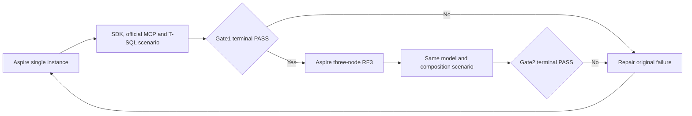

# Working database gates

Owner direction 2026-10-16 replaces the immediate execution order of the 105-task
plan with these two functional gates. The six-hour working window starts at
2026-10-15 22:18 UTC. Existing acceptance statuses and original evidence remain
unchanged. Broad audits, comparative benchmarks, coverage qualification and
unrelated task expansion follow a working database.

The additional [all-model cold-reopen gate](FunctionalDatabaseColdReopen.md) also
passed locally on its separate `57cea624` cohort: one actual node, then all three
RF3 nodes, with original command/SQL/blob replay, persisted authorization and
joined cleanup. Its native results supplement the normal operation gates below;
operation counts and source cohorts are not merged.

## Requirements and acceptance

REQ-DBGATE-001 requires one shared, real-client model scenario on one Aspire
instance followed by the same scenario on three RF3 nodes, with three resources
per supported catalog model, eight workload users, one queue operator and at least 10,000
successful public operations per topology.

- AC-DBGATE-001: the single-instance native TUnit case executes once without
  skips and passes its complete state, authorization and joined-cleanup checks.
- AC-DBGATE-002: the three-node case passes after Gate1 on the same source,
  executable and image-input cohort, including native SQL Queue-to-Graph and
  Graph-to-Queue effects and stable-command SDK/MCP replay.
- AC-DBGATE-003: an original failed operation, wrong result, unauthorized effect
  or failed cleanup keeps the corresponding gate open.

These criteria map to both cases in
[FunctionalDatabaseGateTests](../../../tests/KeyLoad.IntegrationTests/DatabaseComposition/Cases/FunctionalDatabase/FunctionalDatabaseGateTests.cs),
under [ADR-136](../../ADR/ADR-136-native-orleans-partition-ownership.md).
Original local results below retain their original scenario identities; a
scenario or product repair requires a new matched pair.

## Shared operation scenario

The same real .NET SDK and official MCP C# SDK scenario must run first against
one actual KeyLoad instance and then against three actual RF3 nodes. Aspire
AppHost owns each topology, Azure Table Storage membership through local
Azurite, image preparation, readiness, discovered endpoints and joined shutdown.
The one-instance development gate has its actual single-replica acknowledgement
contract; it is not evidence of RF3 durability.

Create three named resources of each supported catalog model: typed relational
tables, documents, event stream sets, work queues, topics, graphs, time-series
sets, blob stores, vector-profile collections and full-text-search collections.
Time-series reads and aggregate operations use the three persisted time-series
sets. Native operational analytics is separate derived node-local history: each
node owns one native analytics engine, observed through the administrator
dashboard. It is not a catalog model or three independent user analytics stores.
Use independent data and canonical entity references between models in one database.
Create eight persisted workload users with writer and reader permissions. A
separate persisted tenant-local operator has the native administrative role and
explicit grants for the three queues, as required for dead-letter redrive.
Verify that ordinary writers cannot redrive and that their refused attempts
leave the parked message unchanged. Do not trust caller-supplied roles or
introduce a separate authentication store.

Each model initializer creates its resources once. Whole-operation exercises
then interleave real SDK, official MCP and native T-SQL operations: create, read,
query, update, link, unlink and delete, with literal expected values, reference
integrity and current persisted authorization assertions. The document initializer
creates `gate_docs_0/anchor` before dependent models initialize. Iteration IDs are
unique across workers; each topology owns fresh storage and credentials.

After the parallel model workers join, a native T-SQL request derives a graph
edge from a ready queue message. A reverse request derives a message in a
second queue from that edge. SDK and official MCP clients replay both stable
commands and verify complete receipts, payloads and links. Both messages are
consumed and acknowledged before the edge and its documents are removed;
the original queue baselines are checked afterward.

Captured search must retain its original-cut movement-authority proof while
other model operations commit. Advancing the live store must neither force an
uncaptured lookup nor publish an old absence proof into the live authority
cache. Ranking uses the bounded captured source; terminal authorization and
ownership are checked again against current persisted state.

The target is at least 10,000 successful caller-visible database operations per
topology, with both SDK and MCP represented. Counts are incremented only after
the original public result reports success; every exercise also verifies its
expected state. This is a functional correctness scenario, not a throughput or
performance claim. A missing model, failed operation, wrong value, unauthorized
effect, unknown cleanup outcome or skipped scenario keeps its gate open.

## Execution and completion

Gate 1 must pass on the genuine single-instance Aspire topology before Gate 2
runs the same scenario on the genuine three-node cluster. Both gates retain
original native TUnit results, source and executable identities, model/operation
counts, actual node membership, failures and resource cleanup evidence. Source
presence, a successful build or successful startup alone cannot pass either gate.

Root owns common context, scenario composition, compiler, execution and commits.
The topology worker owns native one/three-node hosting; the fixture worker owns
test resource lifetime; the identity worker owns real persisted users. Companion
chats own distinct document/SQL/composition, events/queues/blobs and
graph/search/analytics modules. Available workers repair actual gate-blocking
defects while the other modules continue.

## Current local execution evidence

Both corrected native cases passed on commit
`e292c1c1585bc0bc402d3be4f97165ca6b29ac25`:

| Gate | Genuine nodes | Successful SDK operations | Successful MCP operations | Total | Native result |
| --- | --- | --- | --- | --- | --- |
| R477 single instance | 1 | 5,315 | 4,987 | 10,302 | 1 passed, 0 failed, 0 skipped |
| R478 RF3 | 3 | 5,317 | 4,989 | 10,306 | 1 passed, 0 failed, 0 skipped |

Each completed 41 joined waves with the corrected independent resource index,
covering all three event, queue/topic and blob resources. Both retained eight
workload users, one queue operator, actual selected T-SQL composition and full
SDK/MCP result, replay and authorization oracles. Original native cleanup passed
before terminal acceptance. Source, executable and image-input cohort bindings
match exactly; drift is zero. Elapsed owned-runner times were 228.364 seconds
and 385.538 seconds, respectively; these are functional test durations, not
comparable performance measurements.

Original terminal evaluators under `TestResults/stage61-native-join/` are
`root-r477-gate1-terminal-evaluation.original.json`, SHA-256
`d3f05f6737201980432ba493351a0617bd9d0c7622b6239e2c7baa35c5c744c1`,
and `root-r478-gate2-terminal-evaluation.original.json`, SHA-256
`8e4e942842e91440c289e18a806baadd51950e9f606bb47949dbac1499e093dd`.
They bind original TRX, stdout, joined runner, native fixture lifecycle and exact
image identity checks. The complete identities are recorded in
`docs/implementation/status.json`. This local proof does not qualify complete
SQL, DROP, Linux, endurance, power-loss durability or release readiness.

The associated strict full solution build passed with zero warnings/errors;
all 39 selected native whole-operation tests and all three selected recovery
cases passed. The separate real SDK/MCP persisted-authorization RF3 case also
passed through all-three-node same-root cold restart. Production sources and
binaries were unchanged between that cold proof and this corrected pair.

## Previous local execution evidence

Both original native cases passed on commit
`86834e8a68d54c8c749221a373bb38b94b5d8436`:

| Gate | Genuine nodes | Successful SDK operations | Successful MCP operations | Total | Native result |
| --- | --- | --- | --- | --- | --- |
| R456 single instance | 1 | 5,315 | 4,987 | 10,302 | 1 passed, 0 failed, 0 skipped |
| R457 RF3 | 3 | 5,317 | 4,989 | 10,306 | 1 passed, 0 failed, 0 skipped |

Both executions completed 41 waves, eight persisted workload users, one queue
operator and three resources per model. The selected T-SQL QueueToGraph and
GraphToQueue operations, cross-client replay and cleanup are included. The
terminal evaluators accepted original TRX, joined caller/Aspire ownership,
released storage and exact image identity checks. Source and executable drift
were zero in both runs; the complete source, executable and image-input cohort
bindings match between gates.

The original local evaluators are retained under
`TestResults/stage61-native-join/`: R456 SHA-256
`9b9633b26aff5e784df4bcd4504b4866a22b222078f06ba94dc08d5c6a856961`
and R457 SHA-256
`23be0aa36526661a65ea53622d2c07c322547e797b1f633cb0ac9be81b3125af`.
These local artifacts are ignored outputs; this is not a claim of published
GitHub or full-product qualification. Detailed original report and cohort
identities are recorded in `docs/implementation/status.json`.

The subsequent strict R465 build passed with zero warnings/errors. R466 passed
all nine selected native whole-operation cases, including both purposes in all
four new deadline flows; R467 passed all three selected process/native recovery
cases. At that historical R465/R466 checkpoint, the default fixture correction
changed one nullable-key expression only; product and public functional-test
source remained unchanged from the recorded local pair. The later resource-index
correction below changed the functional scenario; its fresh matched R477/R478
pair now passes as recorded above. R466 collected production coverage for its
nine cases only, not a full-product coverage result.

## Resource rotation correction

Source inspection found that the wave scheduler and iteration-based resource
selection correlate: `model = (wave + worker) % 9` and
`iteration = 4 * wave + worker` imply `iteration % 3 = model % 3`.
Consequently, repeated event-stream exercises select resource 0, queue/topic
exercises select resource 1, and blob exercises select resource 2. All three
resources are configured and initialized, but the remaining resources do not
receive those complete repeated operation flows in the original scenario. The
source correction passes a separate resource index to these operation flows and
requires at least 27 complete waves before the successful-operation threshold can
end execution. In the unchanged four-worker schedule this schedules four full
visits to each model/resource combination. A failed original visit still fails
the gate; scheduled visits do not increment successful-operation counters. The
corrected scenario passed the fresh matched R477/R478 gate pair above. Original
recorded PASS reports and operation counts remain historical facts with their
narrower scenario; the corrected pair supplies all-three-resource lifecycle proof.

## Historical repair evidence

R446 passed the earlier one-node scenario with 10,258 operations. R447 failed
its original RF3 scenario after 2,332 operations: SDK queue inspection and MCP
blob metadata returned OwnershipLost. Subsequent successes do not alter that
failed original report. R456/R457 qualify the corrected, extended scenario;
the prior reports remain separate historical evidence.

R441's captured full-text scope error was repaired, with eight related
whole-operation cases passing R450. The later coordinator deadline and bounded
quorum repair preserves fresh majority confirmation, original cancellation,
write uncertainty and configured operation bounds. Exact original R447 runtime
branch attribution remains limited to its retained evidence.

The gate deletes data, rows, blobs and edges. `DROP TABLE` and resource catalog
deletion remain open SQLC-DDL requirements. Selected T-SQL and cross-model
references do not qualify complete unified SQL, cross-partition or failover
behavior. Original task acceptance remains 20 done and 85 in progress; full
Linux, fault/endurance, security, coverage, performance and release gates remain
separate. Neither local gate declares production readiness.
