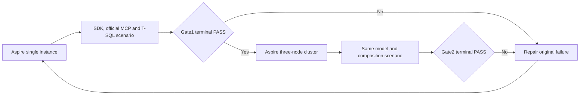

# Working database gates

These two functional gates are the immediate execution order. Broad audits, comparative benchmarks, coverage qualification and unrelated task expansion follow a working database. The additional [all-model cold-reopen gate](FunctionalDatabaseColdReopen.md) runs on one actual node, then on all three replicated-cluster nodes, with original command/SQL/blob replay, persisted authorization and joined cleanup; its operation counts and source cohorts are not merged with the gates below.

## Requirements and acceptance

REQ-DBGATE-001 requires one shared, real-client model scenario on one Aspire
instance followed by the same scenario on three cluster nodes, with three resources
per supported catalog model, eight workload users, one queue operator and at least 10,000
successful public operations per topology.

- AC-DBGATE-001: the single-instance TUnit case executes once without
  skips and passes its complete state, authorization and joined-cleanup checks.
- AC-DBGATE-002: the three-node case passes after Gate1 on the same source,
  executable and image-input cohort, including SQL Queue-to-Graph and
  Graph-to-Queue effects and stable-command SDK/MCP replay.
- AC-DBGATE-003: an original failed operation, wrong result, unauthorized effect
  or failed cleanup keeps the corresponding gate open.

These criteria map to both cases in
[FunctionalDatabaseGateTests](../../../tests/KeyLoad.ClusterTests/DatabaseComposition/Cases/FunctionalDatabase/FunctionalDatabaseGateTests.cs),
under [ADR-136](../../ADR/ADR-136-orleans-partition-ownership.md).
Original local results below retain their original scenario identities; a
scenario or product repair requires a new matched pair.

## Shared operation scenario

The same real .NET SDK and official MCP C# SDK scenario must run first against
one actual KeyLoad instance and then against three actual cluster nodes. Aspire
AppHost owns each topology, private RapidMembership endpoints and a shared
secret, readiness, discovered endpoints and joined shutdown.
The one-instance development gate has its actual single-replica acknowledgement
contract; it is not evidence of cluster durability.

Create three named resources of each supported catalog model: typed relational
tables, documents, event stream sets, work queues, topics, graphs, time-series
sets, blob stores, vector-profile collections, full-text-search collections and
AnalyticsStore resources.
Time-series reads and aggregate operations use the three persisted time-series
sets. User analytics uses three independent canonical AnalyticsStore resources,
with each bounded aggregate built from currently authorized event rows.
The complete contract remains [AnalyticsStore](../AnalyticsStore.md).
Use independent data and canonical entity references between models in one database.
Create eight persisted workload users with writer and reader permissions. A
separate persisted tenant-local operator has the administrative role and
explicit grants for the three queues, as required for dead-letter redrive.
Verify that ordinary writers cannot redrive and that their refused attempts
leave the parked message unchanged. Do not trust caller-supplied roles or
introduce a separate authentication store.

Each model initializer creates its resources once. Whole-operation exercises
then interleave real SDK, official MCP and T-SQL operations: create, read,
query, update, link, unlink and delete, with literal expected values, reference
integrity and current persisted authorization assertions. The document initializer
creates `gate_docs_0/anchor` before dependent models initialize. Iteration IDs are
unique across workers; each topology owns fresh storage and credentials.

After the parallel model workers join, a T-SQL request derives a graph
edge from a ready queue message. A reverse request derives a message in a
second queue from that edge. SDK and official MCP clients replay both stable
commands and verify complete receipts, payloads and links. Both messages are
consumed and acknowledged before the edge and its documents are removed;
the original queue baselines are checked afterward.

Captured search must retain its original-cut proof while
other model operations commit. Advancing the live store must neither force an
uncaptured lookup nor publish an old absence proof into the live authority
cache. Ranking uses the bounded captured source; terminal authorization and
ownership are checked again against current persisted state.

The target is at least 10,000 successful caller-visible database operations per
topology, with both SDK and MCP represented. Counts are incremented only after
the original public result reports success; every exercise also verifies its
expected state. This is a functional correctness scenario, not a throughput or
performance claim. A missing model, failed operation, wrong value, unauthorized
effect, unknown cleanup outcome or skipped scenario keeps its gate open.

## Execution and completion

Gate 1 must pass on the genuine single-instance Aspire topology before Gate 2
runs the same scenario on the genuine three-node cluster. Both gates retain
original TUnit results, source and executable identities, model/operation
counts, actual node count, failures and resource cleanup evidence. Source
presence, a successful build or successful startup alone cannot pass either gate.

## Resource rotation

The wave scheduler and iteration-based resource selection must not correlate (`model = (wave + worker) % 9` and `iteration = 4 * wave + worker` would imply `iteration % 3 = model % 3`). The scenario therefore passes a separate resource index to the operation flows and requires at least 27 complete waves before the successful-operation threshold can end execution. In the four-worker schedule this gives four full visits to each model/resource combination, so all three event, queue/topic and blob resources receive complete repeated operation flows. A failed visit still fails the gate; scheduled visits do not increment successful-operation counters.
