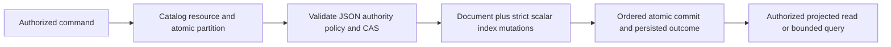

# DocumentStorage

## Exact caller-owned document text (REQ/AC-DSTORE-008)

REQ-DSTORE-008 retains the exact validated `PutDocument.Json` text in the native
canonical document record: Unicode, escapes, property order, whitespace and
decimal spelling remain caller-owned. Validation still enforces the same byte,
depth, object-root, duplicate-member and decimal-range rules. Reuse the existing
CanonicalJsonWriter validation walk with a discard sink rather than materializing
rewritten canonical text. `JsonData.Validate` and every frozen canonical
fingerprint/golden digest remain unchanged. Patch produces its existing validated
derived document; redacted reads still use the existing persisted field policy.
There is no promise of original text for a redacted or patched result.

AC-DSTORE-008 maps to `DocumentExactContentTests`: real TestDatabase/ZoneTree Put, authorized raw read, native record roundtrip and exact same-command replay retain literal caller text; replacement retains its new literal text; duplicate members and out-of-range decimals still fail without effects. Existing CRUD, rollback, index, image/outbox and native serialization regressions remain mandatory. The real SDK/official MCP replicated-cluster Unicode assertion remains exact across every replica and restart. Stored record aliases/IDs, native format, public DTOs and command fingerprints do not change; existing historical records are not rewritten. Local proof and exact-source Linux cluster qualification are separate required evidence.

## Purpose and actors

The [native late-patch atomicity and retained replay control](DocumentStorage/NativePatchAtomicityReplay.md)
extends REQ-DSTORE-001/002/007 with original native replica admission and two joined same-owner cold reopens.

DocumentStorage owns tenant/database/domain-scoped JSON documents, revisions, mutations, scalar index maintenance, and authorized reads. Actors are database clients, the server command boundary, and internal query operators. Concrete current operations are `DatabaseEngine.GetDocument` and mutation application for `PutDocument`, `PatchDocument`, and `DeleteDocument`; these flow through the server/replicated command path. This document describes the observed Core contract and its target slice, not an unqualified production guarantee.

## Canonical slice map and boundaries

| Surface | Current source | Target owner |
|---|---|---|
| Contracts | `src/KeyLoad.Abstractions/Contracts.cs` (`EntityRef`, document mutations/results, `DocumentAuthority`, `IndexDefinition`) | `src/KeyLoad.Abstractions/DocumentStorage/` |
| Backend | `src/KeyLoad.Core/DocumentStorage/Execution/Documents.cs`, shared mutation dispatch in `DatabaseEngine.cs` | `src/KeyLoad.Core/DocumentStorage/` |
| Tests | `tests/KeyLoad.UnitTests/DocumentStorage/`, shared atomic batch cases in `Features/ResourceExecution/TransactionTests.cs`, `SecurityAndQueryTests.cs`, `Features/QueryExecution/` | DocumentStorage behavior and its documented cross-slice atomic/query callers |
| Durable specification | This file | `docs/Features/DocumentStorage.md` |
| HTTP | `src/KeyLoad/DocumentStorage/Transport/DocumentApi.cs` plus shared `Features/ClientApi/ApiEndpoints.cs`: `POST /v1/documents/get` and mutation command `POST /v1/commands` | Shared HTTP transport belongs to `src/KeyLoad/ClientApi/`; document validation and behavior belong to `src/KeyLoad.Core/DocumentStorage/` |
| .NET SDK | `src/KeyLoad.Client/DocumentStorage/Transport/KeyLoadClient.cs`: `GetAsync`; `DatabaseComposition/Commands/KeyLoadClient.cs`: `CommitAsync` | Shared client transport belongs to `src/KeyLoad.Client/ClientApi/`; typed document reads belong to DocumentStorage and atomic writes to DatabaseComposition |
| Official MCP | Actual `Features/ClientApi/McpCommandCatalog.cs` and `McpReadCatalog.cs`, with `McpDocumentParityTests` exercising `keyload_documents_commit` and `keyload_documents_get` through the official C# SDK | Shared ClientApi owns transport/dispatch; DocumentStorage owns the CRUD contract and matching cluster parity cases |
| UI | No document-specific frontend interaction is specified | N/A: database document CRUD is consumed through API/SDK/MCP, not a separate UI surface |
| Backup/export | Cross-resource archive behavior is owned by BackupRestore | N/A here: this slice supplies canonical records but does not define an independent backup format |

## Current source behavior

- A collection resource is resolved inside the supplied partition. JSON is validated against database limits. Put creates or replaces with an incremented revision; optional expected revision is checked. Patch requires an existing live document, a nonempty bounded patch, and an exact revision. Delete writes a tombstone and increments revision.
- Direct document writes are denied when catalog authority is `EventStream`. Row and field permissions are checked on mutation/read. Reads omit deleted or row-invisible records and use the persisted field projector.
- Index definitions currently support scalar paths with inclusion rules for null/missing values. Updates remove old keys and write new keys in the same transaction. Unique values are enforced within the partition; a conflicting owner rejects the transaction.
- `CommandRequest` and mutation records participate in the shared ordered batch path. Existing tests cover document/event/queue batch atomicity and persisted command retry. The literal partition key alone does not merge distinct transaction domains.
- The observed implementation does not establish multikey, covering, partial, computed, global-unique, online generation rebuild, or or online generation rebuild beyond the declared scalar indexes. These remain design/backlog work in section 7 and the indexing workstream; they are outside the CRUD/CAS and batch/outcome scopes.

## Requirements and acceptance

| Requirement | Measurable acceptance | Existing TUnit evidence or planned test |
|---|---|---|
| REQ-DSTORE-001: validate scoped CRUD, revisions, and document authority | AC-DSTORE-001 passes when create/read/replace/patch/delete produce monotone revisions, exact-CAS concurrency has one winner, and invalid/stale writes or direct mutation of event-authoritative resources are rejected without partial state. | Existing `ConcurrentCompareAndSwapHasOneWinner`; actual `DocumentCrudRevisionTests` and `DocumentPutValidationAtomicityTests` cover create/missing/delete/invalid JSON/authority. |
| REQ-DSTORE-002: maintain declared scalar indexes atomically | AC-DSTORE-002 passes when replacing/deleting a document removes its old keys, writes new keys, and a duplicate partition-unique value rejects the full mutation batch. | Existing `UniqueConflictRollsBackDocumentIndexEventAndEnqueue`, `AcMp003PointAndIndexDereferenceConsumeTheSameRawReadBudget`; actual `DocumentScalarIndexMutationTests` covers persisted old/new index transitions and rollback. Local full-suite evidence below; exact-source CI qualification pending. |
| REQ-DSTORE-003: enforce row/field policy at every document boundary | AC-DSTORE-003 passes when unauthorized row writes/reads and protected field use fail or project according to policy; tenant or row ownership cannot be supplied to gain access. | Existing `NestedSensitiveFieldsAreOmittedAndAliasedPredicateAndSortAreDenied`, `RowScopeAndTenantCannotBeForged`; actual field/row/tenant matrix plus isolated replacement-write and Delete-index-use controls. Local full-suite evidence below; exact-source CI qualification pending. |
| REQ-DSTORE-004: share an atomic transaction domain with eligible events and queues | AC-DSTORE-004 passes when document + event + local enqueue commit together or all remain absent, same command retry returns the stored outcome, and identical partition-key text in unrelated domains stays isolated. | Existing `DocumentEventAndQueueCommitTogetherAndCommandRetryDoesNotRepeatEffects`, `UniqueConflictRollsBackDocumentIndexEventAndEnqueue`, `SameLiteralPartitionKeyCannotCrossTransactionDomains`. CI qualification pending. |
| REQ-DSTORE-005: reuse transaction-scoped document images | AC-DSTORE-005 passes when one before-record lookup supplies CRUD and outbox; no final staged lookup/decode is required; exact bytes, revisions, tombstones, indexes, authorization, quotas and sequential same-ID mutations remain intact. Actual native counters must verify the current per-operation read total and paired-size payload work; an obsolete outcome lookup must not be retained to satisfy an old counter. | ADR-035; real-store paired-size/counter and before/after/failure cases plus existing transaction/change-feed/recovery/cluster regressions; GitHub evidence pending. |
| REQ-DSTORE-006: retain command identity and outcome atomically across real process restart | AC-DSTORE-006 passes when two distinct actual RecoveryProcess processes execute one hundred same-ID/same-content retries each around a real first-process kill; every result matches the original complete receipt, while one document revision, one event, one Ready queue message and the exact batch outbox cut remain. Same-ID/changed-content returns Conflict without changing effects or the original outcome; a fresh authorized command succeeds afterward. | ADR-002; new `CommandIdempotencyProcessRecoveryTests` and actual RecoveryProcess scenario under `Features/DocumentStorage/`. |
| REQ-DSTORE-007: prove persisted precondition-failure replay and authenticated-principal isolation | AC-DSTORE-007 passes when a failed expected-revision command replays its exact persisted error after a fresh command makes that precondition satisfiable, without a new document/outbox effect, and a fresh command ID then succeeds. Two distinct persisted authorized principals independently execute the same literal command ID and retain their own exact outcomes and documents; changing either principal's existing command content conflicts without changing either effect. | ADR-002; new `DocumentCommandOutcomeReplayTests` and `DocumentCommandPrincipalScopeTests`, with real TestDatabase/ZoneTree helpers under UnitTests/Features/DocumentStorage. Native Aspire normal/scalar and delivered-source Linux proof remain required. |
| REQ-DSTORE-009: persist command identity in its full resolved scope | AC-DSTORE-009 passes when the current scoped-key, retained-error, corruption, restart and public cluster flows below all pass without outcome rewrites, guessed partition identity or ambiguous principal/ID lookup. | ADR-002 and ADR-011; real ZoneTree unit/scalar, existing RecoveryProcess recovery and SDK/official MCP Aspire cluster cases. Contract accepted before implementation; no complete gate is claimed. |

### Existing unit case-to-acceptance crosswalk

This table binds the current operation cases to their existing criteria; it adds
no product behavior and does not close any CI, recovery, cluster, performance, or
exact-source gate. A listed class is evidence for only the stated scope.

| Native case class | Existing requirement / acceptance | Evidence boundary |
|---|---|---|
| `DocumentCrudRevisionTests`, `DocumentPutValidationAtomicityTests` | REQ-DSTORE-001 / AC-DSTORE-001 | CRUD/CAS/revision, malformed-input rollback, and healthy follow-up. |
| `DocumentScalarIndexMutationTests` | REQ-DSTORE-002 / AC-DSTORE-002 | Old/new index transitions and uniqueness rollback. |
| `ScalarIndexProcessRecoveryTests` and the owning RecoveryProcess DocumentStorage scenario | REQ-DSTORE-002 / AC-DSTORE-INDEX-PROCESS-001 | Real process/reference-model flow; qualification pending. |
| `DocumentRowTenantMutationAuthorizationTests` | REQ-DSTORE-003 / AC-DSTORE-003 and REQ-AUTH-005 / AC-AUTH-005 | Put/Patch/Delete cannot forge row owner or tenant; this does not cover all row-scoped read/query adapters. |
| `DocumentFieldMutationAuthorizationTests`, `DocumentReplacementFieldAuthorizationTests`, `DocumentDeleteIndexAuthorizationTests` | REQ-DSTORE-003 / AC-DSTORE-003 and REQ-AUTH-006 / AC-AUTH-006 | Persisted field-write/index-use grants are independently enforced on the tested paths, not across the full query-adapter or field-lineage matrix. Whole-row delete requires applicable index-use, not field-write. |
| `DocumentMutationImageTests`, `DocumentMutationImageFailureTests`, `DocumentMutationImageReadTests` | REQ-DSTORE-005 / AC-DSTORE-005 | Real same-ID image/outbox bytes, before-image read-counts, and failure rollback. These cases do not establish REQ-DSTORE-004 cross-resource event/enqueue atomicity or performance qualification. |
| `DocumentExactContentTests` | REQ-DSTORE-008 / AC-DSTORE-008 | Exact current caller JSON text, replay and invalid-document no-effect behavior. |
| `DocumentCommandOutcomeReplayTests`, `DocumentCommandPrincipalScopeTests` | REQ-DSTORE-007 / AC-DSTORE-007 | Persisted expected-revision failure replay and principal-scoped command identity; these do not close the broader REQ-DSTORE-009 matrix. |
| `VisibleReadTests` | REQ-MP-002 / its existing grouped AC-MP-002..006 acceptance | Bounded visible-document visitation and persisted visibility/stale-vector exclusion. These shared ResourceExecution criteria are exercised through real document/vector state. The owning spec groups AC-MP-002..006 and does not define per-criterion text, so the mapping does not infer separate AC-003/004 semantics from method names or claim the full group is covered. |
| `ReadOnlyCoreContractTests` | REQ-ROC-005 / AC-ROC-005 under ADR-041 | Strict current public collection-shape behavior and a healthy store follow-up. This cross-slice contract evidence is not AC-DSTORE-001 CRUD coverage. |

The current command-outcome retention contract has no automatic TTL/purge path.
Retries are supported while the original outcome remains in the canonical store
with the same incarnation and current persisted authorization. No finite minimum
time window or retry guarantee after explicit outcome/store removal or changed
incarnation is advertised. This is documented current behavior, not an implemented
expiry policy. A new policy needs an accepted ADR and its own qualification.

## Current scoped outcome contract

REQ/AC-DSTORE-009 requires the exact accepted matrix in
[ADR-011](../ADR/ADR-011-current-native-format.md). Durable identity is verified
principal, explicit Global/Partition scope, the complete resolved `PartitionRef`
for Partition, and CommandId. The canonical fingerprint, native StoredOutcome
alias and IDs 0..7, persisted authorization, incarnation checks and ordered
atomic apply boundary remain unchanged. A partition digest cannot reconstruct
its full identity.

Current partition keys are `KeySpace.Partition("outcome-v2", partition, principal, id)`;
global keys are `KeyCodec.Encode("outcome-v2", "global", principal, id)`.
Current Unknown-scope persisted errors use the distinct key
`KeyCodec.Encode("outcome-v2", "unknown", principal, id)`; Unknown is explicit
missing scope, never an inferred partition or trusted global role.
`outcome-locator-v2` contains the complete partition/principal/id and the exact
matching v2 outcome key. Success and persisted domain failure write outcome,
locator where applicable, domain effects, apply watermark and clock in the same
existing transaction. Unknown writes have no locator. No partition is guessed
and no alternate persisted representation is admitted.

Operation-aware `ResolveOutcome(originalOperation)` is the sole retained-result
lookup. Remove ambiguous public `DatabaseEngine.Outcome(principal,id)` and
`KeySpace.Outcome`; update every current caller to its original operation or an
internal raw-format oracle. SDK/HTTP/MCP lookup-schema changes are N/A because
none exposes the removed Core accessor. UI is N/A for this database contract.

Within one committed view, select only the current key for the operation's full
scope. Validate its native metadata and exact scoped locator before replay or a
new write. An orphan locator, contradictory scope, malformed record or missing
or wrong locator fails Corruption without repair or winner selection. Unknown,
Global and Partition identities remain independent. Lookup is bounded; no
cross-partition presence scan, reservation or inferred global identity is allowed.

AC-DSTORE-009 requires complete actual-operation scenarios:

1. The same principal and literal ID commits independently in two configured full partitions, with exact documents, receipts and outbox effects. Both exact retries retain their own results after fresh engine/store reopen; changed content in either scope conflicts and preserves both scopes. Include tenant/database/domain/key distinctions and explicit Global versus Partition reuse.
2. A real precondition failure in A remains the same retained error after a fresh command makes that precondition satisfiable; reuse in B remains independent. Retry produces no new effects. Actual authorized resolution and revoked/denied controls preserve reauthorization. A current persisted Unknown failure before and after valid A/B commands with the same ID cannot shadow either scoped result; its exact retry/error and changed-content conflict remain independent.
3. Real native transactions prove outcome/locator/effects/watermark/clock atomicity. Missing or wrong locators, orphan locators, contradictory metadata and malformed records reject without rewriting or partial domain effects; a healthy unrelated command remains usable where its authority is intact. Current Global operations have no partition locator and cannot substitute for a missing Partition result.
4. Aspire-owned real process cuts and two-process retry scenarios prove current-key recovery and exact current native state preservation. Aspire cluster tests use both actual SDK and official MCP clients for same-ID/two-partition commits, opposite-endpoint retries and an owned restart path. Local proof remains distinct from delivered-source Linux qualification.

### Authorization and retained-error ordering

If normal admission fails before outcome selection, retain that original error
and reset staged domain effects. Current bounded presence checks prevent a
previous outcome at the selected key from being overwritten; they do not decode
it before authorization or disclose its fingerprint. Preserve the existing
apply-watermark and monotonic-clock transaction behavior. Actual rejected-operation
tests verify original bytes and the absence of a second outcome/locator or domain
effect. An unoccupied selected identity may retain the current denied/domain-error
outcome; occupied-identity protection must not prohibit all retained errors.

Unknown-scope retry/conflict tests must use an actual operation whose persisted
authorization succeeds before its malformed payload fails execution. An error
rejected by authorization cannot reveal a prior fingerprint. Exact authorized
Unknown retries and changed-content conflicts still use their independent v2
identity; no caller-supplied role or metadata-before-authorization shortcut is
permitted. These flows extend AC-DSTORE-009 and its existing native unit/scalar,
recovery and cluster evidence, without qualifying an unexecuted gate.

Under the [ADR-035 document image contract](../ADR/ADR-035-memory-performance.md),
internal context/result carriers stay under Features/DocumentStorage and within one atomic transaction.
UI/SDK/MCP schema changes are N/A: public contracts and current persisted bytes stay exact.

Field-write grants gate create/replacement/patch of protected fields. Whole-row
Delete follows the existing DocumentsWrite capability and row-write policy,
plus any index-field-use grant required for strict maintenance. It does not
introduce a field-write requirement for whole-row deletion. This distinguishes
the current lifecycle and field-mutation contracts in REQ-AUTH-006; neither
client-supplied row ownership nor an administrator label establishes authority.

## Flows and failure behavior

Positive: authorized valid JSON mutation passes catalog and CAS checks, updates document and affected indexes in one atomic command, and returns its committed revision/receipt. Negative: malformed JSON, stale CAS, denied row/field access, event-authoritative direct write, or unique collision rejects the operation. Edge: replacing indexed values removes old entries; delete creates a tombstone; patch of missing/deleted document fails; duplicate command identity is resolved by persisted outcome. Error responses must not disclose protected payload values. Query pages and index scans remain subject to the shared read budgets.

## Decisions and verification

Related decisions: [ADR-001](../ADR/ADR-001-partition-identity-affinity.md), [ADR-002](../ADR/ADR-002-command-idempotency.md), [ADR-004](../ADR/ADR-004-committed-read-views.md), [ADR-005](../ADR/ADR-005-canonical-keyspace-codec.md), [ADR-006](../ADR/ADR-006-strict-derived-indexes.md), [ADR-010](../ADR/ADR-010-query-budgets-security.md), [ADR-014](../ADR/ADR-014-principals-rbac-row-policy.md). Cross-resource batches follow [ADR-024](../ADR/ADR-024-transaction-domain-binding.md).

Document-specific UI is N/A; cross-partition unique constraints and production readiness remain unqualified.

## cluster CRUD public-client completion

Two mirrored success cases use the actual existing keyed Aspire ClusterFixture, separate real scoped persisted principal/API-key grants, the .NET SDK and official MCP C# SDK on different cluster endpoints. One executes SDK create -> MCP explicit replacement -> SDK Patch -> MCP Delete; the other reverses each caller. Both callers therefore successfully execute Patch and Delete, and opposite-client reads assert exact canonical JSON and revisions 1/2/3, revision4 tombstone mutation receipt, and null from both after deletion. Matching accepted command retries through the other client preserve the original command receipt/token. A third case performs an explicit replacement at revision1, then repeats a stale expected revision1 through MCP and the same stable command through SDK: exact RevisionConflict and unchanged revision2/JSON are required. Error assertions do not infer durable storage of a failed outcome merely from repeated identical errors.

Use the existing bounded McpCallerDeadline, actual persisted authorization helpers, native official tool serializers and existing fixture cleanup. No mock, hand-written MCP transport, trusted client role, new listener, broadened retries or weakened test is allowed. Existing document and policy tests stay intact.

## Dstore index process

REQ-DSTORE-002 additionally maps to **AC-DSTORE-INDEX-PROCESS-001**: an independent
parent reference model must agree with canonical documents and declared scalar
index membership after a real child process performs insert, replace, patch,
delete and a rejected unique-conflict batch, then is killed and reopened in a
distinct process. The conflict must leave documents, index entries and all other
batch effects unchanged. Equal unique values in different atomic partitions
remain admissible. Verify every expected member and excluded old/deleted value,
exact document JSON/revision and declared unique ownership; a fresh valid
mutation and subsequent reopen must prove recovery remains usable.

### Composite range process

REQ-DSTORE-002 / AC-DSTORE-002 and new AC-DSTORE-COMPOSITE-PROCESS-001: preserve original equality/range/composite/partition-unique scope. A real four-process RecoveryProcess matrix verifies inserted, replaced, patched, deleted and tombstoned documents, complete composite/ordered-score/unique native index images in two atomic partitions, literal membership and native exclusive-after-key ranges. Composite equality must report the genuine declared composite index; native range Scan proof is distinct from query-planner inequality seeks. A mixed document/event/enqueue unique conflict must roll back every effect; its original persisted failure and successful acknowledged receipt replay unchanged after crash with complete store-byte and position invariance. A fresh command follows recovery and a fourth reopen preserves it.

### Composite sparse native

REQ-DSTORE-002 / AC-DSTORE-002 additionally maps to **AC-DSTORE-COMPOSITE-SPARSE-001**: the existing declared IncludeNull/IncludeMissing flags independently control native composite index and partition-unique membership. A real ZoneTree store with persisted nonadministrator document grants must admit distinct explicit-null and missing-field tuples, reject duplicate live owners only for included tuples, and omit excluded tuples without inventing SQL null/missing index seeks. Every duplicate attempt checks original literal document visibility and complete document/index/unique/epoch/outbox domain bytes; failed outcomes may persist their own existing outcome/clock metadata but cannot stage a domain effect. Explicit replacement removes prior included sparse keys and writes new numeric composite keys atomically. Delete and reuse by another ID prove old unique ownership is gone, followed by literal native index/unique images and healthy authorized reads. Four explicit flag combinations are native functional tests, not mocks or a new storage implementation.

## Exact current absence response boundary

REQ-CLIENT-RESULT-001 / AC-CLIENT-RESULT-001 preserves successful absence with fresh persisted authorization, original cancellation, unchanged storage state and exact positive document/message/schedule/transfer/saga values. Producer, API and consumer change together; partial wrappers are not deployable.

Native proof: GrainCoreReadCapabilities has exactly six nullable domain branches: Document, Message, QueueTransfer, QueueTransferReceipt, RecurringSchedule, Saga. SDK GetAsync(two overloads), InspectAsync, QueueTransferClient(two extensions), RecurringSagaClientExtensions(two extensions) all use allowNullResult:true. McpReadCatalog independently declares these exact six output schemas nullable. Other domain reads remain unchanged. Existing OwnedDocumentReadResultV1 private identity data cannot be exposed as a public response.

Recommended current named responses (each sealed record, GenerateSerializer, sole nullable native domain field Id0; stable new alias below):

| Response | Nullable field | Alias |
|---|---|---|
| DocumentReadResult | DocumentResult? Document | keyload.document-read-result.v1 |
| MessageInspectionResult | MessageInspection? Message | keyload.message-inspection-result.v1 |
| QueueTransferReadResult | QueueTransferInspection? Transfer | keyload.queue-transfer-read-result.v1 |
| QueueTransferReceiptReadResult | QueueTransferReceiptInspection? Receipt | keyload.queue-transfer-receipt-read-result.v1 |
| RecurringScheduleReadResult | RecurringScheduleInspection? Schedule | keyload.recurring-schedule-read-result.v1 |
| SagaReadResult | SagaInspection? Saga | keyload.saga-read-result.v1 |

The native storage/capability observations remain unchanged and nullable. The existing CanonicalOperationGateway, after successful original GrainValue decode and before its existing McpBoundedJson serialization, produces the named current public response for these six public read kinds. This single gateway already owns SDK HTTP, official MCP and SQL CALL reply shaping. No native peer response or underlying private transfer/receipt authority is restamped or wrapped; no changed grain kind, operation ordinal, storage family or request fields. The exact outer wrapper is included in the same MaximumDataReplyBytes check; no response-size exemption. Null native value yields nullable field, exact expected native type yields its unchanged record, and any other actual native type fails closed using existing RecoveryRequired/InvalidRequest. Original error paths never fabricate a successful outer value.

Update SDK generic signatures, remove allowNullResult plumbing, and require every successfully decoded response to be nonnull. Update the six official MCP output schemas to their named nonnullable outer response; preserve field/body privacy and schema validation. Existing SQL CALL output is the same canonical response from this gateway; SQL SELECT domain rows and core query composition remain unchanged. No dual reader or compatibility route for prior unreleased JSON null shape. All current client examples/tests/actual typed CQRS consumers must use the nullable domain field deliberately, preserving prior successful absence versus failures. Native/core direct reads retain their existing APIs.
