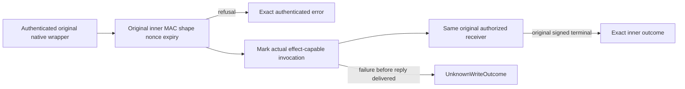

# Native model effect boundary repair

This repair preserves native Orleans transport, exact original generated envelope/MAC/nonce schemas, current native full-owner checks, node-local storage and original lifetime/admission. The native effect boundary follows the original receiver validation and invocation.

REQ-NATIVE-EFFECT-001 maps AC-NATIVE-EFFECT-001: invalid original inner MAC, shape/envelope, canonical inner nonce replay and expiry must return the actual authenticated refusal before any effect-capable receiver invocation. Do not derive effect dispatch merely from decoding an untrusted payload or calling the owning endpoint. The actual original nonce and six wire-fault SDK/MCP RF3 regressions must verify exact refusals and unchanged full canonical cuts.

REQ-NATIVE-EFFECT-002 maps AC-NATIVE-EFFECT-002: a local per-exchange boundary records the actual transition after original validation and immediately before effect-capable receiver execution. Queue Accept, controlled document/blob grant operations and Event SourceEffect must mark it; plain reads and receipts must not. Nonfatal throw/cancellation/expiry/current-generation/shape failure after this boundary remains UnknownWriteOutcome. Only the validated durable queue observation and freshly revalidated controlled-read terminal result remain exact; an Event grain reply error alone does not prove a durable no-effect outcome. No new dispatcher, network, trusted caller input, serialized flag, fake result or replacement request grain.

REQ-NATIVE-EFFECT-003 maps AC-NATIVE-EFFECT-003: cancellation is checked at the boundary before marking; the boundary is confined to the original directly awaited receiver chain, with existing request/body copies, owned work, cancellation/admission, replay and joined disposal unchanged. Original foreground after a replay that may have committed remains independently UnknownWriteOutcome. Actual original SDK/MCP acceptance, fault/cancellation and cleanup tests remain mandatory.

Regression source owners are genuine original nonce and six-under-one-original wire-fault flows, plus current controlled grants and Event source effect fault cases. Compilation, analyzer, TUnit and actual RF3 checks remain OPEN. Pure flag tests would mirror implementation and do not prove the real boundary, so no such substitute is counted.
