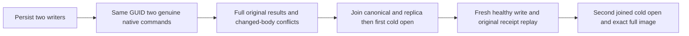

# Native principal-scoped command replay through cold owners

Canonical slice: DocumentStorage. This extends REQ/AC-DSTORE-007/009 and the existing generated operation, partition-scope and replica materializer contracts.

## Requirements and acceptance

| Requirement | Acceptance | Native test |
|---|---|---|
| REQ-DSTORE-PRINCIPAL-COLD-001: two persisted principals sharing one GUID and full PartitionRef own independent acknowledged native commands. | AC-DSTORE-PRINCIPAL-COLD-001: genuine replica admission appends consecutive original entries, returns full receipts for different literal documents, persists separate complete scoped outcomes and exactly two outbox effects. Explicit operation-scoped reads retain each original entry; ambiguous GUID-only reads refuse. | DocumentCommandPrincipalColdReplayTests. |
| REQ-DSTORE-PRINCIPAL-COLD-002: original replay and changed-body conflict use full command scope across both native cold owners. | AC-DSTORE-PRINCIPAL-COLD-002: warm and two joined same-owner canonical/replica cold opens preserve exact full canonical image, position, applied/index/commit/term, identities, original operation/entry/results and persisted outcomes. Changed bodies under each original ID return Conflict without any canonical/journal/outbox effect. | Same complete flow. |
| REQ-DSTORE-PRINCIPAL-COLD-003: healthy continuation does not overwrite historical outcomes. | AC-DSTORE-PRINCIPAL-COLD-003: a new command by the first writer changes only its document to literal revision2, adds one outbox effect, and preserves the second document at revision1. Both original revision1 receipts replay after continuation and second cold open; the healthy receipt also replays exactly. | Same complete flow. |

## Slice map and scope

Tests use DocumentStorage Cases, Contracts, Helpers and Assertions, the existing genuine DocumentPatchAtomicityOwner, and a finite full-scope correction to TestDatabaseReplicaAdmission in ClusterReplication Fixtures with TestDatabase forwarding. No product algorithm/provider/format change. Frontend and public SDK/MCP surfaces are N/A for this isolated native regression; their original qualification remains mandatory.

The retained-admission identity is exact ID, ordinal principal and the existing native CommandOutcomePartitionIdentity.Resolve full scope. Fingerprint is deliberately evaluated by the original fresh authorized outcome resolver, so a changed body conflicts instead of appending. The new operation-scoped observation normalizes its input through the original engine before matching; a GUID-only read is valid only for one retained full identity.

## Flow and evidence limits

The existing owner retains initiating and cleanup failures, joins materializer/log/store before reopen, verifies the original full canonical and distinct replica identities, and deletes owned directories only on successful cleanup. The bounded complete canonical scan and isolated journal cut are not a concurrent cross-store snapshot or a raw whole-journal dump. This is a same-process native control, not process-kill, power-loss, Docker/Aspire RF3, public-client or production qualification. Compiler, native TUnit execution and delivered-source Linux gates remain OPEN.
