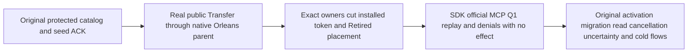

# Native public protected-document movement setup

Applicable decisions: [ADR-007 — native Orleans cluster communication](../../ADR/ADR-007-replica-consensus-bootstrap.md), [ADR-106 — fenced physical-owner movement](../../ADR/ADR-106-partition-owner-movement.md), and [ADR-125 — current connection-owned execution](../../ADR/ADR-125-connection-owned-execution.md).

REQ-CLIENT-002, REQ/AC-DSTORE-003/006/009 and the current KL043/ClusterRouting native Orleans ownership contract retain the original protected document and activation/migration/read/uncertainty operations. R272 actual failure was HTTP404 in ProtectedDocumentRf3SetupPeer.SendAsync, before seed relocation completed. Production intentionally removed the custom peer HTTP movement/outcome routes; the test still posted them. This packet repairs the owning fixture rather than restoring a forbidden route.

REQ-PROTECTED-NATIVE-SETUP-001 / AC-PROTECTED-NATIVE-SETUP-001: original seed/catalog/persisted reader/denied principals and original command remain. One actual SDK MovePartitionAsync Transfer starts the genuine current server-owned parent, actual native GrainService discovery/MAC/receiver, ordered node-local capture/install/publication/retirement. Require exact Retired result, independent source/destination records, fenced source cut, native installed token/epoch and complete current placement. Installation token retains the destination physical epoch; publication separately advances logical ownership and the global placement-directory revision. Root/target full original document reads use an actual observed destination Applied/incarnation cut bound to the independently verified published logical epoch. This is an observed read cut, not a synthesized original ACK token; source and destination cuts conservatively bound real settlement.

REQ-PROTECTED-NATIVE-SETUP-002 / AC-PROTECTED-NATIVE-SETUP-002: preserve full original movement/seed results through actual SDK, official MCP and existing Q1 public movement replay/conflict/denied-subject operation helpers. Full literal root document and exact outbox conservation bracket the replay/refusal wave even after primary failure. The seed receipt keeps its original identity, fields and hidden CompositionReferences.IsEmpty Boolean. No new dispatcher, provider, topology, trusted caller role, budget/deadline change, cold stop or file inspection is introduced.

REQ-PROTECTED-NATIVE-SETUP-003 / AC-PROTECTED-NATIVE-SETUP-003: all four original activation scenarios still create and move the protected seed before their genuine callback/migration operations. ProtectedDocumentRf3Scenario and ProtectedDocumentUncertaintyScenario retain their entire existing SDK/MCP/Q1 reads/writes, original minimum-token invalidation, selected cancellation/probe/reconciliation, conflict, acknowledged receipt and original cold oracles. Uncertainty's physical Source/Target assertions bind to the actual public movement witness. New caller owners are lexical and independently joined through the existing helper; source SDK and six-owner wave are borrowed. Any setup/body/owned-client cleanup error latches the existing wave RetainRoots through the same full failure ledger before rethrow; success does not retain evidence or dispose the wave.

The exclusive obsolete manual HTTP setup/outcome/MAC client and its timing helper are removed. The old private A/B phase-witness assertions, wrong HTTP purpose path and bad HTTP MAC cannot originate through the actual public API. The real GrainServiceClient requires silo-owned native factory/ring and authentic active caller discovery; the Aspire test process has no such native caller. Those obsolete API-specific checks are removed, with the equivalent current native operation evidence explicitly OPEN. Public replay is not substituted for private raw control/target-effect/phase outcome bytes or receiver MAC negative proof. Existing native MAC/authority tests remain required separately; no public response reserialization becomes a stored/wire golden. No cold raw reader is inserted inside an already held live flow. A future distinct native criterion must join all six actual host/store owners before safe untouched-byte/identity inspection.

Source/numeric cleanliness is not compilation, discovery, RF3 or Linux qualification. R272 original failure remains immutable; the complete same original migration and affected protected public cases must run on the adopted exact source/image. Original limits, private native authority/MAC/retained-outcome gates, mandatory suites and Linux evidence remain OPEN until their actual receipts exist.

## Adjacent terminal oracle correction in the same batch

The existing PartitionMovementPublicParentRf3Scenario.RequireTerminalAsync had two source-confirmed incorrect expectations: it compared an installation physical token to the incremented logical epoch, and kept the global placement directory revision unchanged. Actual CompleteMoveInstall binds installation to destination physical owner epoch; PublishMovePlacement computes logical epoch=max(source logical,destination physical)+1 and directory/row revision=current GLOBAL directory+1. The existing correct PhysicalShardPartitionMovementRf3Placement now owns these full independent literal checks, called with that exact one-publication revision for both published row and current directory. Equality remains exact. All original first/reverse moves, compound models, retained outcomes, cold steps and external caller bodies remain unchanged. No expected value is copied from actual current placement, no >= directory relaxation is added, and this source correction is not a runtime defect claim.
