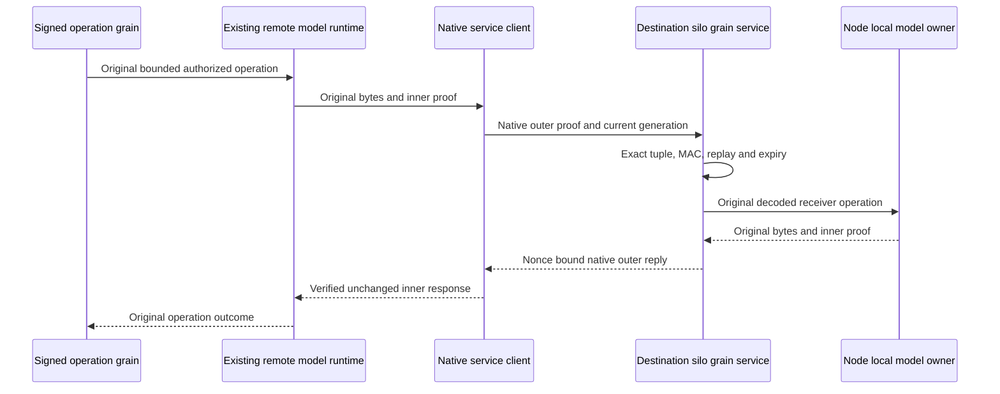

# Native Orleans remote model transport

Source proposal only. Required native compiler, genuine native silo tests, process recovery and Linux Aspire RF3 SDK/official MCP qualification remain open.

This supplement preserves the original DocumentStorage, BlobStorage, EventStreams and Messaging authorization/read-cut/atomic receipt contracts. Orleans owns cluster membership, generation discovery and RPC. The existing node-local model runtime and work owner keep storage, admission and joined shutdown. This is internal execution behind the authenticated connection/operation boundary under ADR-125; it adds no public SQL/client compatibility.

REQ-NATIVE-MODEL-001 → AC-NATIVE-MODEL-001: use one dedicated native IRemoteModelGrainService.ExchangeAsync and native GrainServiceClient provider. DocumentEnvelope channel 0 retains exact generated RemoteDocumentTransportEnvelope fields 0 Document, 1 Controlled, 2 ControlledBlob, 3 QueueTransfer. EventVector channel 1 retains its separate exact original wire and inner MAC. No peer HTTP endpoint/client, DNS pins, guessed silo port, callback network or alternate membership authority remains active. Native tests must dispatch the actual service through genuine TestCluster; RF3 callers remain real SDK and official MCP.

REQ-NATIVE-MODEL-002 → AC-NATIVE-MODEL-002: generated outer request fields are fixed: 0 Channel; 1 Payload; 2 Signature (original inner proof); 3 SourceOwner; 4 DestinationOwner (both existing PhysicalShardRecord); 5 CallerVoter; 6 CallerSiloAddress; 7 DestinationVoter; 8 DestinationSiloAddress; 9 Nonce (fresh nonempty Guid); 10 ExpiresAt (original UTC expiry); 11 SenderSignature. Outer reply fields are fixed: 0 Payload; 1 Signature (original inner proof); 2 Error; 3 SafeDetail; 4 Nonce; 5 SenderSignature. Existing native aliases and inner IDs are unchanged. New aliases identify distinct v1 request/reply/channel/service/MAC-frame contracts. Generated round trips must preserve all bytes, owner fields and outer discriminants.

REQ-NATIVE-MODEL-003 → AC-NATIVE-MODEL-003: before secret selection or dispatch, match both physical tuples against the actual configured Control/Destination entries using existing equality and native key-selection owners. Require the exact current Active unique voter/full SiloAddress generation and current local receiver generation via original Orleans oracle/state. Only then verify the outer MAC using the existing owned RemoteDocumentMac with separate native request/reply purposes and bounded generated frame. Copy authenticated bounded bytes before admission, reject wrong channel/purpose/tuple/generation/nonce/expiry/oversize, and use the existing bounded replay owner. Discovery uses the existing native original authenticated probe, not caller endpoints. Recheck cancellation, original expiry and current generation before dispatch and before accepting reply. A historical inner owner address remains canonical but cannot substitute for the fresh outer generation. No credential or caller payload enters diagnostic fields.

REQ-NATIVE-MODEL-004 → AC-NATIVE-MODEL-004: preserve original inner frame/MAC, original receiver replay/fresh authorization/read cut, work limits, observed exact-byte Blob borrowing and durable QueueTransfer grants. Do not renew original expiry. Derive whether dispatch can have effects from the actual decoded inner operation; never trust an outer query flag. Refusals before dispatch preserve their original errors; uncertain effects after invocation preserve UnknownWriteOutcome. Authenticated outer failures have bounded static detail and no inner success payload. Original inner errors remain original validated inner reply bytes. Test actual success/replay, denied principal/policy change, mutated inner bytes, stale current generation, effects uncertainty, cancellation and healthy continuation.

REQ-NATIVE-MODEL-005 → AC-NATIVE-MODEL-005: actual HMAC evaluation and key disposal/zeroing share the owned lifecycle gate. A sign concurrent with disposal either returns the original signature or refuses as disposed; later crypto/admission refuses. Runtime/service stop cancels admission and joins original service executions before releasing MAC owners, model storage or the silo. Existing primary and cleanup errors remain joined. Tests use the real owners and join every worker/task; no fake service/oracle, detached task, sync-over-async or increased timeout.

Canonical map: Server DocumentStorage Contracts/GrainServices/Transport/Authentication/Execution own the shared wrapper and original document/blob dispatch; EventStreams owns original event wire/auth/execution; Messaging owns original queue-transfer execution; ClusterRouting existing native membership, configured physical tuple/key and bounded replay helpers are borrowed unchanged. UnitTests mirror these slices and use genuine native silo fixtures. Public schema/SDK/MCP changes: N/A, internal transport only. Persistence changes: N/A, original records/receipts stay authoritative. Site changes: N/A, no new qualified capability/performance claim. Main exclusively owns shared Server/Silo registration and all build, test, formatter, Git and evidence integration.

Acceptance mapping: AC-001 native original dispatch and retired endpoint/reference checks; AC-002 generated wire/native MAC contract cases; AC-003 actual current-generation/tuple/replay cases; AC-004 original model whole-flow/refusal/unknown/cancellation cases; AC-005 actual owner close/race and joined runtime cases. All are requirements; source guards and packet manifests alone do not establish a passing gate.
