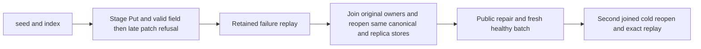

# late-patch atomicity and retained replay

Canonical slice: DocumentStorage. This extends REQ-DSTORE-001/002/007 and ADR-002,
ADR-060 and ADR-117 without changing product formats or admission.

## Requirements and acceptance

| Requirement | Acceptance | test |
|---|---|---|
| REQ-DSTORE-PATCH-ATOMIC-001: a later patch failure rolls back every earlier staged document, scalar/unique index and outbox effect. | AC-DSTORE-PATCH-ATOMIC-001: two actual admitted batch controls first stage a Put and a valid patch field, then encounter a missing object parent or an array parent. The exact original error is returned; all document/index/unique/outbox/head rows equal their pre-command bytes. The failed command outcome and replica commit legitimately advance and are retained. | DocumentPatchAtomicityReplayTests, arguments0/1. |
| REQ-DSTORE-PATCH-ATOMIC-002: recorded failures retain their original operation, result and scoped outcome after repair and owner restart. | AC-DSTORE-PATCH-ATOMIC-002: warm and first/second genuine same-owner cold admissions replay the original full entry/result and strict ResolveOutcome without changing the complete canonical image, identity, applied/position or journal cut. A public repair creates revision2; replay retains the original parent failure rather than evaluating the now-stale revision. | Same complete flows and DocumentPatchAtomicityAssertions. |
| REQ-DSTORE-PATCH-ATOMIC-003: a fresh repaired batch remains healthy. | AC-DSTORE-PATCH-ATOMIC-003: fresh ID with current revisions produces first revision2 and second revision3, exact literal JSON, old/new indexed IDs, exactly two additional outbox entries, full receipt/replay, and unchanged healthy state after the second cold reopen. | Same complete flows. |

## Slice map

Tests: `tests/KeyLoad.UnitTests/DocumentStorage/` owns Cases,
Fixtures, Helpers, Assertions and Contracts roles for this scenario.
Backend and shared contracts: existing document batch implementation and
current generated serializers; no product change. Frontend, SDK/MCP and cluster:
N/A for this isolated functional regression; their original qualification
gates remain separate and mandatory.

## Operation and failure flow

Use the real TestDatabase replica admission, ZoneTree existing-store owner,
original engine factory and original execution budgets. Join materializer/log/store
before every reopen; verify the original full canonical and replica identities.
Retain initiating and cleanup failures in their original order; delete owned
directories only after successful joined cleanup. Bounded scans refuse truncation.
The complete canonical rows and journal cut are sampled in an isolated joined
fixture; they are not a concurrent cross-store snapshot or full raw journal dump.

## Evidence

Requirements authored before code. This scenario adds source coverage.
Compiler, TUnit execution, delivered-source Linux, process recovery and
Docker/Aspire cluster qualification are OPEN. Two same-process cold owner reopens
do not prove process-kill or power-loss durability.
