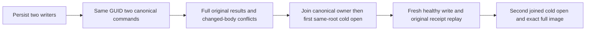

# principal-scoped command replay through cold owners

Canonical slice: DocumentStorage. This extends REQ/AC-DSTORE-007/009 and the current command, partition-scope and [canonical storage/read contracts](../StorageRecovery/RuntimeReadCuts.md).

## Requirements and acceptance

| Requirement | Acceptance | test |
|---|---|---|
| REQ-DSTORE-PRINCIPAL-COLD-001: two persisted principals sharing one GUID and full PartitionRef own independent acknowledged commands. | AC-DSTORE-PRINCIPAL-COLD-001: ordered canonical apply assigns consecutive sequences, returns full receipts for different literal documents, persists separate complete scoped outcomes and exactly two outbox effects. Operation-scoped reads retain each original command; a GUID alone cannot select an ambiguous identity. | DocumentCommandPrincipalColdReplayTests. |
| REQ-DSTORE-PRINCIPAL-COLD-002: original replay and changed-body conflict use full command scope across both cold owners. | AC-DSTORE-PRINCIPAL-COLD-002: warm execution and two joined same-root canonical cold opens preserve the complete canonical image, physical store position, applied sequence, storage identity, original commands/results and persisted outcomes. Changed bodies under either original ID return Conflict without canonical or outbox effects. | Same complete flow. |
| REQ-DSTORE-PRINCIPAL-COLD-003: healthy continuation does not overwrite historical outcomes. | AC-DSTORE-PRINCIPAL-COLD-003: a new command by the first writer changes only its document to literal revision2, adds one outbox effect, and preserves the second document at revision1. Both original revision1 receipts replay after continuation and second cold open; the healthy receipt also replays exactly. | Same complete flow. |

## Slice map and scope

`DocumentCommandPrincipalColdReplayTrial` uses the actual `DocumentPatchAtomicityOwner` and canonical `TestDatabase`. Commands enter the execution `DatabaseEngine.Apply` or `ApplyEmbedded` path; exact stored observations come from the committed `StoredOutcome.PreparedCommand` and `CanonicalSequence`. `DocumentPatchAtomicityOwner.ReopenAsync` joins storage and opens the same original ZoneTree root and identity. Public SDK/MCP and independent-process cluster qualification remain separate.

Command identity includes the exact GUID, ordinal verified principal and full partition scope resolved by `CommandOutcomePartitionIdentity`. Fresh persisted authorization and the retained fingerprint govern replay, so changed content conflicts without another apply. An operation-scoped observation owns its command input before matching; an observation keyed only by GUID must refuse ambiguity.

## Flow and evidence limits

The owner retains initiating and cleanup failures, joins original storage before reopening, verifies the complete original storage identity, and deletes owned directories only after successful joined cleanup. Complete bounded canonical scans and the applied/store-position observation do not establish a concurrent cross-store snapshot. This is a same-process canonical storage control. Process-kill, power-loss, Docker/Aspire cluster, public-client and production qualification require separate evidence. TUnit execution and delivered-source Linux gates remain OPEN.
