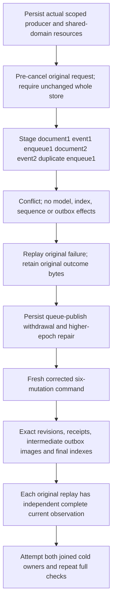

# Repeated mutation images in one atomic triad

This contract preserves [the canonical document contract](../DocumentStorage.md), [events](../EventStreams.md), [messaging](../Messaging.md) and ADR-008/017. The existing atomic apply gate and current ZoneTree transaction implement this stage; no product format, API, parser, authorization provider or acknowledgement profile changes.

| Requirement | Acceptance operation and oracle |
| --- | --- |
| REQ-TRIAD-STAGED-001 A later mutation reads the current transaction's prior mutation | AC-TRIAD-STAGED-001: `AtomicTriadStagedWholeFlowTests.LateDuplicateRollsBackRepeatedTriadThenFreshPolicySixReceiptsAndIntermediateOutboxImagesSurviveTwoColdOwners` submits document create/CAS replace, stream NoStream/Exact1 append and two enqueues in one command. A duplicate final message ID yields exact Conflict and no result value. The entire pre-command partition model/index/unique/epoch/event/queue/outbox image remains equal; document and both messages remain absent, stream is empty and outbox status is exactly empty. Its genuine failed outcome remains retryable with the original failure before policy changes. |
| REQ-TRIAD-STAGED-002 Successful ordinal receipts and outbox images describe each applied step | AC-TRIAD-STAGED-002: a fresh original GUID and corrected second message ID commit six independently listed receipts: document1/event1/enqueue1/document2/event2/enqueue1. durability is ProcessDurable; incarnation, atomic partition identity, positive canonical position and actual acknowledged copy count are checked. Full mutation receipt composition references are empty. Each outbox entry checks all eight fields, including initial document after-image and second document before/after-image, common token/time and exact ordinal. The document epoch advances once for this command. Only the final numeric index/unique membership survives, old-value query is empty, final query has the exact complete row. Both raw bodies, ready keys/values and all queue counters are checked. |
| REQ-TRIAD-STAGED-003 Fresh persisted authorization and immutable retry identity remain authoritative | AC-TRIAD-STAGED-003: persist the actual producer at epoch1; withdrawal epoch2 rejects a new complete recipe without effects; repair epoch3 allows a fresh six-operation command. Earlier cached failures return current-policy refusal after repair and retain their original stored outcome bytes. Every original replay checks complete result and hidden receipt references where observable, whole store bytes and position independently. |
| REQ-TRIAD-STAGED-004 Real public routes and cold owners preserve the same final model state | AC-TRIAD-STAGED-004: `AtomicTriadStagedClusterTests.RepeatedTriadLateDuplicateThenSixReceiptsCurrentPrincipalAndTwoColdOwners` owns a real Aspire cluster fixture and persisted principal/key. Actual SDK and official MCP commands plus both supported unified SQL operation-call routes exercise refusal and original successful replay. Each result is followed by a pure nonrecursive complete SDK/MCP document, stream, message, old/new index membership and frozen outbox-status observation. Every official refusal compares the independently expected complete safe Problem and performs actual credential/payload disclosure checks. Two actual all-node same-volume cold cycles are attempted independently, each using fresh SDK/official MCP connections and full final/original replay checks. two-cold uses joined original handles and ZoneTreeExistingStore with original node/incarnation/signing identity and exact whole-store bytes/cut. |

The public receipt oracle checks all five serialized CommitReceipt fields, including actual PersistedCopies, and all three CommitToken fields. The generated log position is retained as a positive opaque server result; it is never compared with a physical query/event cut. Public event RecordedAt is retained from the first authentic committed event and both full literal records must share it across every replay/cold observation. timestamps come from the actual committed evaluation clock. CompositionReferences is JsonIgnored and cannot be proved by inspecting an SDK/MCP DTO default; receipt/store checks own that fifth-field proof.

The cancellation control cancels before admission, requires the original OperationCanceledException token and unchanged full store, then uses the same original command GUID for the real refusal. It is not a mid-I/O, response-loss or power-loss proof. Existing QueueProducerAtomicClusterTests false/true response-cancellation flows, AtomicTriadOutboxTests three rotations, TransactionTests preconditions/domain refusal, and genuine EventAppendProcessRecoveryTests/CommandIdempotencyProcessRecoveryTests remain mandatory. ANN freshness remains a separate existing projection/ANN qualification contract; six synchronous triad receipts do not assert ANN publication.

This stage also corrects one existing public refusal assertion to compare the complete `DocumentReadResult(null)` success wrapper. KeyLoadClient.GetAsync returns that current wrapper; successful absence is its null Document, not a null wrapper. Original negative error, authorization, session-minimum and all existing operation order/goldens remain unchanged.

Status: implementation and self-review only. Independent peer, combined solution compiler/analyzers, TUnit execution, process recovery and real Docker/Aspire SDK/official MCP cluster qualification remain OPEN, including exact-source Linux artifacts. No throughput, allocation, power-loss or production-readiness claim follows from source or standalone syntax/numeric/nesting checks. Frontend is N/A: this stage exercises database operations. Rollback removes only this additive test/doc stage and the exact wrapper assertion correction, without a data migration or product behavior change.

## Coherent original-error and restart receipt conservation

The repaired owner retains each actual returned operation/result before
reading its original stored outcome or checking independent receipt fields. Missing
healthy producers/outcomes remain explicit errors; no command/receipt is synthesized
to fill missing execution. warm/refusal, withdrawal, legitimate repair, healthy
producer and every original replay have independent failure observers. Position,
full raw image and signing identity conservation run independently after the original
body error; both same-root cold opens retain their own errors. Public successful
responses are marked only when actually returned, before assertions. The existing
command GUIDs, all six independent mutation/token oracles and model images remain.

The new private cluster cold owner obtains unique scenarios from the actual fixture's
ModelSqlClusterColdOwnership allocator; canonical ContainerRuntimeOwnedReceipt CreateNew
publication retains node1/2/3 receipts without overwrite. All kills and all starts
are attempted before health. Each actual receipt is read with a65,536-byte bound;
path/length/SHA256 enters its owned ledger before file disposal or aggregate throw.
Every successful capture survives another node's failure. Prior originals are
independently reread after later waves and the final replay/conservation ledger.
Restart failure and the subsequent state-observation wave are separate attempts.
No shared helper, product default, timeout, provider or phase is changed.
Source/compiler/cluster/Linux acceptance remains OPEN.
