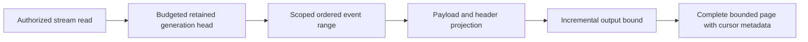

# EventStreams

[ADR-035](../ADR/ADR-035-memory-performance.md) and AC-MP-005/012 apply.

| Requirement | Acceptance | Tests |
|---|---|---|
| REQ-EVENT-001: one raw work/deadline/cancellation budget covers stream head and event range | AC-MP-005 | Real-store bounded ranges, point/scan work, cancellation and subsequent store health |
| REQ-EVENT-002: projected complete StreamPage fits the result limit including head/cut/HasMore | AC-MP-005 | Exact positive/empty/edge response and over-budget event/protocol metadata cases |
| REQ-EVENT-003: preserve revisions, generation/retention failures and payload/header policy | AC-MP-005/012 | Existing event/processing recovery and new real persisted-policy redaction cases |

Owning slice: Core/Features/EventStreams/ helpers and UnitTests/Features/EventStreams/.
Append/dedup/persistence are outside
this bounded-read task. Request DTO/wire and schema remain unchanged. Public SDK
and HTTP are entry points; UI N/A.

## Event Store contract

Actors: producer append, authorized reader/replay consumer and subscription worker. Entry points: `AppendEvents` in the public contracts, `CommitAsync`/`ReadStreamAsync` in the [SDK](../../src/KeyLoad.Client/KeyLoadClient.cs), HTTP operations. Source: Events.cs; the source exists, but the new shared changes are not yet GitHub-qualified.

| Requirement | Observable acceptance / flows | Test mapping |
|---|---|---|
| REQ-EVENT-004: an append batch has an expected-revision precondition and atomic domain authority | AC-EVENT-004: a valid append changes head and events in the same command commit; a stale revision, NoStream or wrong domain rejects the whole batch without partial document/queue effects | Existing `DocumentEventAndQueueCommitTogetherAndCommandRetryDoesNotRepeatEffects`, `UniqueConflictRollsBackDocumentIndexEventAndEnqueue` in TransactionTests; additional isolated OCC boundaries PLANNED |
| REQ-EVENT-005: EventId dedup belongs to the stream generation and preserves content identity | AC-EVENT-005: a retry with the same ID and content creates no second event; different content yields Conflict; another stream generation has its own identity; restart does not lose dedup | Existing `EventIdsAreScopedToTheStreamGenerationAndStreamsCanBeSubscribed`, `RetainedEventIdRejectsDifferentContentAndPreservesDedupForTheInitialStoreFormat` in SubscriptionTests; recovery expansion PLANNED |
| REQ-EVENT-006: read/replay has ordered revisions, a retained generation and a bounded safe page | AC-EVENT-006: a page/cursor continues the retained stream without duplicate or skip; an empty tail is valid; an invalid generation or history loss is a typed failure; current payload/header policies are applied | Existing [StreamReadResourceTests](../../tests/KeyLoad.UnitTests/EventStreams/Cases/Stream/StreamReadResourceTests.cs), `FromNowAndTailCursorIncludeEveryLaterAppend` in SubscriptionTests; AC-MP-005/012 preserved |
| REQ-EVENT-007: compatible snapshot and complete same-cut tail reproduce an aggregate | AC-EVENT-007: reference equals snapshot+tail reduction; exact reducer/state schema enforced; explicit full replay requires complete history; wrong generation, erased/missing history and invalid identity fail explicitly | ADR-075; AggregateReplay real ZoneTree, pure worker, process recovery and actual cluster SDK/MCP tests; runtime pending |
| REQ-EVENT-008: one bounded snapshot slot has atomic CAS and stable retry | AC-EVENT-008: absent-slot version zero, exact prior version, nondecreasing source revision and tail/floor bounds hold; retry never advances twice; unknown format/checksum corruption fail closed; reopen preserves exact state | ADR-075; AggregateSnapshot CAS/native/reopen/recovery tests; runtime pending |
| REQ-EVENT-009: aggregate state requires fully authorized workers | AC-EVENT-009: persisted EventsRead plus EventsReplay or EventsSnapshotsManage and every payload/header raw-read/raw-use grant are checked before bodies; tenant/resource denial and revocation disclose no protected state/events | ADR-075; persisted-policy real-store and official-client cluster tests; runtime pending |
| REQ-EVENT-010: replay is bounded and produces no external effects | AC-EVENT-010: complete tail fits MaximumEvents and shared raw/result/deadline/cancel bounds or fails whole; one cut and one exact current event schema feed a deterministic pure worker; schema mismatch fails before callbacks; no append/enqueue/ack/subscription redrive occurs | ADR-075; AggregateReplay bounds/source invariance and pure SDK worker tests; runtime pending |

The full resource identity includes tenant/database/atomic partition/stream set/stream/generation. Domain events are public history; CDC/outbox, the replicated WAL and queue state have their own authority/retention under [ADR-023](../ADR/ADR-023-journal-authority.md). Feed positions and revisions are in [ADR-025](../ADR/ADR-025-event-revision-feed-positions.md), atomic binding in [ADR-024](../ADR/ADR-024-transaction-domain-binding.md), privacy in [ADR-029](../ADR/ADR-029-event-message-classification.md), restore/retention in [ADR-030](../ADR/ADR-030-retention-paused-restore.md).

Topics and group delivery belong to [Messaging](Messaging.md), CDC/system projections to [ChangeFeeds](ChangeFeeds.md), uploaded user bytes to [BlobStorage](BlobStorage.md). External effects and cross-partition atomic commits are not promised. Target map: Abstractions/Core/Client/Server/tests `Features/EventStreams/`; shared transport and host composition have their own owners. UI N/A: this is a programmable Event Store. New runtime tasks start from their ADR contracts; tests are real GitHub TUnit/recovery/cluster SDK/MCP only. Existing test methods are source evidence, not a passing run.

## Current replay and event identity contract

Under ADR-075, `AggregateReplayReduction.Reduce` accepts the complete current
page, exact reducer, validated `IOptions<AggregateReplayWorkerLimits>` and
cancellation. Every event must match the reducer's current event schema exactly.
Validate the complete stream/generation/head/floor/tail/order/identity, original
payload/header JSON and combined input limits before invoking any reducer. Pass
the original immutable event to the reducer; validate each resulting state and
check cancellation at every existing boundary. There is no schema conversion
callback, registry, path resolver or associated configuration/message surface.
Snapshot and full-history replay must yield the same independently expected
state; wrong schema, invalid JSON, incomplete tail or exhausted budget must fail
without reducer effects. A subsequent healthy replay must still succeed.

AC-EVENT-005 uses only the current stream-and-generation EventId key. Real
append/retry/different-content/reopen cases retain exact head, revision, sequence,
receipt and content checks. Remove the alternate resource-wide key lookup.
Current whole-operation dedup tests remain required.

## Event append seeded crash

REQ-EVENT-004/005 and AC-EVENT-004/005, REQ-MSG-005/AC-MSG-005 and REQ-STORAGE-006/007/AC-STORAGE-006/007 refine the seeded DURING-append acceptance.

AC-EVENT-CRASH-001: a real CrashHost seeds canonical resources and stream revision1, freezes one original typed command containing PutDocument, AppendEvents Exact1 and EnqueueMessage, then arms only its next native commit. Parent observes the existing exact crash marker at HeaderWritten, PayloadWritten, JournalFlushed, MutationApplied0/3/6 or ApplyCompleted, kills only its owned child and joins actual original exit and both bounded readers. Reopen native ZoneTree only after native handle/lock release. The retained outcome determines one complete recovered prefix: document/event/head/EventId identity/queue/outbox/receipt and store position must all match independent literal expectations. JournalFlushed and later cuts must recover committed; pre-flush cuts may expose either complete valid prefix, never partial state.

AC-EVENT-CRASH-002: applying the exact original principal/CommandId/payload/time on the recovered store yields one successful canonical effect, retains the original complete result on matching retry without position/byte changes, rejects changed content as exact Conflict, and leaves a matching healthy retry valid. A fresh bounded document/event/queue follow-up must advance stream revision3 and publish complete literal state. No sidecar may define recovered truth: sidecars hold only frozen caller input and seed coordinates; all canonical recovery comes from actual store.

## Bounded native topic purge

REQ-EVENT-RETENTION-002: delete only retained positions FirstAvailablePosition..ThroughPosition inclusive; reject nonpositive, beyond-tail or already-retained-away cuts, stale generation and scan/byte exhaustion. Every persisted same-source/generation group's contiguous Checkpoint pins all positions greater than Checkpoint, including paused/parked groups; IssuedPosition/ACK gaps do not release pins. Therefore requested cut must be <= every Checkpoint. Refusal is ResourceExhausted and cannot alter topic/group/inbox/queue state.

REQ-EVENT-RETENTION-003: atomically advance FirstAvailablePosition to cut+1 and subtract exact native serialized source bytes; preserve TailPosition, partition event sequence, generation, group/inbox/queue state, incarnation and backup identity. Retain only generated native typed event-ID digest/original position/generation in existing topic-event-id family. No bodies, fallback, migration or receipt pruning. Fresh identical event reuse remains DuplicateEventId; conflicting content remains Conflict; same immutable original command ID returns byte-identical receipt after purge.

AC-EVENT-RETENTION-001: genuine ZoneTree seeded three-event/two-group operation refuses unread and paused pins, releases only by existing exact ACK/explicit seek; bounded approved purge leaves literal event3 at original position/sequence3 and unchanged other model bytes, old read yields exact HistoryUnavailable; same-ID purge replay retains complete receipt and stable store cut. AC-EVENT-RETENTION-002: post-purge original publish replay returns exact original receipt, fresh identical/conflicting event commands preserve exact distinct errors; denied caller cannot purge or replay privileged receipt, stale generation/cut/record/byte budget failures retain complete logical state and stable same-ID rejected outcomes; healthy next publish is position/sequence4. AC-EVENT-RETENTION-003: native store reopen retains exact head, digest identities, group/checkpoint/inbox/queue state and receipts; shared real SQL compiler/decoder admits same Batch mutation; root must run native unit/scalar/recovery and genuine cluster SDK/MCP before qualification.

### Native admitted purge cuts

REQ-EVENT-RETENTION-004 / AC-EVENT-RETENTION-004: the real CrashHost first acknowledges purge through source position1, then arms the existing native CanonicalCrashBoundary for exactly the next Store.Commit position of immutable purge-through2. Two seeds admit either success (paused checkpoint3) or exact ResourceExhausted rejection (paused checkpoint1). Kill only the owned original process after its native phase marker; join original exit and both bounded readers, prove exclusive native locks, reopen actual ZoneTree. HeaderWritten/PayloadWritten are pre-flush boundaries; JournalFlushed is AFTER native durable flush returns and BEFORE native apply, not inside an OS flush syscall. MutationApplied0 and ApplyCompleted are actual native apply cuts. Pre-flush may recover old or whole new cut; post-flush must recover complete success/rejected receipt, never partial model changes.

## Original public whole flow

REQ-EVENT-004/005 and AC-EVENT-004/005 retain the current expected-revision,
stream-generation EventId identity and same-command replay contracts. The new
AC-EVENT-APPEND-CLUSTER-001 requires one actual Aspire cluster flow through the .NET SDK
and official MCP SDK: the existing literal three-event NoStream seed; exact
NoStream refusal, same-command changed-content Conflict, changed EventId Conflict,
partial-duplicate DuplicateEventId and stale append-generation TokenInvalidated
with full canonical stream invariance;
persisted EventsRead-only append/retained-command refusal with safe problems;
two joined Exact3 producers with exactly one complete winner and one immutable
RevisionConflict; unchanged full successful/failed replay; a fresh Any append
and the complete independent five-event literal stream, head, revision, sequence,
metadata and receipt oracle. Each page independently covers the actual receipt
cut; running-cluster physical positions may advance and are not domain-effect
oracles. Original event RecordedAt values are retained across refusal/replay.

### Current product implementation contract

REQ-EVENT-READ-DIRECTION-001 / AC-EVENT-READ-DIRECTION-001 requires complete independent forward/backward retained-event pages, exclusive bounds, current field/header redaction, byte refusal without partial publication, cancellation/refusal followed by a healthy operation. REQ-EVENT-READ-CUT-001 / AC-EVENT-READ-CUT-001 freezes original traversal tail/floor and snapshot cut, with subsequent append excluded until a new traversal; current CutPosition remains actual same-view position. Original generation/history, signed source feed and every global gate remain mandatory.

## Traceability join

REQ/AC-BACKUP-003/004 and REQ/AC-EVENT-RETENTION-001–005 map to the exact current-format mixed-cut operation, ordering, native source owners, higher-epoch privacy repair and remaining qualification in [BackupRestore](BackupRestore.md#mixed-retained-eventing-archive-cut). Existing original local artifact, Phase1 queue backup, target-inbox cold/process and topic purge/process cases remain unchanged. The proposed new Unit case creates real original subscription gap/inbox, pending/parked/leased queue, target inbox/effects and separately purged source under ONE original native archive cut; no empty-family count or fake rows. Both actual atomic partitions, immutable outcomes and complete source/archive bytes stay exact. Paused new-incarnation restore, original authority refusal, explicit authorized continuation, current persisted privacy/revoke/repair and joined same-root cold/healthy follow.

## Bounded native provider operation

REQ-EVENTFEED-PUBSUB-001: the disposable EventFeed native `IGrainStorage` provider must own keyed state, detached values, ETag CAS and joined cleanup through the actual Orleans `GrainId` and registered serializers. Charge encoded key, state name, ETag and value against the same configured `MaxResults` and `MaxQueryReadBytes`; each entry must also fit `min(MaxBatchBytes, MaxQueryReadBytes)`. Cancellation, stale ETag, foreign state, exhausted byte/entry budget and disposal must refuse without replacing existing state.

AC-EVENTFEED-PUBSUB-001: both existing `EventFeedPubSubStorageTests` whole operations must write/read the complete original value and ETag, reject stale CAS and the actual configured quota/cancellation/foreign-state/disposed-owner cases with unchanged state, then clear or replace through the actual native provider and verify a fresh complete healthy value. Preserve original owner cleanup and every failure. These are disposable provider operations; canonical ZoneTree state, durable delivery, public registration, restart and cluster acceptance require their independent mapped gates. ADR-025 and the existing native-provider implementation contract remain sufficient; no additional public or persisted contract is introduced by this traceability clarification.

REQ/AC scope: approved advisory-provider admission and disposable native pubsub resource ownership. The purpose-owned EventFeed provider borrows the actual pinned Orleans10.4 MemoryAdapterFactory, native IQueueAdapter/cache, and registered Serializer<MemoryMessageBody>; Microsoft.Orleans.Streaming is explicitly centrally pinned at the SAME10.4 version to expose those native APIs. There is no replacement/copied provider. Queue slots, cache batch slots, and encoded fixed-hint bytes remain distinct; MaxAddCount is not a memory bound.

## Complete ACK/Release public operations

REQ-EVENTS-VECTOR-RELEASE-001 / AC-EVENTS-VECTOR-RELEASE-001: ordinary map Release uses the same owners and genuine current retained Pin frontier; it preserves original first-Pin identity/body/expiry and settles each exact Release outcome before terminal CompleteRelease. Retained unknown tombstones keep map/source charges. First-issuance abandonment cleanup remains its distinct cleanup path and cannot fall through ordinary map release. No new quota, TTL, retry, schema field or public authority is added.

## Receiving-only native Tail owner

REQ-EVENTS-TAIL-OWNER-001: Tail observes only original persisted Offer outcomes through the authenticated existing ConnectionGrain CQRS stream, with register-before-recheck, current persisted control and every-source authorization, original fixed map/principal/control incarnation/policy/coverage/source digest/expiry fences, actual current owner and scoped read view. It creates no Offer/ACK/Refresh/Release or source dispatch. Only this observational path permits current revision >= the exact original signed admitted revision; every effect CAS remains strict. Every delivery verifies its own genuine current terminal phase/StoredOutcome and preserves complete original payload/token/receipt. Refresh or changed fixed fences refuses; absent/corrupt referenced outcome is RecoveryRequired.

REQ-EVENTS-TAIL-OWNER-002: original native provider subscriptions/callbacks/reads/enqueue/notification/CQRS writers are bounded call-local owners. Subscribe settles before authoritative recheck; hints coalesce and confer no data authority. Provider loss/error permits one authoritative recheck then terminates with original provider and cleanup failures retained. Original expiry/cancellation and native execution lifetime remain unchanged; no timer/polling/retry/copied provider or durable wakeup promise. All native producers/callbacks/Unsubscribe and readers join before connection release.

AC-EVENTS-TAIL-OWNER-001: genuine public SDK native CQRS SSE and official MCP native progress execute Open→Offer→Tail first complete original delivery→external ACK→new Offer→second independent complete delivery→bounded terminal LAST original evidence. Check whole events/revisions/source cuts/cursors/map/receipt/token, fixed fences, backpressure and joined cleanup. Terminal is evidence, not another delivery/Tail receipt. Source-only revoke→refusal before protected decode/no redispatch→policy repair→exact original replay and cold continuation preserve canonical whole images/charges.

AC-EVENTS-TAIL-OWNER-002: actual register/recheck race, duplicate hints, native provider pressure/loss/error, true caller cancellation vs original expiry, missing/corrupt original outcome→exact fault repair→healthy are whole operations under the original native owners. Unit callback field tests/provider direct storage controls cannot substitute for this gate.

### Owning validated-progress transport join

REQ-EVENTS-TAIL-TRANSPORT-001 / AC-EVENTS-TAIL-TRANSPORT-001: exact public route /v1/event-feeds/tail and tool keyload_tail_event_feed consume the same original ConnectionGrain CQRS enumeration. Native SSE/SDK chunks and actual awaited official MCP progress carry complete original EventFeedTailProgress; one original terminal result remains distinct from delivery. McpCatalogTests includes the independent87-tool literal tuple and strict native public Tail decode/unknown authority denial→healthy. EventFeedFirstOpenClusterFlow exercises actual SDK progress and official MCP progress plus full original terminal equality both before and after same-root cold, preserving its original independent source-page/receipt oracle and Offer replay. Receiving cancellation, multi-offer wakeup, stale/policy refusal, bounded pressure and real cluster execution remain required open gates, not source-completed claims.

## Eventfeed tail json terminal

REQ-EVENTS-TAIL-TRANSPORT-001 / AC-EVENTS-TAIL-TRANSPORT-001 require reservation of one failure terminal inside the existing centrally configured Tail JSON aggregate and frame grants before starting the original producer. Measure the complete static ResourceExhausted chunk with the largest admitted native sequence; measure every actual emitted chunk again. Progress consumes only the remaining grant, and the original terminal consumes the reservation. These are JSON-body bytes, not SSE physical-wire bytes. No new limit/default or provider implementation is introduced.

## Local profile negative

REQ-EVENTS-FIRST-OPEN-ORDERED-001 / AC-EVENTS-FIRST-OPEN-ORDERED-001: the existing EventVectorReservedLocalProfileTests complete original foreign-enrollment refusal keeps exact protected error and full owned bytes/modes. Only Registration=false removes its three dependent remote/query/protected selectors so strict base membership validation succeeds before the intended protected EventVector guard. EventVector=true stays selected; product validation order and every other negative/repair remain unchanged. Original Stage54 normal/scalar setup failures retained; configuration proof does not qualify cluster FirstOpen/coverage or Linux acceptance.

## Referenced outcome recovery

REQ-EVENTS-TAIL-OWNER-001/002 and AC-EVENTS-TAIL-OWNER-001/002 require RecoveryRequired when a genuinely referenced original native outcome is missing or its scoped locator is inconsistent. EventVectorParentOutcome performs the narrow owning selection: only a typed Corruption from the existing scoped selection becomes RecoveryRequired with the original exception retained as cause. Generic CommandOutcomeKeyResolver keeps its existing Corruption contract. Authorization, owner, budget, cancellation and fatal failures are not translated; existing aliases, IDs, identities, outcomes and receipts remain unchanged.

## Event feed refresh

REQ-EVENTS-VECTOR-REFRESH-001 / AC-EVENTS-VECTOR-REFRESH-001: the same authenticated ConnectionGrain call-local parent may refresh a current Active map only with exact current revision/coverage, original admitted principal/control owner/resource/scope, fresh persisted control and every-source grants, valid existing map token and no unacknowledged Offer or pending child. Refusal occurs before child admission/effects. Replayed terminal parents return only their original retained outcome after current authority checks.

### Exact additive public Refresh transport

REQ/AC-EVENTS-VECTOR-REFRESH-001 uses existing EventFeedControlRequest IDs0..12, EventFeedControlResult IDs0..10 and EventFeedControlAction.Refresh3 unchanged. No serializer alias or native private field changes. Complete typed SDK method RefreshEventFeedAsync requires that exact action and original CommandId; HTTP route /v1/event-feeds/refresh invokes the existing EventFeedParentApi and authenticated current ConnectionGrain parent owner. Official MCP/Q1 identity keyload_refresh_event_feed registers the SAME typed complete request/result and EventFeedParentArguments.Refresh, existing command36 parent purpose and existing command effect hints (readOnly=false, idempotent=false, destructive=true). Guidance: Refresh complete authorized source coverage only after every original source Pin, Advance and Release disposition settles, preserving acknowledged positions and the original terminal result.

### Persisted append-sequence authority

REQ-EVENT-004/006 and AC-EVENT-004/006 require the partition event sequence read
by Append to be at least the existing stream tail before publishing any record.
An absent empty stream retains its valid zero sequence. A seeded tail1 with a
persisted sequence -1 or 0 is Corruption, before document, queue, event-feed,
stream-head or command-outcome writes; it must not overwrite the existing feed
entry or issue a zero global sequence. This is a lower-bound authority guard,
not an all-stream inventory proof or a new serialized contract.

EventAppendSequenceAuthorityTests exercises both literal corruptions through the
real ZoneTree atomic producer. Repeat the original GUID twice, require the exact
Corruption/no-effect full raw image and absent document/message, restore the
original sequence bytes, and accept that same GUID. Independently require the
ordered full document/enqueue/append mutation receipts and complete initial,
repaired and healthy event records. Preserve both original accepted outcomes and
full raw images across warm replay and two actual same-root cold reopen owners.
Keep original expected revisions, generation, authenticated principal, event
schemas, limits and clock. Cold resource disposal retains initiating and cleanup
failures.

### Complete retained traversal authority

REQ-EVENT-006 / AC-EVENT-006 bind the actual native event range key to its stored
stream/generation/revision and require contiguous revisions within the selected
captured tail/floor. Reject key-correct skipped first/middle/final rows before a
page can claim complete history. A bounded page may stop at its existing limit;
its original signed continuation must then require the next exact revision.
When native HasMore is false, an unread retained prefix/suffix is Corruption.
Use the existing traversal Corruption detail. No extra scan, resource grant,
retry, schema/public format, authorization or clock change is admitted.

The coherent StreamRecordKeyAuthorityTests successor retains its original two
miskeyed revision inputs and adds literal missing-row inputs1,2,3. Both complete
directions and original cursor scopes require exact typed failures/full canonical
no-effects. An original forward cursor already past missing1 legitimately reads
2,3; an original backward cursor already past missing3 legitimately reads2,1.
An empty read strictly after tail3 remains valid and empty. Existing real-store
StreamTraversalNativeTests and StreamReadResourceTests preserve retained floor,
original cursor invalidation, policy/owner/expiry, raw/result byte bounds,
pre-cancel and subsequent healthy operations; these controls are not replaced.
Restore exact original bytes, preserve full retained append outcome during the
fault and after repair, publish literal healthy4, then require independent full
four-event pages, original captured three-event cursors and original receipts
through two actual cold owners with joined primary/cleanup ledgers.

## Production advisory-provider reachability

REQ-EVENTFEED-PROVIDER-HOST-001: the actual OrleansSiloConfiguration.Configure must register the existing EventFeedNativeProviderRegistration once for each native silo, immediately after the existing NativeRuntimeJournalRegistration call. Reuse the unchanged named `keyload-event-feed-advisory-v1` provider, keyed EventFeedPubSubStorage, native memory adapter, bounded cache/hint admission and registered serializers. Preserve every original option, native lifecycle default, membership/directory/repartitioning registration and RuntimeJournal registration order. Do not add another provider, dispatcher, fallback, timeout or synthetic readiness.

REQ/AC-EVENTFEED-PROVIDER-HOST-001 supports REQ/AC-EVENTS-TAIL-OWNER-001/002 and ADR025 without closing them. In particular, the pinned [native provider shutdown](https://github.com/dotnet/orleans/blob/d114d7522a53b8cce4c6b97d44293e5c7273d766/src/Orleans.Streaming/PersistentStreams/PersistentStreamProvider.cs) can stop waiting when its lifecycle token cancels while pulling-manager cleanup continues. Registration or host/provider disposal alone is not proof that the original native agents, callbacks and producers joined.
